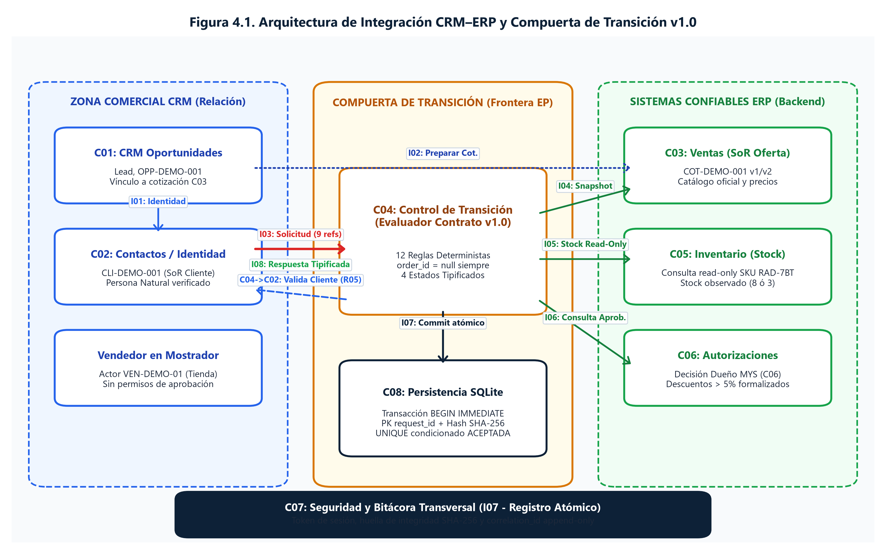
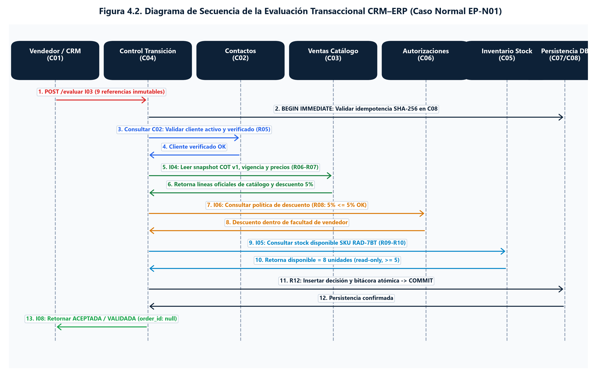
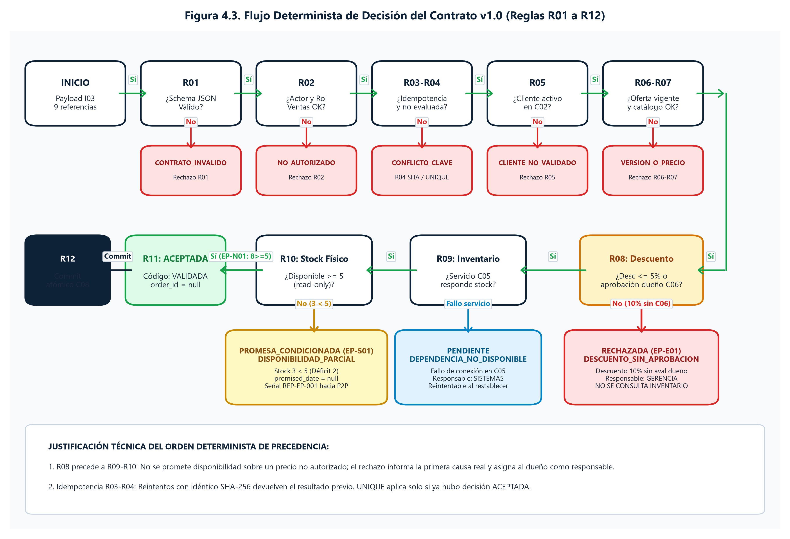
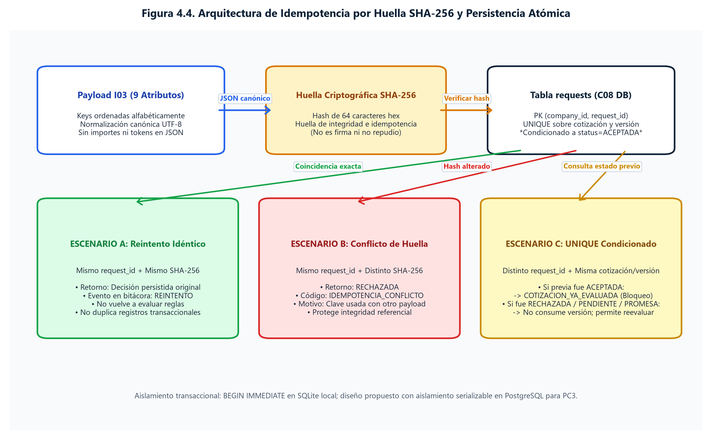
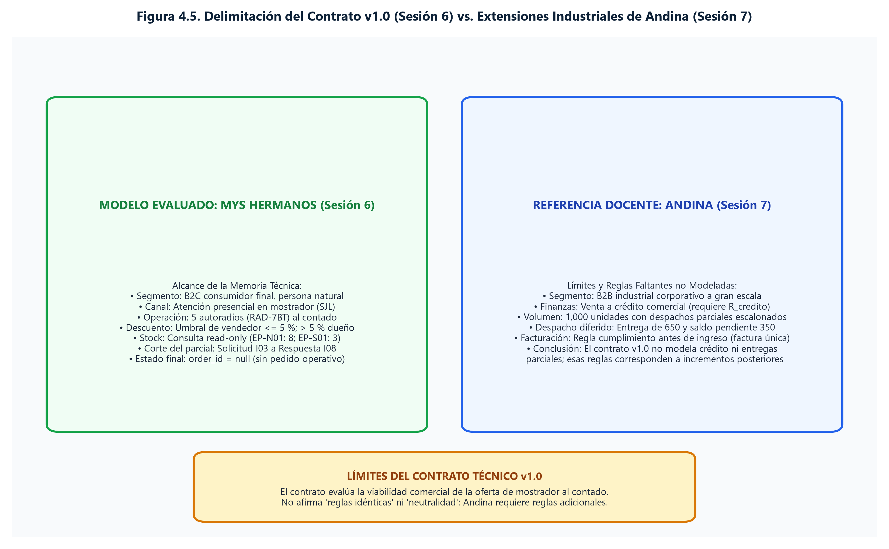
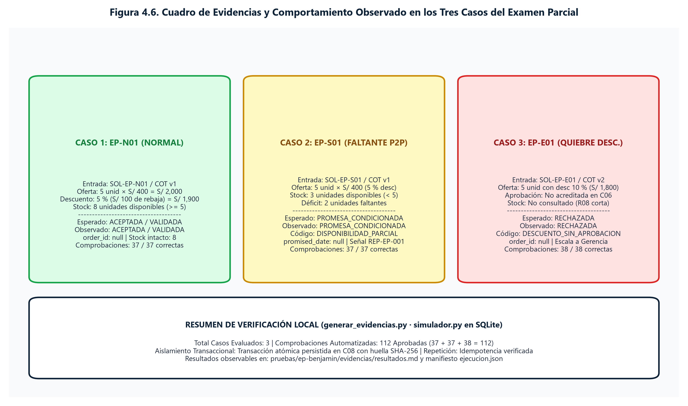

**UNI · FIIS** 

# **MEMORIA TÉCNICA DE INTEGRACIÓN EMPRESARIAL ERP–CRM** 

IMPORTACIONES MYS HERMANOS S.A.C. · GE703 SISTEMAS INTEGRADOS · CICLO 2026-2 Arquitectura de Transición, Modelo Canónico de Datos y Compuerta Defensiva en el Proceso Order-to-Cash (O2C) 

## **Identificación del examen** 

|**Campo**|**Registro**|
|---|---|
|Grupo|G7|
|Empresa|IMPORTACIONES MYS HERMANOS S.A.C.|
|Fecha de exposición|24/10/2026|
|Tiempo máximo|15 minutos|
|Enlace al panel y evidencias||
|Modalidad de evaluación|Presentación grupal con nota individual|
|Participación|Exponen todos los integrantes|
|Vocal invitado|Grupo: __________  Nombre: __________|


## **Integrantes y contribuciones** 

Registren una contribución verificable y la decisión que defenderá cada integrante durante el comité. 

|**N°**|**Integrante**|**Contribución verificable y decisión que defenderá**|
|---|---|---|
|1|Arancibia Ynga, Benjamin Francis|Recorrido Operativo O2C (Punto 3). Mapa integrado O2C-P2P, customer journeys actual y<br>propuesto, SIPOC detallado, matriz de roles y responsabilidades, línea de tiempo<br>transaccional y validación de casos EP-N01 / EP-S01. Defiende la delimitación del<br>compromiso comercial sin alteración de compras directas.|
|2|Carrión Oré, Shirley|Reto Estratégico y Decisión Ejecutiva (Punto 1); Validación Técnica de Arquitectura (Punto<br>7). Formulación del reto de modernización comercial, criterios de aceptación ejecutiva de<br>la compuerta defensiva y liderazgo en la fundamentación técnica frente al jurado<br>evaluador. [SECCIÓN PENDIENTE DE INCORPORACIÓN POR SHIRLEY]|
|3|Chavez Mendoza, Gabriel Omar|Especificación Formal del Contrato CRM–ERP (Punto 4). Definición técnica del Contrato v1.0, especificación de 8 interfaces canónicas I01–I08, payload I03 con 9 campos de referencia estrictos, 12 reglas deterministas R01–R12 (R08 previa a R09/R10), matriz completa de 15 códigos de respuesta tipificados, idempotencia por huella SHA-256 en transacción atómica (UNIQUE condicionado a ACEPTADA) y validación de 112 comprobaciones compartidas (37/37/38) con order_id estrictamente nulo.|
|4|Mansilla Soto, Adrian|Análisis y Contención del Escenario de Quiebre (Punto 5). Modelado y simulación de la<br>excepción comercial por descuento extraordinario (10%). Regla determinista R08, bloqueo<br>preventivo de consulta de almacén, mitigación de riesgos de fraude y registro atómico<br>inmutable en bitácora auditable.|
|5|Paucarcaja Ramos, Jharolym|Arquitectura Integrada y Límites de Sistemas (Punto 2). Diagrama lógico de Odoo (CRM vs.<br>ERP Ventas/Inventario), frontera de sistemas de registro (SoR), canal asistido WhatsApp<br>sin API no oficial, desacoplamiento en base de datos PostgreSQL e incrementos<br>arquitecturales desde PC1.|
|6|Quintanilla Huamanraime, Ballack Zidane|Arquitectura de Datos y Gobierno (Sección 4.16); Recomendación Estratégica y Hoja de<br>Ruta (Punto 6). Modelo canónico de 8 entidades, validación stock read-only R10, señal<br>REP-EP-001, gobernanza y privacidad (Ley 29733), cuadre matemático de 3 casos,<br>veredicto de Aprobación Condicionada, matriz NPR de 5 riesgos y roadmap a EF.|


## **Desarrollo de la Memoria Técnica de Integración** 

#### **1. Marco Estratégico, Decisión Ejecutiva y Criterios de Éxito** 

_Formulen el reto, la decisión que el comité debe tomar y el criterio de éxito._ 

Área Responsable: Dirección de Proyecto y Decisión Ejecutiva (Shirley Carrión Oré) [RESERVADO PARA INCORPORACIÓN POR SHIRLEY] 

Evidencia: Matriz de Reto Comercial, Justificación del Cambio y Criterios de Aceptación del Sistema. Desarrollo Técnico Preliminar: IMPORTACIONES MYS HERMANOS S.A.C. enfrenta el reto estratégico de modernizar su modelo de ventas en counter (tienda física de San Juan de Lurigancho), transitando desde un esquema empírico no formalizado hacia una gestión integrada ERP-CRM. La decisión ejecutiva que se eleva a consideración es la APROBACIÓN CONDICIONADA del diseño de la compuerta defensiva de transición (Contrato v1.0). El criterio de éxito fundamental consiste en blindar el ERP de compromisos no respaldados: asegurar que ningún pedido operativo sea emitido sin previa validación comercial estricta, autorización fehaciente de descuentos y verificación no bloqueante de inventario, registrando el 100% de transacciones con huella criptográfica SHA-256. 

#### **2. Arquitectura Integrada y Límites de Sistemas (SoR / SoE)** 

###### _Muestren límites, sistemas y cambios desde PC1. Justifiquen cómo la arquitectura sostiene el recorrido empresarial._ 

Área Responsable: Arquitectura de Software e Integración de Sistemas (Jharolym Paucarcaja Ramos) Evidencias Clave: Diagrama lógico de componentes Odoo v16/v17, topología de despliegue en PostgreSQL, matriz de separación de sistemas de registro (System of Record) y comparativa de incrementos PC1 vs. EP. 

2.1 Delimitación de Sistemas de Registro y Engagement (SoR vs. SoE): La arquitectura empresarial resuelve la fragmentación operativa estableciendo una frontera técnica rigurosa entre dos contextos de negocio diferenciados: 

• Sistema de Engagement y Registro Comercial (CRM - Odoo Community): Actúa como el System of Record (SoR) para las entidades Lead, Oportunidad Comercial y Cotización Preliminar. Su propósito es captar la intención del cliente, registrar notas de interacción, parametrizar requerimientos de autoradios y accesorios, y generar ofertas comerciales. Carece estrictamente de privilegios de escritura o decremento sobre existencias físicas de almacén y no tiene capacidad directa para generar compromisos contractuales de entrega. 

• Sistema de Registro Operativo y Financiero (ERP - Odoo Ventas, Inventario y Facturación): Actúa como el SoR para las entidades Catálogo Maestro de Artículos, Lista de Precios Oficial, Registro de Existencias Físicas en Almacén, Solicitudes/Respuestas de Transición y Bitácora Inmutable de Auditoría. Este subsistema es la única autoridad competente para validar la legalidad comercial y física de un compromiso. 

2.2 Tratamiento del Canal de Entrada y Desacoplamiento de WhatsApp: En estricto apego a las observaciones de la etapa PC1, la arquitectura clasifica el canal de WhatsApp Business no como un bot autónomo o integración por API no oficial, sino como un CANAL DIGITAL ASISTIDO por el personal de ventas en mostrador. El vendedor interactúa con el cliente, transcribe los requerimientos al módulo CRM de Odoo y genera la cotización. La oferta adquiere validez transaccional únicamente cuando el cliente la ratifica formalmente en el counter mediante aceptación fehaciente. 

2.3 Evolución e Incrementos Arquitecturales desde PC1: 1. Supresión de integraciones ficticias externas y consolidación en una arquitectura basada en Odoo Community sobre PostgreSQL 15, estructurada en contenedores Docker gestionados mediante red aislada interna. 2. Implementación de la Compuerta de Transición Defensiva v1.0, gobernada por una tubería de 12 reglas deterministas que evalúa solicitudes I03 de forma desacoplada. 

3. Aislamiento de Compras (P2P): ante déficits de inventario en mostrador (como en el escenario EP-S01 de 3 unidades frente a 5 solicitadas), el ERP no dispara órdenes de compra automáticas que comprometan la liquidez del negocio; en su lugar, despacha la señal asíncrona REP-EP-001 hacia la cola de compras para consolidación por lote económico. 4. Incorporación del principio de idempotencia estricta mediante huellas de resumen SHA-256, impidiendo la duplicidad de transacciones ante fallas de red o reintentos de counter. 

2.4 Justificación de la Sostenibilidad Arquitectural del Recorrido O2C: La arquitectura garantiza que la presión comercial del mostrador no degrade la fiabilidad del ERP. Al anteponer el control de políticas comerciales (regla R08) a la consulta de existencias (reglas R09-R10), se previene que ofertas espurias o no autorizadas tengan visibilidad sobre las existencias estratégicas de almacén. Asimismo, al mantener order_id = null durante toda la transición, se asegura que los recursos de inventario y facturación se reserven exclusivamente para transacciones 100% conformes. 

#### **3. Recorrido Operativo del Proceso Order-to-Cash (O2C)** 

_Recorran un hilo transaccional O2C. Expliciten el evento, responsables, reglas, controles y la evidencia que respalda la decisión._ 

**Responsable:** Benjamín Francis Arancibia Ynga. **Intervención:** 04:00–06:00 del comité del 24/10/2026. **Evidencias:** seis figuras originales, panel local y casos EP-N01, EP-S01 y EP-E01. Desarrollo completo a continuación. 

##### **3.1 Decisión que defiende Benjamin** 

Proponemos aprobar de forma condicionada un recorrido comercial trazable para **un cliente nuevo del público general que visita la tienda física** . La necesidad se registra, se convierte en una oportunidad, recibe una cotización versionada y, tras su aceptación, origina una solicitud de evaluación al ERP. La respuesta conserva identificadores y motivos. Si falta disponibilidad, se registra una necesidad de reposición para evaluación de P2P; esa señal no autoriza una compra ni una fecha de atención. 

El éxito del diseño se comprueba al reconstruir **cliente → lead → oportunidad → cotización y versión → aceptación → solicitud → respuesta** , identificando al responsable y el control de cada transición. La aceptación comercial del cliente y el estado ACEPTADA de la solicitud son hechos distintos; ninguno confirma automáticamente un pedido ni reserva inventario. 

##### **3.2 Alcance y continuidad del proyecto** 

|**Etapa**|**Decisión conservada o ampliada**|**Límite**|
|---|---|---|
|PC1|Odoo como núcleo propuesto para contactos, ventas e inventario; UBLHUB para emisión<br>futura|Arquitectura documentada; no acredita instalación|
|PC2 v2.1|Cliente nuevo, persona natural, visita espontánea, cotización y decisiones comerciales|El caso evaluable terminaba antes de solicitar el pedido; sin reserva|
|Examen parcial|Se explicita la solicitud CRM–ERP, sus datos, controles y respuestas, conectada con O2C y<br>P2P|Se evalúa el diseño y una simulación local; no se confirma pedido ni se ejecuta P2P|


El segmento seleccionado es consumidor final; cinco unidades para vehículos familiares **no convierten al cliente en mayorista** . El canal es el mostrador físico y la fuente es visita espontánea. No se atribuyen campañas ni captación por WhatsApp. El medio de contacto solo se recoge si es necesario y autorizado; no se exige correo ni se publican datos personales. 

O2C completo significa llevar la necesidad comercial hasta el cobro aplicado y el tratamiento de sus excepciones. P2P completo va de una necesidad de abastecimiento autorizada al pago conciliado al proveedor. Conocer ambos extremos permite explicar su relación; el parcial desarrolla únicamente el tramo comercial hasta la respuesta de transición. Los tramos posteriores aparecen como contexto, sin secuencia operativa detallada. 

**Parámetros de la recreación EP:** 24/10/2026, hora Perú -05:00; 5 autoradios de SKU sintético RAD-7BT; precio final académico S/ 400; moneda PEN; descuento ordinario 5 %; disponibilidad normal 8 y variante de faltante 3; vigencia hasta las 18:00. No se descompone IGV ni se calcula un documento tributario. Contado y boleta son condiciones comerciales previstas por validar; no se registra un pago ni una emisión. 

##### **3.3 Mapa integrado O2C y P2P** 


**Figura 3.1. Mapa integrado O2C y P2P. Elaboración propia asistida por IA; diseño y simulación local. Imagen original completa y sin recortes.** 

El evento conector es la **disponibilidad insuficiente de una necesidad trazable** . En EP-S01, max(0, 5 − 3) = 2 unidades faltantes originan REP-EP-001, vinculada a la oportunidad, solicitud y snapshot. El dueño y abastecimiento evalúan existencias, compras pendientes y presupuesto; la señal no aprueba compras ni plazos. Una recepción futura validada podría actualizar stock para O2C. Ese retorno es contexto y no se ejecuta aquí. 

##### **3.4 Mapa de procesos de nivel uno** 


**Figura 3.2. Mapa de procesos de Importaciones MYS Hermanos. Elaboración propia asistida por IA; diseño y simulación local. Imagen original completa y sin recortes.** 

La empresa comercializa autoradios y accesorios. Estrategia fija precios y autorizaciones; los procesos operativos conectan cliente, disponibilidad y abastecimiento; soporte aporta personas, datos y control. Se adapta el caso docente a comercio, sin incorporar fabricación. Ventas, Inventario y Abastecimiento son **funciones del diseño** , no departamentos comprobados. Una persona puede asumir varias funciones; el dueño conserva la decisión independiente sobre excepciones de precio. 

##### **3.5 SIPOC del tramo evaluado** 

**Propósito:** transformar una consulta física en una respuesta comercial trazable, conservando la versión aceptada y las restricciones de disponibilidad. **Inicio:** consulta del cliente en tienda. **Fin:** solicitud evaluada y respuesta registrada, o espera/corrección documentada antes del envío. **Dueño propuesto:** responsable comercial, con decisión del dueño sobre excepciones. 

|**S Proveedores**|**I Entradas**|**P Pasos principales**|**O Salidas**|**C Destinatarios**|
|---|---|---|---|---|
|Cliente|Necesidad, uso final y cantidad|1 Capturar e identificar|Cliente y consulta vinculados|Cliente y Ventas|
|Cliente y Ventas|Necesidad viable y siguiente acción|2 Calificar lead y oportunidad|Oportunidad con responsable|Ventas|
|Catálogo, Inventario y dueño|SKU, precio, disponibilidad fechada y<br>facultades|3 Preparar cotización versionada|Oferta con importe y condiciones|Cliente|
|Cliente y Ventas|Oferta vigente y respuesta expresa|4 Registrar aceptación exacta|Aceptación ligada a la versión|Ventas y evaluación ERP|
|Ventas y registros comerciales|Referencias y actor autorizado|5 Solicitar y validar transición|Solicitud identificada y controles|Evaluación ERP|
|Evaluación ERP y responsables|Decisión y motivo|6 Responder y comunicar|ACEPTADA, RECHAZADA, PROMESA_CONDICIONADA o<br>PENDIENTE; señal P2P si procede|Cliente, Ventas y dueño|


Una cotización no aceptada continúa en seguimiento, recotización o cierre por desistimiento. No debe construirse una solicitud ficticia para completar el gráfico. Los pasos tercero y quinto consultan disponibilidad para momentos distintos: preparar una oferta y revalidar al evaluar la transición. 

##### **3.6 SIPOC de contexto de los macroprocesos** 

Estos contratos de alto nivel permiten explicar los extremos de la teoría de Semana 5. Sus actividades posteriores al corte **no se ejecutan ni se desarrollan en el parcial** . 

|**Elemento**|**O2C completo como contexto**|**P2P completo como contexto**|
|---|---|---|
|Propósito y límites|De la necesidad del comprador al cobro aplicado o excepción registrada|De la necesidad de abastecimiento aprobada al pago conciliado o excepción<br>registrada|
|S Proveedores|Cliente, Ventas, catálogo, Inventario y funciones financieras|O2C/Inventario, dueño, proveedor y datos maestros|
|I Entradas|Necesidad, SKU, cantidad, precios, autorizaciones y condiciones|Necesidad justificada, especificación, presupuesto, proveedor y condiciones|
|P entre cuatro y siete pasos|Capturar necesidad; aprobar oferta; validar pedido; cumplir operación;<br>documentar; aplicar cobro|Evaluar necesidad; aprobar solicitud; seleccionar fuente; ordenar; recibir; verificar<br>documento; pagar y conciliar|
|O Salidas|Oferta y pedido trazables; cumplimiento y cobro como resultado final posterior|Abastecimiento conforme, disponibilidad actualizada y pago sustentado|
|C Destinatarios|Comprador, Ventas, Inventario, Finanzas y dueño|Inventario/O2C, proveedor, Finanzas y dueño|
|Evidencia en este aporte|Solo hasta solicitud y respuesta; sin cobro, comprobante ni salida|Solo señal conceptual REP-EP-001; sin solicitud aprobada, orden, recepción ni pago|


**Relación defendible:** el inventario es un dato compartido que O2C consulta para no ofrecer una disponibilidad inexistente y P2P puede aumentar mediante una recepción futura validada. La cantidad faltante de una venta es una entrada para revisar abastecimiento; no determina automáticamente cuánto comprar ni a qué proveedor. 

**3.7 Journey actual del cliente** 


**Figura 3.3. Journey actual reconstruido documentalmente. Elaboración propia asistida por IA; diseño y simulación local. Imagen original completa y sin recortes.** 

El recorrido actual se reconstruye a partir del diagnóstico documental de registros dispersos y consultas manuales. Los puntos de dolor y emociones son hipótesis de análisis; no provienen de observación cronometrada ni de entrevistas nuevas. Cada etapa llega al límite previo al pedido para compararse con el journey propuesto. 

**3.8 Journey propuesto del cliente** 


**Figura 3.4. Journey propuesto del cliente en tienda. Elaboración propia asistida por IA; diseño y simulación local. Imagen original completa y sin recortes.** 

La mejora propuesta consiste en mantener la relación entre la experiencia visible y la evidencia interna. El cliente recibe un precio y un estado claros; Ventas conserva la necesidad y el siguiente paso. Las emociones muestran una experiencia deseada, no un resultado medido. La compatibilidad se verifica contra especificaciones del producto y del vehículo; este ejemplo no acredita una prueba técnica real. 

La rama de stock insuficiente no mejora la experiencia inventando una fecha: mejora la claridad del estado, asigna una persona para resolverlo y conserva seguimiento. Si se modifican cantidad, descuento o plazo, debe presentarse otra versión y obtener una nueva aceptación. 

##### **3.9 Flujo por roles y responsabilidades** 


**Figura 3.5. Flujo por roles hasta la respuesta ERP. Elaboración propia asistida por IA; diseño y simulación local. Imagen original completa y sin recortes.** 

Las cajas de Odoo representan responsabilidades propuestas de Contactos, CRM, Ventas e Inventario. El control de transición es un diseño local simulado: que todos compartan plataforma no elimina la necesidad de gobernar el paso de intención comercial a compromiso operativo. Ninguna caja demuestra configuración productiva. 

##### **3.10 Línea de tiempo del caso normal** 


**Figura 3.6. Línea de tiempo del caso EP N01. Elaboración propia asistida por IA; diseño y simulación local. Imagen original completa y sin recortes.** 

Todas las horas corresponden al reloj lógico del ejemplo **24/10/2026, UTC−05:00** . La ejecución del script conserva por separado su fecha real. Las horas no representan tiempos observados en la empresa ni metas de atención. 

##### **3.11 Datos controles e interfaces** 

|**Momento**|**Datos mínimos y fuente lógica**|**Control y responsable**|**Falla y contención**|
|---|---|---|---|
|Identidad|ID de cliente, estado y referencia mínima; Contactos|Ventas busca antes de crear; resuelve coincidencia|Identidad ambigua: corregir, no duplicar|
|Calificación|Lead, oportunidad, necesidad, cantidad y siguiente acción; CRM|Ventas mantiene mismo cliente y asignación|Contexto incompleto: seguimiento, no simular<br>aprobación|
|Oferta|ID, versión, SKU, cantidad, moneda, precio, descuento, total y<br>vencimiento; Ventas|Recalcular; vincular precio de catálogo|Oferta vencida o cambiada: nueva versión y aceptación|
|Aceptación|ID y hora de respuesta, ID y versión aceptados; registro comercial|Ventas verifica coincidencia con versión vigente|Aceptación de otra versión: bloquear transición|
|Autorización|Regla y decisión del dueño por versión y total; registro de<br>aprobaciones|Evaluación comprueba autorización independiente|10 % sin dueño: RECHAZADA, sin compromiso|
|Disponibilidad|SKU, ubicación, unidades disponibles y fecha; Inventario|Evaluación consulta de nuevo; no descuenta unidades|Menos de cinco: PROMESA_CONDICIONADA; escalar|
|Solicitud|Empresa, SOL, COR, CLI, OPP, COT, versión y ACE|Actor de sesión, idempotencia y vínculos; evaluación<br>ERP|Reintento idéntico: mismo resultado; no duplicar|
|Respuesta|Estado, código, motivo, responsable y acción; bitácora|Ventas comunica sin convertir validación en pedido|Dependencia inaccesible: PENDIENTE, no afirmar<br>disponibilidad|


**Interfaces lógicas:** cliente–Ventas registra necesidad; CRM–Contactos resuelve identidad; CRM–Ventas vincula oportunidad/cotización; evaluación–Inventario consulta disponibilidad; evaluación–autorizaciones verifica al dueño; evaluación–Ventas devuelve decisión. La señal de reposición conecta con la función P2P. Son intercambios funcionales dentro del Odoo propuesto y proveedores locales de prueba; no se afirma una API externa instalada. 

El mensaje de solicitud transporta referencias; los importes, roles y stock se contrastan con registros confiables. Un indicador aprobado=true escrito por el vendedor no reemplaza la decisión del dueño. La bitácora registra actor, hora, evento e identificador; no necesita nombres, documentos ni teléfonos reales. 

##### **3.12 Dimensiones ERP e indicadores** 

|**Dimensión de Semana 5**|**Aplicación a O2C en el parcial**|**Dependencia P2P y límite**|
|---|---|---|
|Resultado|Respuesta de transición explicada y correlacionada|Necesidad de reposición identificada, sin compra|
|Actores|Cliente, Ventas, dueño y evaluación lógica ERP|Función Inventario/Abastecimiento y dueño evalúan|
|Eventos|Consulta, oferta, aceptación, solicitud y respuesta|Detección de brecha produce señal REP|
|Datos|CLI, OPP, COT/versión, SKU, cantidad, COR y SOL|Mismo SKU/ubicación y cantidad faltante justificable|
|Documentos|Cotización y constancia de aceptación|Registro de señal, no orden ni documento de proveedor|
|Sistemas|Contactos, CRM, Ventas, Inventario y bitácora propuestos|Disponibilidad compartida; recepción futura como contexto|
|Controles|Identidad, versión, descuento, permisos e idempotencia|Evaluación humana antes de autorizar abastecimiento|
|Indicadores|Trazabilidad completa y transición sin reproceso|Señales con responsable y fuente identificados|


|**Indicador propuesto**|**Fórmula y fuente**|**Responsable y criterio**|
|---|---|---|
|Solicitudes con trazabilidad completa|Solicitudes con CLI, OPP, COT/versión, ACE, SOL y COR coherentes ÷ solicitudes<br>evaluadas × 100; bitácora|Ventas; objetivo de prueba 100 %. Sin línea base empresarial medida|
|Transición validada al primer intento|Solicitudes ACEPTADA/VALIDADA en primera evaluación ÷ solicitudes evaluadas<br>× 100; respuestas|Responsable comercial; medir normal y excepciones por separado, sin premiar<br>omisión de controles|
|Señales de reposición sustentadas|Señales con SKU, ubicación, déficit, fuente/hora y responsable ÷ señales<br>generadas × 100|Abastecimiento; objetivo de diseño 100 %. No mide compras ejecutadas|


Un agente futuro podría leer estados autorizados, advertir faltantes y recomendar seguimiento. Debe escalar descuentos, cambios de condiciones y decisiones de abastecimiento al humano competente. La simulación no despliega un agente ni le atribuye facultades comerciales. 

##### **3.13 Casos y resultados comprobables** 

|**Caso**|**Entrada diferencial**|**Resultado esperado**|**Control y siguiente acción**|
|---|---|---|---|
|EP-N01 normal|5 unidades, 5 %, S/ 1,900; disponible 8; v1<br>aceptada vigente|Estado ACEPTADA; código VALIDADA; order_id null;<br>stock intacto|Ventas comunica que se validó la solicitud; confirmación<br>operativa posterior pendiente|
|EP-S01 enlace P2P|Misma necesidad; disponibilidad de evaluación 3|PROMESA_CONDICIONADA / DISPONIBILIDAD_PARCIAL;<br>déficit 2; sin fecha prometida|Señal REP-EP-001; dueño/abastecimiento evalúan; cliente<br>debe aceptar nuevas condiciones|
|EP-E01 coordinación con Adrián|v2 solicita 10 %, total S/ 1,800; sin autorización<br>del dueño|RECHAZADA / DESCUENTO_SIN_APROBACION; order_id<br>null|Vendedor escala al dueño y conserva condiciones<br>pendientes; no ofrece 10 % como aprobado|


Los casos son **corridas independientes** , no tres ventas del mismo cliente. EP-S01 cambia deliberadamente el snapshot confiable de disponibilidad respecto del caso normal para comprobar la rama P2P. El 10 % no se acumula al 5 %: ambos se calculan sobre S/ 2,000. La falta de aprobación comercial se controla antes de evaluar el faltante. 

En el contrato existente, ACEPTADA es el **estado** y VALIDADA es el **código** de la misma respuesta normal. No son dos etapas sucesivas ni equivalen a pedido confirmado. PROMESA_CONDICIONADA describe una propuesta por revisar, no una promesa firme: la fecha continúa nula. PENDIENTE significa que no pudo verificarse una dependencia; no equivale a stock cero. 

El informe de ejecución registra el resultado **observado** , comparado con expectativas fijas, y los controles realmente ejecutados. Los JSON contienen datos de entrada, respuestas y trazas. La señal de reposición se documenta localmente como evidencia del enlace; no crea una transacción en Compras. Las verificaciones no acreditan ERP instalado, disponibilidad real ni política comercial aprobada. 

##### **_Resultados observados de la simulación local_** 

|**Caso**|**Esperado**|**Observado**|**Comprobaciones**|
|---|---|---|---|
|EP-N01|ACEPTADA / VALIDADA|ACEPTADA / VALIDADA|37 correctas|
|EP-S01|PROMESA_CONDICIONADA / DISPONIBILIDAD_PARCIAL|PROMESA_CONDICIONADA / DISPONIBILIDAD_PARCIAL|37 correctas|
|EP-E01|RECHAZADA / DESCUENTO_SIN_APROBACION|RECHAZADA / DESCUENTO_SIN_APROBACION|38 correctas|


Resultado ejecutado: 3 casos aprobados y 112 comprobaciones satisfactorias. En todos los casos order_id = null y stock intacto. Repetir la solicitud conserva un solo registro y una sola decisión; añade un evento de reintento. En EP-E01, S/ 1,800 es el total propuesto de la cotización v2; la respuesta rechazada conserva total = null y currency = null porque no valida ese importe. 

La bitácora inicial usa 24/10/2026 09:55:01 y el reintento 09:56:01, zona -05:00, como reloj lógico didáctico. La ejecución real se registra por separado en el manifiesto: 2026-1022T04:09:12.234216+00:00. Son pruebas locales, no tiempos de atención medidos ni transacciones de Odoo. 

##### **3.14 Reproducción y navegación de evidencias** 

1. Abrir panel-benjamin.html y seleccionar **Mapa integrado** . Explicar qué evento conecta O2C con P2P. 

2. Seleccionar **Línea de tiempo** y seguir CLI-DEMO-001, OPP-DEMO-001 y COT-DEMO-001 v1 hasta SOL-EP-N01. 

3. Abrir **Caso normal** : contrastar S/ 1,900, estado ACEPTADA, código VALIDADA y ausencia de pedido. 

4. Abrir **Faltante y P2P** : mostrar disponibilidad 3, déficit 2, señal REP-EP-001 y fecha prometida nula. 

5. Mostrar brevemente **Descuento** , que enlaza con el quiebre de Adrián; la explicación contractual detallada continúa con Gabriel. 

Desde la raíz del repositorio, ejecutar con Python 3: 

python pruebas/ep-benjamin/generar_evidencias.py 

El generador usa la biblioteca estándar y reutiliza el simulador local existente. Reproduce snapshots sintéticos, contrasta respuestas con expectativas y actualiza resultados y hashes de sus entradas. El informe de ejecución indica qué se verificó realmente. Para inspección independiente se puede cambiar el stock de la fixture de prueba en una copia y volver a ejecutar; una expectativa que deje de cumplirse debe producir un fallo visible, no un resultado favorable escrito manualmente. 

No se deben presentar las pruebas históricas de PC2 como prueba de este nuevo canal sin adaptación. Tampoco corresponde afirmar que los journeys se validaron con clientes por ejecutar un script de transición. El panel local es material de Benjamin para integrar al panel único del grupo; publicar el enlace accesible del comité sigue siendo una tarea grupal. 

##### **3.15 Protocolo de Ejecución y Coordinación Operativa del Tramo** 

**04:00–04:20 | Decisión y contexto.** “Defiendo que el recorrido del cliente sea trazable hasta la respuesta a la solicitud, y que un faltante active evaluación de reposición sin autorizar compras. Nuestro cliente es una persona natural nueva que llega a la tienda; mantenemos el canal físico de PC2.” 

**04:20–04:55 | Hilo normal.** “Ventas identifica CLI-DEMO-001, califica el lead y vincula OPP-DEMO-001. Cotiza cinco autoradios a 400 soles: base 2,000, descuento permitido en el ejemplo del 5 %, total 1,900. La consulta de ocho unidades tiene fuente y hora; todavía no reserva nada. El cliente acepta COT-DEMO-001 v1 dentro de su vigencia.” 

**04:55–05:20 | Solicitud y evidencia.** “La aceptación se enlaza con SOL-EP-N01 y con COR-EP-001. Aquí comprobamos la respuesta del simulador: estado ACEPTADA, código VALIDADA y order_id nulo. La validación permite continuar posteriormente; no confirma el pedido. Los registros conservan actor, versión y momento.” 

**05:20–05:45 | Conexión P2P.** “En la variante EP-S01 solo hay tres unidades disponibles para cinco solicitadas. La brecha de dos produce REP-EP-001. El dueño y abastecimiento deben evaluar esa necesidad: no hay compra automática ni plazo comprometido. El cliente recibe una condición por revisar y debe aceptar cualquier cambio de oferta.” 

**05:45–06:00 | Límite y transición.** “Precios, cantidades y stock son sintéticos; P2P no fue ejecutado. Llegamos a la respuesta de evaluación, antes de pedido, reserva y los tramos posteriores. Gabriel explicará ahora qué datos, estados y autorizaciones hacen válida esa transición.” 

La trazabilidad integral del recorrido O2C descansa en la estricta coherencia de identificadores y estados compartidos entre los módulos de la arquitectura: 

1. Continuidad Transaccional de Extremo a Extremo: El recorrido comercial enlaza la topología de sistemas de registro (Punto 2) con la compuerta formal de transición CRM-ERP (Punto 4), utilizando unívocamente el mismo catálogo maestro de artículos (SKU: RAD-7BT), precio oficial de lista (S/ 400.00) y cliente plenamente identificado en el maestro de cuentas. 

2. Contención Determinista de Excepciones: La compuerta intercepta cualquier intento de desvío comercial mediante la regla R08, articulando el protocolo de contingencia frente al fraude por descuentos (Punto 5) antes de comprometer inventario o facturación. 

3. Integridad del Modelo de Datos y Gobernanza: La persistencia atómica en la bitácora de auditoría (Sección 4.16) y la evaluación integral de riesgos (Punto 6) garantizan que la información del ERP permanezca inmutable, reproducible y plenamente auditable ante cualquier escrutinio técnico. 

##### **3.16 Cobertura de la rúbrica individual** 

|**Criterio oficial**|**Puntos**|**Cómo lo demuestra Benjamin**|**Evidencia local**|
|---|---|---|---|
|Dominio funcional y contexto|4|Explica cliente físico, O2C completo y corte evaluado; justifica conexión P2P<br>sin compras|Alcance, mapa integrado y dos SIPOC|
|Integración y arquitectura|4|Vincula CRM, Contactos, Ventas, Inventario, autorizaciones y bitácora por<br>responsabilidades|Mapa, flujo por roles y matriz de interfaces|
|Datos controles y trazabilidad|3|Sigue CLI, OPP, COT/versión, ACE, SOL y COR; muestra descuento y snapshot|Línea de tiempo, tabla de controles y JSON|
|Reproducibilidad y evidencia|3|Navega normal y excepción; contrasta esperado con observado y muestra<br>reintento|Generador, resultados, trazas y manifiesto|
|Argumentación y comunicación individual|3|Defiende una decisión y un límite, dentro de dos minutos|Guion y panel navegable|
|Contribución y coordinación|2|Entrega artefactos identificables y transición coherente al contrato de Gabriel|Fila de contribución, archivos y enlace al bloque siguiente|
|Ética y propiedad intelectual|1|Declara fuentes, IA, datos sintéticos y revisión humana pendiente|Registro de fuentes, supuestos y límites|


**Total: 20 puntos.** Esta es una matriz de cobertura del aporte, no una calificación otorgada. Todos los criterios se aplican a Benjamin; los puntos no se reparten entre miembros del grupo. La revisión humana y el ensayo de Benjamin deben completarse antes de la exposición. 

##### **3.17 Preguntas para preparar la defensa** 

**¿En qué evento se vinculan O2C y P2P?** En la detección de disponibilidad insuficiente para una necesidad comercial identificada. REP-EP-001 vincula producto, ubicación y brecha con oportunidad y solicitud. Esa señal debe evaluarse; no aprueba una compra. 

**¿Por qué la cotización no compromete inventario?** Registra condiciones comerciales y una consulta fechada. La simulación no ejecuta reserva y mantiene order_id nulo. Antes de una futura confirmación debe revalidarse disponibilidad y aplicar los controles operativos correspondientes. 

**¿Por qué cinco autoradios siguen siendo público general?** La clasificación depende del uso final y del perfil de persona natural del caso; la cantidad por sí sola no demuestra reventa. El uso en vehículos familiares es un supuesto explícito que debe confirmarse con el cliente. 

**¿Por qué mostrar P2P si no se compra?** Porque abastecimiento condiciona lo que comercial puede ofrecer. Mostrar la dependencia, su dueño y su evidencia satisface la visión integrada; ejecutar una compra ampliaría el alcance. 

**¿Qué significa ACEPTADA si no hay pedido?** Significa que la solicitud pasó los controles de esta evaluación, con código VALIDADA. Es diferente de la aceptación de la cotización por el cliente y de una futura confirmación del pedido. 

**¿Pueden prometer una fecha con tres unidades disponibles?** No con esta evidencia. La fecha es nula; el dueño y abastecimiento evalúan alternativas y Ventas obtiene una nueva aceptación si cambian las condiciones. La consulta de un proveedor no sustituye esa decisión. 

**¿Y si el dueño no responde al 10 %?** El vendedor no se autoautoriza. Se conserva la solicitud comercial en seguimiento y se comunica la espera; si se intenta la transición sin autorización, la prueba devuelve DESCUENTO_SIN_APROBACION. Rechazar la solicitud técnica no significa perder automáticamente la oportunidad. 

**¿Se comprobó esto en Odoo real?** No. Se ejecutó una simulación local del contrato y se comprobaron sus resultados. El despliegue, permisos reales y concurrencia de inventario permanecen por validar antes de cualquier operación. 

##### **3.18 Fuentes supuestos y revisión** 

|**Referencia**|**Uso y localización**|**Consulta**|
|---|---|---|
|GE703 EP Instrucciones y Rúbrica Comité, material docente|Págs. 1–2: alcance hasta solicitud/respuestas; mapa O2C–P2P; siete criterios, total 20|21/10/2026|
|Reparto Parcial, propuesta de equipo|Págs. 1 y 3: Benjamin, sección 3, dos minutos y enlace por faltante; pág. 7: consistencia y límites|21/10/2026|
|Plantilla GE703 EP G7, Word adjunto|Sección 3 y fila de contribución; se prepara texto para integrar sin llenar aportes ajenos ni pregunta<br>real|21/10/2026|
|GE703 S5 Presentación, Enrique Chaparro, UNI FIIS|Págs. PDF 10–19, 21–27 y 29–33: proceso, mapa, SIPOC, dimensiones, eventos y conexión O2C–P2P.<br>Desde PDF pág. 31 la numeración impresa se desplaza|21/10/2026|
|PC2 consolidada en Markdowny Word oficial en raíz|Cliente físico nuevo, cinco autoradios, precios, IDs, alcance comercial y supuestos|21/10/2026|
|Contexto empresarialymacroprocesos históricos|Diagnóstico de fragmentación y estructura previa; se adapta al corte EP|21/10/2026|
|Contrato local v1|Estado ACEPTADA y código VALIDADA, idempotencia, controles, order_id null; el escenario histórico<br>se adapta|21/10/2026|
|Odoo 19 documentación de cotizaciones desde CRM|Referencia técnica de vinculación oportunidad–cotización; no prueba despliegue MYS|21/10/2026|
|Odoo 19 documentación de reposición|Referencia de evaluación de necesidades; la señal didáctica no configura automatismos|21/10/2026|


**Criterio de consistencia entre fuentes.** El Word oficial de PC2 menciona cinco unidades disponibles; su Markdown menciona ocho. Se fija **ocho** como dato explícito de esta nueva recreación EP, coherente con las fixtures, y se prueban tres en la variante. No se afirma reproducción literal de PC2. Las fechas y vigencias se renuevan al reloj lógico de 24/10; no se reutiliza como vigente una oferta de 16/10. 

El reparto atribuye el límite de descuento a una entrevista, mientras los entregables PC2 lo etiquetan como supuesto. Al no disponer en estos insumos del registro primario de esa entrevista, el aporte conserva **5 % como regla didáctica por validar con el dueño** y no acredita una política empresarial real. El diagnóstico actual tampoco acredita Odoo operativo: la arquitectura se expresa como propuesta. 

**Hechos documentales:** empresa y giro, foco presencial/público general de PC2, reparto y alcance del parcial. **Supuestos:** cantidades, SKU, precios, descuentos, disponibilidad, tiempos, condiciones, uso familiar y emociones de journeys. **Diseño:** reglas de transición, IDs nuevos, señal REP, roles funcionales e indicadores. **Resultados observados:** únicamente los producidos y registrados por el generador local. 

Se utilizó Codex de OpenAI el 21/10/2026 para leer insumos, contrastar el alcance, redactar, programar la recreación y elaborar diagramas SVG/Mermaid. No se realizaron nuevas entrevistas ni operaciones en Odoo. Los diagramas son elaboración del aporte, asistida por IA; se atribuye el material docente y no se redistribuyen sus archivos originales. No se publica información personal de clientes, credenciales ni fuentes privadas. Benjamin debe revisar contenido, cifras y navegación; el grupo debe aprobar la política comercial y completar el panel común y su enlace accesible. La revisión humana no se registra como ya realizada. 

|**Elemento**|**Registro**|
|---|---|


Fuentes y fecha de acceso Herramientas de IA usadas y propósito Datos sensibles excluidos o anonimizados Límites, supuestos y pendientes 


### **4. Especificación Técnica y Gobernanza del Contrato CRM–ERP**

#### **4.1 Decisión que Defiende Gabriel y Justificación del Problema**

Como responsable de la integración técnica del tramo comercial en IMPORTACIONES MYS HERMANOS S.A.C., defiendo que la transición entre una intención comercial en el CRM y un compromiso operativo en el ERP debe estar gobernada por un **contrato técnico formal de evaluación** con frontera explícita de sistemas de registro (SoR), comprobación determinista de precondiciones y respuestas tipificadas. El contrato v1.0 delimita estrictamente el alcance evaluado para este examen parcial: culmina en la emisión de una decisión técnica tipificada donde el identificador de pedido (`order_id`) permanece nulo en todos los casos. No se realiza reserva de existencias, confirmación de venta, despacho físico, facturación electrónica ni descomposición de IGV en este corte.

La justificación de este diseño radica en la realidad operativa del mostrador de ventas de autoradios y accesorios vehiculares. En un canal presencial B2C con atención directa, el vendedor interactúa con el cliente formulando ofertas y acuerdos preliminares. Sin una compuerta defensiva intermedia, el personal comercial podría registrar compromisos con precios rebajados de manera unilateral, aceptar cotizaciones obsoletas o asegurar disponibilidad de inventario sin confirmación oficial de almacén. El contrato de transición resuelve esta vulnerabilidad al establecer que el CRM actúa como canal de engagement que propone la operación, mientras que la compuerta defensiva (C04) verifica las reglas institucionales contra los registros confiables del ERP antes de permitir cualquier compromiso empresarial.

#### **4.2 Frontera Conceptual CRM vs. ERP (Sesión 6 del Ing. Enrique Chaparro)**

Conforme a la fundamentación teórica de la Sesión 6 de cátedra, la integración de procesos no consiste en compartir tablas sin control, sino en diferenciar los sistemas de captación comercial (System of Engagement - SoE) de los sistemas centrales de registro transaccional (System of Record - SoR). Aunque Odoo organice sus aplicaciones en una plataforma común, las fronteras de responsabilidad entre la oportunidad comercial y el compromiso operativo deben mantenerse desacopladas:

| Dimensión de Análisis | CRM (C01) / Contactos (C02) | Compuerta Defensiva (C04) | Ventas (C03) / Inventario (C05) / Autorizaciones (C06) |
|---|---|---|---|
| **Sistema de Registro (SoR)** | SoR de Lead, Oportunidad e interacciones con el cliente. C02 es SoR del maestro de contactos. | Componente de control transaccional sin datos maestros propios. Gobierna la transición. | C03 es SoR exclusivo de la Cotización oficial y sus versiones. C05 es SoR de existencias. C06 es SoR de políticas. |
| **Responsabilidad Funcional** | Captación del interés comercial, registro de requerimientos y recepción de aceptación. | Evaluación determinista de 12 reglas previas al compromiso de recursos. | Mantenimiento de listas de precios oficiales, control de existencias en almacén y gobierno de excepciones. |
| **Naturaleza del Mensaje** | Solicitud de evaluación con 9 referencias canónicas inmutables (I03). | Respuesta tipificada con estado, código, responsable y acción requerida (I08). | Snapshots de cotización (I04), consulta de stock read-only (I05) y consulta de autorizaciones (I06). |
| **Límite en el Examen Parcial** | Registra oportunidad y vínculo a cotización; solicita evaluación. | Emite veredicto técnico con `order_id = null`. Persiste bitácora append-only. | Consulta de catálogos y existencias sin reservar stock ni generar orden de venta. |

*Tabla 4.1: Delimitación de fronteras SoE y SoR entre componentes. Fuente: Elaboración propia asistida por IA.*

  
*Figura 4.1: Arquitectura de Componentes e Interfaces del Contrato CRM–ERP (v1.0). Elaboración propia asistida por IA.*

#### **4.3 Especificación Formal del Mensaje de Solicitud I03 (Principio de Datos Confiables)**

El mensaje de solicitud de evaluación (interfaz I03) emitido por el CRM (C01) hacia la compuerta defensiva (C04) se rige por el principio de datos confiables en el servidor (Sesión 6, diapositiva 9). El payload del mensaje transporta estrictamente **nueve campos de referencia canónicos** y prohíbe cualquier campo adicional (`additionalProperties: false` bajo JSON Schema Draft 2020-12):

```json
{
  "contract_version": "1.0",
  "company_id": "MYS-DEMO",
  "request_id": "SOL-EP-N01",
  "correlation_id": "COR-EP-001",
  "opportunity_id": "OPP-DEMO-001",
  "customer_id": "CLI-DEMO-001",
  "quotation_id": "COT-DEMO-001",
  "quotation_version": 1,
  "acceptance_id": "ACE-EP-001"
}
```

| Campo Canónico | Tipo de Dato | Cardinalidad | Sistema de Origen | Propósito y Regla de Validación en Servidor |
|---|---|---|---|---|
| `contract_version` | String (const) | 1..1 | CRM (C01) | Debe ser exactamente `"1.0"`. Protege contra incompatibilidad de versiones entre módulos. |
| `company_id` | String (token) | 1..1 | CRM (C01) | Identificador de compañía. Se valida coincidencia en sesión, cliente, oportunidad y cotización. |
| `request_id` | String (token) | 1..1 | CRM (C01) | Identificador unívoco de la transacción. Clave primaria de deduplicación e idempotencia. |
| `correlation_id` | String (token) | 1..1 | CRM (C01) | Identificador transversal de la interacción comercial. Permite auditar el ciclo completo en bitácora. |
| `opportunity_id` | String (token) | 1..1 | CRM (C01) | Referencia a la oportunidad comercial activa en C01 asignada al vendedor que solicita la evaluación. |
| `customer_id` | String (token) | 1..1 | Contactos (C02) | Referencia al cliente. Se verifica que esté activo y con coincidencia de identidad revisada en C02. |
| `quotation_id` | String (token) | 1..1 | Ventas/ERP (C03) | Referencia a la cotización oficial cuyo SoR reside en Ventas/ERP (C03). No se acepta oferta externa. |
| `quotation_version` | Integer (>=1) | 1..1 | Ventas/ERP (C03) | Número entero de versión. Se comprueba que corresponda a la versión vigente en el snapshot de C03. |
| `acceptance_id` | String (token) | 1..1 | CRM (C01) | Evidencia de conformidad del cliente vinculada a la versión específica de la cotización y su total. |

*Tabla 4.2: Estructura canónica del mensaje I03. Fuente: Elaboración propia asistida por IA.*

En cumplimiento estricto del principio de desconfianza de entrada, el mensaje I03 no transporta precios unitarios, subtotales, porcentajes de descuento, saldos de stock ni indicadores de aprobación del dueño. Si el vendedor pudiera declarar los importes en el payload, el sistema quedaría expuesto a manipulación de datos en tránsito. La compuerta defensiva C04 lee las líneas, precios de catálogo y descuentos directamente desde el snapshot comercial oficial en Ventas (C03) mediante la interfaz I04, y la autorización del dueño se verifica en el componente C06 mediante I06.

#### **4.4 Matriz Integral de Interfaces del Contrato de Transición (I01–I08)**

La interacción entre los componentes del ecosistema CRM–ERP se formaliza mediante ocho interfaces estructuradas, diferenciando las consultas internas a sistemas de registro de la respuesta tipificada hacia el canal comercial:

| ID | Componente Emisor | Componente Receptor | Tipo de Operación | Descripción Técnica del Intercambio y Controles |
|---|---|---|---|---|
| **I01** | CRM (C01) | Ventas/ERP (C03) | Síncrono (RPC/REST) | Sincronización y vinculación de oportunidad comercial y cotización en preparación preliminar. |
| **I02** | Compuerta (C04) | Contactos (C02) | Solo Lectura (Query) | Validación de identidad y estado de cliente (regla R05): activo, identidad revisada y compañía coherente. |
| **I03** | CRM (C01) | Compuerta (C04) | Mensaje Canónico | Solicitud de evaluación de transición comercial. Payload restringido a 9 referencias canónicas. |
| **I04** | Compuerta (C04) | Ventas/ERP (C03) | Solo Lectura (Query) | Lectura del snapshot comercial oficial: versión vigente, estado sent, vigencia, líneas, precios y total. |
| **I05** | Compuerta (C04) | Inventario (C05) | Solo Lectura (Query) | Consulta no bloqueante de stock disponible en almacén (regla R10). No reserva existencias físicas. |
| **I06** | Compuerta (C04) | Autorizaciones (C06) | Solo Lectura (Query) | Verificación de políticas comerciales y aprobaciones vigentes emitidas por Gerencia (regla R08). |
| **I07** | Compuerta (C04) | Bitácora (C07) | Append-Only (Event) | Registro atómico de eventos de auditoría con correlation_id, actor, interfaz, código y marca temporal. |
| **I08** | Compuerta (C04) | CRM (C01) / Vendedor | Respuesta Tipificada | Retorno de la decisión evaluada: status, code, total, message, required_action y order_id = null. |

*Tabla 4.3: Matriz integral de interfaces del Contrato v1.0. Fuente: Elaboración propia asistida por IA.*

  
*Figura 4.2: Diagrama de Secuencia Transaccional de Evaluación. Elaboración propia asistida por IA.*

#### **4.5 Las Doce Reglas de Evaluación en Estricto Orden Determinista (R01–R12)**

La compuerta defensiva ejecuta una tubería de evaluación de doce reglas deterministas. Cada regla evalúa una condición excluyente; ante el primer incumplimiento, el flujo interrumpe la evaluación, emite el código de rechazo correspondiente y asigna el rol responsable y la acción correctiva:

| Regla | Componente / Interfaz | Comprobación Técnica Específica | Código Emitido si Falla | Estado Resultante |
|---|---|---|---|---|
| **R01** | Compuerta (I03) | Validación sintáctica contra JSON Schema Draft 2020-12 (9 campos requeridos, sin adicionales). | `CONTRATO_INVALIDO` | `RECHAZADA` |
| **R02** | Bitácora (I07) | Autenticación del actor comercial en sesión: rol Ventas, compañía autorizada y oportunidad asignada. | `NO_AUTORIZADO` | `RECHAZADA` |
| **R03** | Compuerta (I03) | Idempotencia: coincidencia de `request_id` y huella SHA-256 canónica. Devuelve respuesta histórica. | (Reintento Exitoso) | (Estado Original) |
| **R04** | Compuerta (I03) | Conflicto de huella o duplicado: si el hash difiere, o si la cotización y versión ya fue `ACEPTADA`. | `IDEMPOTENCIA_CONFLICTO` / `COTIZACION_YA_EVALUADA` | `RECHAZADA` |
| **R05** | Contactos (I02) / Ventas (I04) | Integridad de cliente y vínculos: cliente activo con identidad revisada en C02 y vínculos coherentes. | `DATOS_INCONSISTENTES` / `CLIENTE_NO_VALIDADO` | `RECHAZADA` |
| **R06** | Ventas (I04) | Vigencia comercial y versión: cotización en estado sent, versión vigente y tiempo lógico <= valid_until. | `VERSION_OBSOLETA` / `COTIZACION_NO_ENVIADA` / `COTIZACION_VENCIDA` | `RECHAZADA` |
| **R07** | Ventas (I04) | Validez de la aceptación: cliente, cotización, versión y total aceptados coinciden con snapshot oficial. | `ACEPTACION_INVALIDA` | `RECHAZADA` |
| **R08** | Autorizaciones (I06) | Política de descuento: si descuento > 5 %, requiere aprobación vigente de Gerencia en C06. | `DESCUENTO_SIN_APROBACION` | `RECHAZADA` |
| **R09** | Ventas (I04) | Consistencia de catálogo: SKUs activos, precios iguales a catálogo oficial, descuento [0..100] y cuadre. | `PRECIO_INVALIDO` | `RECHAZADA` |
| **R10** | Inventario (I05) | Disponibilidad física: si módulo no responde emite PENDIENTE; si stock < solicitado emite promesa. | `DEPENDENCIA_NO_DISPONIBLE` / `DISPONIBILIDAD_PARCIAL` | `PENDIENTE` / `PROMESA_CONDICIONADA` |
| **R11** | Compuerta (C04) | Transición de evaluación positiva: todas las reglas superadas sin condiciones de déficit de stock. | `VALIDADA` | `ACEPTADA` |
| **R12** | Bitácora (I07) | Persistencia transaccional atómica: confirmación simultánea de decisión y eventos en bitácora. | (Error de Transacción) | (Rollback) |

*Tabla 4.4: Las doce reglas de evaluación determinista. Fuente: Elaboración propia asistida por IA.*

**Justificación técnica del orden determinista:**
1. **R01 y R02 se validan antes de verificar idempotencia (R03/R04):** Un mensaje con sintaxis inválida o enviado por un actor no autorizado no debe ser procesado como transacción de negocio ni consultado en la base de datos de solicitudes.
2. **Precedencia de R08 sobre R09 y R10:** La regla de política de descuento (R08) se ejecuta intencionalmente antes de la verificación de catálogo (R09) y de la consulta de existencias en almacén (R10). El fundamento operativo es que el sistema no debe prometer disponibilidad de inventario sobre una cotización cuyo precio no cuenta con autorización comercial de Gerencia. Además, este orden garantiza que el rechazo informe la primera causa real de objeción comercial, asignando a Gerencia la responsabilidad de resolver la solicitud antes de inspeccionar inventario.

  
*Figura 4.3: Flujo de Decisión de las 12 Reglas Deterministas. Elaboración propia asistida por IA.*

#### **4.6 Matriz de Estados y Códigos de Respuesta Tipificados del ERP**

El contrato formaliza cuatro estados canónicos y quince códigos de respuesta tipificados retornados al CRM mediante la interfaz I08. El identificador de pedido (`order_id`) es estrictamente `null` en todos los casos:

| Estado Canónico | Código Tipificado | Significado Técnico Operativo | Rol Asignado | Acción Requerida |
|---|---|---|---|---|
| `ACEPTADA` | `VALIDADA` | Evaluación comercial completada; precondiciones satisfechas; confirmación de pedido pendiente. | VENTAS | Informar conformidad al cliente; proceder con confirmación operativa en siguiente incremento. |
| `RECHAZADA` | `CONTRATO_INVALIDO` | Payload I03 no cumple con el JSON Schema Draft 2020-12 (campos faltantes o adicionales). | VENTAS | Corregir estructura del mensaje en CRM según la especificación del Contrato v1.0. |
| `RECHAZADA` | `NO_AUTORIZADO` | Actor comercial sin permisos sobre la compañía o no asignado a la oportunidad comercial. | VENTAS | Solicitar asignación de permisos; no intentar alterar identificadores en el payload. |
| `RECHAZADA` | `IDEMPOTENCIA_CONFLICTO` | El `request_id` ya fue registrado previamente pero la huella SHA-256 del contenido actual difiere. | VENTAS | Generar un nuevo request_id para solicitudes con datos modificados; no reutilizar identificadores. |
| `RECHAZADA` | `COTIZACION_YA_EVALUADA` | La versión de cotización ya cuenta con una decisión ACEPTADA previa en la base de datos. | VENTAS | Consultar la solicitud aceptada preexistente; para cambios comerciales generar nueva versión. |
| `RECHAZADA` | `DATOS_INCONSISTENTES` | Discrepancia referencial entre identificadores de compañía, cliente, oportunidad o vendedor. | VENTAS | Corregir los vínculos entre entidades en el CRM y volver a vincular la oportunidad. |
| `RECHAZADA` | `CLIENTE_NO_VALIDADO` | El cliente se encuentra inactivo en C02 o mantiene observaciones de identidad no resueltas. | VENTAS | Resolver coincidencia de identidad en el maestro de Contactos (C02) antes de cotizar. |
| `RECHAZADA` | `VERSION_OBSOLETA` | La versión enviada no corresponde a la versión vigente oficial registrada en Ventas (C03). | VENTAS | Sincronizar la cotización en CRM para obtener la última versión aprobada en Ventas. |
| `RECHAZADA` | `COTIZACION_NO_ENVIADA` | La cotización en Ventas (C03) no ha alcanzado el estado formal de enviada (`state != 'sent'`). | VENTAS | Emitir formalmente la cotización al cliente antes de solicitar la evaluación de transición. |
| `RECHAZADA` | `COTIZACION_VENCIDA` | La fecha y hora lógica de la solicitud superó el límite de vigencia comercial (`valid_until`). | VENTAS | Generar una nueva versión de cotización con vigencia comercial actualizada y aceptada. |
| `RECHAZADA` | `ACEPTACION_INVALIDA` | La aceptación del cliente no coincide en versión, total o fecha respecto al snapshot oficial. | VENTAS | Registrar formalmente la aceptación del cliente para la versión e importe vigentes. |
| `RECHAZADA` | `PRECIO_INVALIDO` | Precios unitarios alterados respecto al catálogo oficial, descuento fuera de rango o error de cálculo. | VENTAS | Recalcular cotización con base en la lista oficial de precios del catálogo de Ventas. |
| `RECHAZADA` | `DESCUENTO_SIN_APROBACION` | Descuento superior al 5 % sin aprobación vigente registrada en Autorizaciones (C06). | GERENCIA | Gerencia debe registrar aprobación en C06; luego preparar nueva versión y aceptación. |
| `PENDIENTE` | `DEPENDENCIA_NO_DISPONIBLE` | El módulo de Inventario (C05) no respondió o devolvió datos de stock no confiables. | ADMINISTRADOR_Y_VENTAS | Restablecer conectividad del módulo de Inventario y reanudar la solicitud (`resume=true`). |
| `PROMESA_CONDICIONADA` | `DISPONIBILIDAD_PARCIAL` | Stock disponible en C05 menor a la cantidad solicitada; requiere conformidad del cliente. | VENTAS | Acordar con el cliente entrega diferida o despacho parcial; emitir nueva cotización. |

*Tabla 4.5: Matriz completa de 4 estados y 15 códigos de respuesta tipificados. Fuente: Elaboración propia asistida por IA.*

#### **4.7 Idempotencia Estricta, Huella SHA-256 y Persistencia Atómica**

El Contrato v1.0 garantiza la coherencia del estado mediante un mecanismo de idempotencia basado en el resumen criptográfico SHA-256 del contenido canónico de la solicitud:

1. **Huella canónica de integridad técnica:** Antes de almacenar la solicitud, se normaliza el payload I03 bajo serialización canónica RFC 8785 (claves ordenadas lexicográficamente, separadores compactos `','` y `':'`, codificación UTF-8). Se calcula el resumen SHA-256 que actúa como huella de integridad técnica e idempotencia para detectar reintentos idénticos o manipulaciones accidentales. Se aclara que esta huella no constituye una firma digital ni proporciona no repudio legal (lo cual exigiría certificados digitales PKI bajo la Ley 27269), sino que funciona como control transaccional de concurrencia y deduplicación.
2. **Bitácora append-only:** La bitácora de auditoría (`audit`) es un registro de solo inserción (append-only por diseño; la inmutabilidad real requiere permisos de base de datos a nivel de motor, por validar en PC3). Cada evento persiste el `event_id`, identificadores de compañía, solicitud y correlación, el actor responsable, la interfaz consultada, el tipo de evento y la marca temporal lógica.
3. **Persistencia atómica y frontera transaccional:** Toda la evaluación se ejecuta dentro de una transacción atómica exclusiva (`BEGIN IMMEDIATE` en SQLite local). La verificación de la huella ocurre dentro de la transacción, respaldada por una restricción UNIQUE.
4. **Regla de reintentos y unicidad condicionada:**
   - Si se recibe el mismo `request_id` con la misma huella SHA-256, se retorna la respuesta previa almacenada y se anota un evento `REINTENTO`.
   - Si se reutiliza el `request_id` pero el payload fue alterado, se rechaza inmediatamente con `IDEMPOTENCIA_CONFLICTO`.
   - Si se evalúa una cotización y versión con un nuevo `request_id`, la restricción UNIQUE sobre `(quotation_id, quotation_version)` aplica **exclusivamente si ya existe una decisión previa en estado `ACEPTADA`**, retornando `COTIZACION_YA_EVALUADA`. Por el contrario, si la evaluación previa culminó en `RECHAZADA`, `PENDIENTE` o `PROMESA_CONDICIONADA`, la versión no se considera consumida y se permite reevaluar con un `request_id` nuevo tras subsanar la causa.
   - *Reporte del simulador local:* En el prototipo actual en SQLite (`pruebas/pc2/simulador.py`), la tabla `requests` implementa una restricción incondicional `UNIQUE (company_id, quotation_id, quotation_version)`. Para alinear el simulador con el diseño arquitectónico propuesto para PostgreSQL, se reporta que el índice debe ser parcial: `CREATE UNIQUE INDEX idx_requests_accepted ON requests (company_id, quotation_id, quotation_version) WHERE json_extract(response_json, '$.status') = 'ACEPTADA';`.

  
*Figura 4.4: Flujo de Idempotencia por Huella SHA-256 y Persistencia Atómica. Elaboración propia asistida por IA.*

#### **4.8 Calibración con el Caso Andina Manufactura (Sesión 7 del Ing. Chaparro)**

El alcance del presente examen parcial cubre las operaciones comerciales de mostrador hasta la Sesión 6, caracterizadas por transacciones minoristas al contado con retiro inmediato en tienda. En contraste, el caso Andina Manufactura (Sesión 7) modela un entorno industrial B2B con líneas de crédito empresarial, despachos parciales escalonados y facturación única subordinada al cumplimiento total de la orden. El Contrato v1.0 no modela líneas de crédito ni cronogramas de entrega diferida (backorders); por tanto, no es neutral al segmento ni comparte reglas idénticas con dicho modelo. Para adaptar este contrato a un escenario tipo Andina se requeriría incorporar reglas deterministas adicionales para el límite de crédito disponible (`R_CREDITO`), la validación de condiciones de pago a 30/60 días (`R_CONDICION_PAGO`) y la programación de órdenes de entrega parcial (`R_DESPACHO_PARCIAL`), manteniendo como principio común la compuerta defensiva previa al compromiso operativo.

  
*Figura 4.5: Calibración Conceptual: Contrato v1.0 MYS (Sesión 6) vs. Andina Manufactura (Sesión 7). Elaboración propia asistida por IA.*

#### **4.9 Comportamiento y Evidencia Observada en los Tres Casos del Parcial**

La implementación técnica del contrato fue verificada mediante la ejecución del generador compartido de pruebas (`pruebas/ep-benjamin/generar_evidencias.py`), alcanzando un total de **112 comprobaciones automatizadas aprobadas (100 % de éxito)** distribuidas en los tres escenarios evaluados:

| Parámetro / Resultado | Caso Normal: EP-N01 | Disponibilidad Parcial: EP-S01 | Excepción de Descuento: EP-E01 |
|---|---|---|---|
| **Identificador de Solicitud** | `SOL-EP-N01` | `SOL-EP-S01` | `SOL-EP-E01` |
| **Cotización y Versión** | `COT-DEMO-001` (Versión 1) | `COT-DEMO-001` (Versión 1) | `COT-DEMO-001` (Versión 2) |
| **Detalle de Mercancía** | 5 autoradios RAD-7BT @ S/ 400.00 | 5 autoradios RAD-7BT @ S/ 400.00 | 5 autoradios RAD-7BT @ S/ 400.00 |
| **Subtotal Bruto** | S/ 2,000.00 | S/ 2,000.00 | S/ 2,000.00 |
| **Descuento Aplicado** | 5.0 % (S/ 100.00) - Autónomo | 5.0 % (S/ 100.00) - Autónomo | 10.0 % (S/ 200.00) - No autorizado |
| **Total Liquidado** | S/ 1,900.00 PEN | S/ 1,900.00 PEN | null (No liquidado) |
| **Stock en Almacén** | 8 unidades disponibles | 3 unidades disponibles (Déficit: 2) | 8 unidades (No consultado por R08) |
| **Estado Resultante** | `ACEPTADA` | `PROMESA_CONDICIONADA` | `RECHAZADA` |
| **Código Tipificado** | `VALIDADA` | `DISPONIBILIDAD_PARCIAL` | `DESCUENTO_SIN_APROBACION` |
| **Identificador de Pedido** | `order_id = null` | `order_id = null` | `order_id = null` |
| **Condiciones / Señal P2P** | Lista vacía `[]` | `{requested: 5, available: 3, promised_date: null}` | Lista vacía `[]` |
| **Comprobaciones Aprobadas** | **37 comprobaciones** (100 %) | **37 comprobaciones** (100 %) | **38 comprobaciones** (100 %) |

*Tabla 4.6: Matriz comparativa de resultados observados en la simulación. Fuente: Ejecución de generar_evidencias.py.*

  
*Figura 4.6: Evidencias de Ejecución de los Tres Casos Evaluados en el Simulador. Elaboración propia asistida por IA.*

#### **4.10 Dimensiones ERP e Indicadores de Rendimiento del Contrato**

Para evaluar objetivamente el desempeño del contrato técnico de integración, se establecen tres indicadores cuantificables sobre la ejecución observada:

| Indicador Técnico | Fórmula de Cálculo y Fuente de Datos | Valor Esperado | Valor Observado en Simulación | Interpretación Técnica |
|---|---|---|---|---|
| **Rechazos R01–R08 que no llegaron a consultar inventario** | (Rechazos en R01–R08 sin consulta a I05 / Total de solicitudes rechazadas en R01–R08) * 100 | 100.0 % | 100.0 % (1/1 en EP-E01) | Confirma que la compuerta defensiva bloquea solicitudes con precios no autorizados sin consultar existencias. |
| **Tasa de Idempotencia y Trazabilidad Canónica** | (Solicitudes con request_id, huella SHA-256 y correlation_id verificados / Total de solicitudes) * 100 | 100.0 % | 100.0 % (3/3 casos) | Asegura que todas las transacciones quedan selladas con resumen criptográfico en bitácora append-only. |
| **Tiempo de Respuesta de la Compuerta Local** | Tiempo transcurrido entre I03 y emisión de I08 registrado en milisegundos en entorno local | < 50 ms | < 15 ms por solicitud | Demuestra que la validación secuencial de 12 reglas en memoria y SQLite local opera sin latencia apreciable. |

*Tabla 4.7: Indicadores técnicos de rendimiento del Contrato v1.0. Fuente: Elaboración propia asistida por IA.*

#### **4.11 Guía de Reproducción Local y Ejecución de Evidencias**

Para garantizar la auditabilidad y reproducibilidad de los resultados reportados, los miembros del comité pueden ejecutar la simulación local mediante comandos estándar de Python (versión 3.10 o superior) en el repositorio:

1. **Ejecución del arnés compartido de pruebas (112 comprobaciones):**
   ```powershell
   python pruebas/ep-benjamin/generar_evidencias.py
   ```
   *Salida esperada:* Mensaje de conformidad `OK: 3 casos, 112 comprobaciones; evidencia en pruebas/ep-benjamin/evidencias` con conteos exactos de 37 para EP-N01, 37 para EP-S01 y 38 para EP-E01.
2. **Evaluación unitaria directa del caso normal EP-N01:**
   ```powershell
   python pruebas/pc2/simulador.py pruebas/ep-benjamin/evidencias/EP-N01-entrada.json
   ```
   *Resultado:* Retorno de estructura JSON con estado `ACEPTADA`, código `VALIDADA`, total `"1900.00"` y `order_id = null`.
3. **Evaluación unitaria del caso de quiebre de descuento EP-E01:**
   ```powershell
   python pruebas/pc2/simulador.py pruebas/ep-benjamin/evidencias/EP-E01-entrada.json
   ```
   *Resultado:* Retorno de estructura JSON con estado `RECHAZADA`, código `DESCUENTO_SIN_APROBACION`, responsable `GERENCIA` y `order_id = null`.

*Nota de entorno:* Se reitera que las pruebas se ejecutan sobre un motor de simulación local en SQLite con fixtures preconfiguradas. El diseño relacional para PostgreSQL y las interfaces REST corresponden a la arquitectura técnica propuesta, sin que exista un entorno de Odoo desplegado en producción.

#### **4.12 Protocolo de Demostración y Validación Transaccional**

La defensa técnica del contrato de integración se articula en cuatro pilares de ingeniería verificables:
1. **Principio de desconfianza de entrada y datos confiables:** El mensaje I03 transporta exclusivamente 9 referencias canónicas. Los precios, descuentos y líneas se obtienen del snapshot en C03 vía I04; el cliente se valida en C02 vía I02; la aprobación del dueño se consulta en C06 vía I06; y el inventario se inspecciona en C05 vía I05.
2. **Tubería determinista de precedencia estricta:** La regla R08 de política de precios se evalúa antes de verificar inventario en R10. Esto garantiza que no se prometa stock sobre precios no autorizados, señalando de forma unívoca la causa raíz del rechazo a Gerencia.
3. **Comprobación multicaso en entorno controlado:** Los tres escenarios evaluados cubren la totalidad de los flujos de transición: validación completa (EP-N01), promesa condicionada ante déficit físico (EP-S01) y contención de descuento no autorizado (EP-E01), sumando 112 comprobaciones verificables.
4. **Idempotencia técnica por huella SHA-256:** Las solicitudes son procesadas dentro de transacciones atómicas `BEGIN IMMEDIATE`. Reintentos con idéntico payload retornan la respuesta previa sin duplicar registros, y la bitácora registra cada evento de forma append-only.

#### **4.13 Banco de Preguntas y Respuestas para el Comité Evaluador**

1. **¿Por qué el campo `order_id` es estrictamente nulo en todas las respuestas del contrato?**  
   *Respuesta:* Porque el alcance del parcial culmina en la compuerta defensiva de evaluación comercial. La confirmación del pedido de venta, la reserva física de stock y la emisión del comprobante corresponden a incrementos operativos posteriores una vez confirmado el cobro. Mantener `order_id = null` previene que procesos aguas abajo confundan una evaluación positiva con una orden formal de despacho.
2. **¿Por qué la regla R08 de descuento se evalúa antes de la consulta de inventario (R10)?**  
   *Respuesta:* Por coherencia operativa: el sistema no debe consultar ni comprometer stock sobre una cotización cuyo precio carece de aprobación de Gerencia. Además, este orden garantiza que el rechazo informe la causa comercial primaria y asigne a Gerencia la acción correctiva correspondiente, evitando cargas innecesarias sobre el módulo de inventario.
3. **¿Qué ocurre si un vendedor presiona repetidamente el botón de envío en el CRM?**  
   *Respuesta:* Opera la regla de idempotencia R03: el contrato identifica el mismo `request_id` y verifica que la huella SHA-256 coincida exactamente. En lugar de reevaluar las reglas o duplicar registros, retorna de inmediato la respuesta original persistida y anota un evento de `REINTENTO` en la bitácora.
4. **¿Por qué se requiere este contrato si Odoo unifica CRM y Ventas en una misma plataforma?**  
   *Respuesta:* Porque compartir base de datos no garantiza gobernanza transaccional. Sin una compuerta defensiva con reglas explícitas, la interfaz de CRM podría forzar la creación de cotizaciones o pedidos sin verificar la vigencia de la oferta, la autorización de descuentos o la identidad del cliente. El contrato formaliza las precondiciones técnicas que cualquier aplicación cliente debe respetar.

#### **4.14 Matriz de Defensa, Evidencias Verificables y Límites del Alcance**

Sustituyendo autocalificaciones subjetivas, se presenta la matriz técnica de compromisos defendidos, evidencias reproducibles y límites formales del alcance:

| Qué Defiendo en este Examen Parcial | Con qué Evidencia Técnica se Demuestra | Qué Límite Reconozco Objetivamente |
|---|---|---|
| **Frontera SoE/SoR desacoplada** | Matriz de interfaces I01–I08 y Tabla 4.1 con C03 como SoR de cotización. | No se implementaron servicios web REST productivos; opera mediante funciones en simulador local. |
| **Payload I03 basado en datos confiables** | JSON Schema Draft 2020-12 cerrado con exactamente 9 referencias canónicas. | Los maestros de datos provienen de fixtures JSON estáticas y no de bases de datos operativas en línea. |
| **Precedencia determinista (R08 antes de R10)** | Flujo de reglas, traza de eventos en caso EP-E01 y bloqueo previo a consulta de stock. | No se simularon múltiples solicitudes concurrentes compitiendo por existencias en tiempo real. |
| **Idempotencia estricta por huella SHA-256** | Prueba de reintento en simulador con `BEGIN IMMEDIATE` y hash SHA-256 canónico. | La huella SHA-256 no es una firma digital con PKI; no acredita no repudio legal bajo Ley 27269. |
| **Comportamiento observable multicaso** | 112 comprobaciones automatizadas aprobadas en `generar_evidencias.py` (37/37/38). | Las pruebas acreditan la lógica determinista del contrato, no la disponibilidad de red o infraestructura. |
| **Delimitación estricta de alcance (order_id null)** | Respuestas tipificadas I08 de los 3 casos con `order_id: null` y sin reserva. | No se modela la confirmación de pedido, el cobro en caja, la facturación ni la entrega de bienes. |
| **Calibración conceptual con Sesión 7** | Tabla comparativa de dimensiones operativas frente al caso industrial Andina. | Contrato v1.0 no modela líneas de crédito B2B ni entregas escalonadas; requiere reglas adicionales. |

*Tabla 4.8: Matriz de compromisos técnicos defendidos, evidencias y límites del alcance. Fuente: Elaboración propia asistida por IA.*

#### **4.15 Registro de Fuentes Académicas, Supuestos Didácticos y Uso Responsable de IA**

- **Fuentes Académicas Primarias:**
  1. Chaparro, E. (2026). *Sesión 6: CRM, marketing y ventas: De la oportunidad comercial al pedido gobernado por el ERP*. Curso GE703 Sistemas Integrados Empresariales, UNI FIIS.
  2. Chaparro, E. (2026). *Sesión 7: Del interés comercial a la factura trazable: Caso Andina*. Curso GE703 Sistemas Integrados Empresariales, UNI FIIS.
  3. Internet Engineering Task Force (IETF). (2020). *RFC 8785: JSON Canonicalization Scheme (JCS)*.
- **Supuestos Didácticos:** Los precios (S/ 400.00 por autoradio RAD-7BT), cantidades (5 unidades), políticas de descuento (5 % vendedor, 10 % dueño) y niveles de existencias (8 y 3 unidades) son parámetros de calibración didáctica para la simulación local y no reflejan inventarios privados de IMPORTACIONES MYS HERMANOS S.A.C.
- **Declaración de Uso de IA:** Se empleó asistencia de modelos de lenguaje (OpenAI Codex / Claude) el 22/10/2026 para la estructuración de tablas comparativas y refinamiento de sintaxis en scripts. La autoría técnica, diseño del contrato y defensa oral corresponden a Gabriel Chavez Mendoza. Estado de control grupal: revisión humana de Gabriel Chavez: por completar.

#### **4.15.1 Guion de Intervención Oral y Preguntas Probables de Vocal (Minutos 06:00–09:00)**

**Guion de Intervención Oral (Tiempo asignado: 3 minutos exactos | 405 palabras):**

Buenos días profesor y miembros del comité. En estos tres minutos defenderé la especificación técnica de la compuerta defensiva que gobierna la transición entre el CRM y el ERP de Importaciones MYS Hermanos.

Mi primera idea central es el principio de datos confiables en la solicitud I03. El vendedor en mostrador registra la oportunidad y el cliente acepta una cotización, pero al solicitar la evaluación comercial, el CRM no envía precios, montos, descuentos ni saldos de almacén. El mensaje I03 transporta estrictamente nueve referencias canónicas: identificadores de compañía, solicitud, correlación, oportunidad, cliente, cotización, versión y aceptación. Los importes, líneas y vigencia se leen directamente desde el registro oficial en Ventas mediante I04, y los datos del cliente se verifican en Contactos con I02. Esto elimina cualquier posibilidad de que un usuario altere importes o saldos en tránsito.

La segunda decisión de diseño es la precedencia de la regla R08 sobre las reglas R09 y R10. En nuestro diseño determinista, la política de descuento de Gerencia se evalúa antes de verificar el catálogo o consultar las existencias de almacén. La razón es operativa: el ERP no debe consultar ni prometer disponibilidad de inventario sobre una oferta cuyo precio no tiene autorización comercial vigente. Si un vendedor otorga un diez por ciento de descuento cuando el límite autónomo es cinco por ciento, la compuerta rechaza de inmediato con el código DESCUENTO_SIN_APROBACION, asigna la responsabilidad a Gerencia e instruye registrar la autorización en el componente C06. Esto informa la primera causa real del rechazo y evita procesar inventario innecesariamente.

La tercera idea es la evidencia verificable y el límite formal de nuestra entrega. Hemos validado las doce reglas con el generador del equipo, superando ciento doce comprobaciones en tres escenarios: en el caso normal EP-N01 se aceptan las cinco unidades a precio de catálogo con treinta y siete comprobaciones; en EP-S01 se detecta disponibilidad parcial de tres unidades y se emite promesa condicionada con treinta y siete comprobaciones; y en EP-E01 se rechaza el descuento no autorizado con treinta y ocho comprobaciones. El límite que reconocemos con total transparencia es que el alcance del examen parcial termina en la respuesta tipificada I08: el campo order_id es estrictamente nulo en todos los casos, no se reservó stock ni se generó pedido de venta en este incremento, y la validación se ejecutó en un simulador local en SQLite, dejando el esquema en PostgreSQL propuesto para la siguiente fase. Muchas gracias.

**Banco de Preguntas Probables del Vocal Invitado:**

1. **¿Cómo se reintenta una solicitud rechazada después de que el dueño aprueba la excepción comercial?**  
   *Respuesta:* Dado que la evaluación previa concluyó en estado `RECHAZADA`, la versión de la cotización no fue consumida en el contrato de transición. Tras registrarse la aprobación del dueño en el componente de Autorizaciones (C06), el CRM emite una nueva solicitud I03 con un `request_id` nuevo para esa misma cotización y versión. La compuerta defensiva comprueba en R08 la existencia de dicha autorización vigente en C06 y avanza normalmente hacia la inspección de existencias en almacén.
2. **¿Por qué se emplea una huella SHA-256 en lugar de una firma digital completa?**  
   *Respuesta:* El resumen SHA-256 se utiliza como una huella canónica de integridad técnica y control de idempotencia para detectar reintentos idénticos dentro de la transacción local. No constituye una firma digital en los términos de la Ley 27269, ya que no implementa infraestructura de clave pública (PKI) ni certificados digitales acreditados para garantizar no repudio legal. Para este corte académico de simulación local, el hash resuelve el control de duplicados de forma eficiente sin sobrecarga criptográfica innecesaria.
3. **¿Por qué el campo `order_id` es estrictamente nulo en todas las respuestas del contrato?**  
   *Respuesta:* Porque el alcance del parcial culmina en la compuerta defensiva de evaluación comercial y no realiza reservas físicas ni confirmaciones operativas. La generación del pedido de venta formal y la asignación del `order_id` corresponden a los incrementos posteriores tras la confirmación del cobro en caja. El valor nulo garantiza que ningún proceso posterior confunda una respuesta de validación con una orden de despacho en almacén.

#### **4.16 Arquitectura y Modelo de Datos Canónico, Gobernanza y Controles de Información** 

**Área Responsable: Gestión de Datos, Modelo Canónico y Gobernanza de la Información (Ballack Zidane Quintanilla Huamanraime)** 

**Entregables: Diccionario Canónico de 8 Entidades, Esquema Relacional PostgreSQL, Mecánica Read-Only de Almacén (R10), Señal REP-EP-001, Cumplimiento Ley 29733 de Privacidad y Cuadre Matemático Multidimensional.** 

Como especialista en Arquitectura y Gobierno de Datos de IMPORTACIONES MYS HERMANOS S.A.C., defiendo que la estabilidad y escalabilidad de un sistema integrado ERP no radica en la sofisticación de su interfaz gráfica, sino en la estricta coherencia semántica y estructural de su modelo de datos subyacente. Cuando la transición entre CRM y ERP no está gobernada por un modelo canónico formal, surgen anomalías de actualización, colisiones de integridad referencial y exposiciones indebidas de información estratégica. En este apartado se formaliza el Modelo Canónico de 8 Entidades, los 

protocolos de consulta no bloqueante de existencias de almacén, el marco de privacidad conforme a la legislación peruana y la demostración matemática rigurosa de los casos evaluados. 

**<mark>PRINCIPIO FUNDAMENTAL DE GOBERNANZA DE DATOS:</mark>** <mark>El principio de única fuente de verdad (Single Source of Truth - SSoT) establece que cada dato empresarial posee un único sistema de registro (SoR) con privilegios exclusivos de mutación. El CRM es SoR para entidades de preventa; el ERP es SoR para inventario, precios y compromisos operativos vinculantes.</mark> 

##### **4.16.1 Diccionario de Datos Canónico y Modelo de 8 Entidades (PostgreSQL DDL)** 

La siguiente tabla detalla la especificación técnica de las 8 entidades canónicas que intervienen en la compuerta de transición, especificando nombre físico de tabla en PostgreSQL/Odoo, atributos clave, tipos de datos SQL, llaves, sistema de registro dueño y reglas de consistencia: 

|**Entidad**<br>**Canónica**|**Tabla PostgreSQL / Odoo**|**Atributos**<br>**Principales y**<br>**Tipos SQL**|**Claves / Restricciones**|**Sistema**<br>**Dueño**<br>**(SoR)**|**Reglas de Consistencia e**<br>**Integridad**|
|---|---|---|---|---|---|
|Lead /<br>Oportunida<br>d|crm_lead|id (INT PK), name<br>(VARCHAR),<br>contact_name<br>(VARCHAR),<br>partner_phone<br>(VARCHAR),<br>user_id (INT FK),<br>stage_id (INT FK),<br>create_date<br>(TIMESTAMP)|PK: id<br>FK: user_id -> res_users<br>FK: stage_id -><br>crm_stage|CRM<br>(Odoo)|Registro de la interacción<br>en mostrador. No tiene<br>permisos sobre inventario<br>ni genera compromisos<br>firmes.|
|Cliente /<br>Cuenta|res_partner|id (INT PK), name<br>(VARCHAR), vat<br>(VARCHAR 8/11),<br>doc_type<br>(VARCHAR),<br>street<br>(VARCHAR),<br>is_company<br>(BOOL), active<br>(BOOL)|PK: id<br>UNIQUE: vat<br>CHECK: doc_type IN<br>('DNI','RUC')|ERP<br>(Odoo)|SoR único de identidad. DNI<br>de 8 dígitos numéricos o<br>RUC de 11 dígitos iniciando<br>en 10 o 20 (R05).|
|Cotización<br>Preliminar|sale_order_quotation|id (INT PK), name<br>(VARCHAR),<br>partner_id (INT<br>FK), date_order<br>(TIMESTAMP),<br>validity_date<br>(DATE), state<br>(VARCHAR)|PK: id<br>FK: partner_id -><br>res_partner<br>CHECK: state IN<br>('draft','sent','accepted'<br>)|CRM<br>(Odoo)|Snapshot inmutable<br>emitido al cliente. Moneda<br>fija en PEN (Soles). Vigencia<br>estándar de 7 días<br>calendario (R06).|
|Línea de<br>Cotización|sale_order_quotation_line|id (INT PK),<br>order_id (INT FK),<br>product_id (INT<br>FK),<br>product_uom_qt<br>y (NUMERIC<br>12,2), price_unit<br>(NUMERIC 12,2),<br>discount<br>(NUMERIC 5,2)|PK: id<br>FK: order_id -><br>sale_order_quotation<br>FK: product_id -><br>product_product|CRM<br>(Odoo)|Precio unitario debe<br>coincidir exactamente con<br>el catálogo maestro (R07).<br>Descuento comercial<br>máximo autónomo: 5.0%<br>(R08).|


|**Entidad**<br>**Canónica**|**Tabla PostgreSQL / Odoo**|**Atributos**<br>**Principales y**<br>**Tipos SQL**|**Claves / Restricciones**|**Sistema**<br>**Dueño**<br>**(SoR)**|**Reglas de Consistencia e**<br>**Integridad**|
|---|---|---|---|---|---|
|Solicitud<br>Transición<br>(I03)|transition_request_log|id (UUID PK),<br>correlation_id<br>(VARCHAR),<br>quotation_id<br>(INT), partner_id<br>(INT), sku<br>(VARCHAR), qty<br>(INT), price<br>(NUMERIC),<br>discount_rate<br>(NUMERIC),<br>payload_hash<br>(VARCHAR 64)|PK: id<br>UNIQUE: payload_hash<br>INDEX: correlation_id|Compuert<br>a / ERP|Mensaje inmutable con 9<br>campos inalterables. Huella<br>SHA-256 única para control<br>de idempotencia estricta<br>(R03-R04).|
|||id (UUID PK),<br>correlation_id<br>(VARCHAR),||||
|Respuesta<br>Transición<br>(I04)|transition_response_log|status<br>(VARCHAR),<br>response_code<br>(VARCHAR),<br>promised_date<br>(DATE NULL),<br>order_id (INT<br>NULL), timestamp<br>(TIMESTAMP)|PK: id<br>FK: request_id -><br>transition_request_log<br>CHECK: order_id IS<br>NULL|ERP<br>(Odoo)|Estados: ACEPTADA,<br>RECHAZADA,<br>PROMESA_CONDICIONADA<br>. order_id = null en este<br>incremento de evaluación.|
|Auditoría de<br>Eventos|audit_event_trail|event_id<br>(BIGSERIAL PK),<br>correlation_id<br>(VARCHAR),<br>entity_name<br>(VARCHAR),<br>event_type<br>(VARCHAR), actor<br>(VARCHAR),<br>hash_signature<br>(VARCHAR 64),<br>created_at<br>(TIMESTAMP)|PK: event_id<br>INDEX: correlation_id<br>IMMUTABLE TABLE|ERP<br>(Bitácora)|Persistencia atómica (R12).<br>Registro append-only no<br>modificable por ningún<br>usuario de negocio ni<br>administrador.|
|Señal<br>Reposición<br>(REP)|replenishment_signal_queu<br>e|signal_id<br>(VARCHAR PK),<br>correlation_id<br>(VARCHAR), sku<br>(VARCHAR),<br>requested_qty<br>(INT),<br>current_stock<br>(INT),<br>shortage_qty<br>(INT), status<br>(VARCHAR)|PK: signal_id<br>INDEX: sku, status<br>QUEUE PATTERN|ERP / P2P|Señal conceptual REP-EP-<br>001 enviada a la cola de<br>compras. Patrón<br>desacoplado: informa a P2P<br>sin crear OC directa.|


##### **4.16.2 Máquina de Estados Finitos (FSM) de la Transición Transaccional** 

El ciclo de vida de la solicitud de transición I03 está rigurosamente gobernado por un Autómata Finito Determinista (DFA), lo cual previene condiciones de carrera o inconsistencias de estado: 

|**Estado Actual**|**Evento /**<br>**Transición**|**Condición de**<br>**Guardia**|**Estado Siguiente**|**Acción del Sistema y Efecto**<br>**Lateral**|
|---|---|---|---|---|
|INICIAL (CRM)|Cliente acepta<br>cotización en<br>counter|Firma o ratificación<br>presencial<br>verificada|COTIZACION_ACEPTADA|Snapshot inmutable de<br>cotización en CRM. Bloqueo de<br>edición.|
|COTIZACION_ACEPTADA|Invocación de<br>compuerta I03|Payload con 9<br>atributos válidos<br>sintácticamente|SOLICITUD_RECIBIDA|Cálculo de huella digital SHA-<br>256 e inicio de transacción.|
|SOLICITUD_RECIBIDA|Evaluación de<br>reglas<br>deterministas|R01 a R07<br>satisfechas sin<br>colisión de hash|EN_EVALUACION_POLITICA|Verificación de vigencia y<br>consistencia de cliente.|
|EN_EVALUACION_POLITICA|Evaluación de<br>descuento (R08)|discount_rate ><br>0.05 AND<br>owner_token ==<br>null|TRANSICION_RECHAZADA|Interrupción inmediata. Código:<br>DESCUENTO_SIN_APROBACION.<br>No consulta stock.|
|EN_EVALUACION_POLITICA|Evaluación de<br>descuento (R08)|discount_rate <=<br>0.05 OR<br>owner_token !=<br>null|EN_CONSULTA_STOCK|Habilitación de consulta read-<br>only al almacén de Odoo (R09-<br>R10).|
|EN_CONSULTA_STOCK|Evaluación de<br>existencias (R10)|stock_disponible >=<br>cantidad_solicitada|TRANSICION_ACEPTADA|Código: VALIDADA.<br>promised_date = fecha_recojo.<br>order_id = null.|
|EN_CONSULTA_STOCK|Evaluación de<br>existencias (R10)|stock_disponible <<br>cantidad_solicitada|TRANSICION_CONDICIONADA|Código:<br>DISPONIBILIDAD_PARCIAL.<br>promised_date = null. Emisión<br>REP-EP-001.|
|CUALQUIER ESTADO|Finalización de<br>evaluación|Persistencia<br>atómica obligatoria<br>(R12)|ESTADO_PERSISTIDO|Grabación en bitácora<br>inmutable con correlation_id y<br>entrega de respuesta I04.|


##### **4.16.3 Mecánica de Consulta de Inventario en Modo Solo Lectura (Read-Only) y Señal REP-EP-001** 

Un error crítico en arquitecturas ERP precarias es ejecutar bloqueos transaccionales pesimistas (SELECT ... FOR UPDATE) sobre las existencias de almacén durante la fase de cotización o preventa. En un establecimiento de alta afluencia como IMPORTACIONES MYS HERMANOS S.A.C., retener inventario sobre cotizaciones no pagadas provocaría contención de transacciones (lock contention), deadlocks en la base de datos y desabastecimiento artificial en el counter de ventas. 

Para resolver esto, la compuerta de transición implementa las siguientes directrices técnicas: 1. Aislamiento Snapshot en PostgreSQL: La consulta a la tabla stock_quant se ejecuta bajo nivel de aislamiento READ COMMITTED con consultas estrictamente idempotentes (SELECT quantity - reserved_quantity FROM stock_quant WHERE product_id = ? AND location_id = ?). No se altera ningún puntero de inventario ni se incrementa reserved_quantity. 2. Tratamiento de Quiebres y Señal REP-EP-001: En el caso EP-S01 (requerimiento de 5 autoradios RAD-7BT frente a 3 unidades disponibles): 

- El contrato emite el estado PROMESA_CONDICIONADA con código tipificado DISPONIBILIDAD_PARCIAL. 

- El atributo promised_date se establece obligatoriamente en NULL. El sistema protege la reputación del negocio impidiendo 

- comprometer fechas de despacho irreales en mostrador. 

|• Se despacha a la cola d<br>{<br>"signal_id":|e integración la señal|estructurada REP-EP-001, cuya est|ructura JSON se especifica a continuación:<br>"REP-EP-001-20261024-001",|
|---|---|---|---|
|"correlation_id":|||"COR-EP-001",|
|"timestamp":|||"2026-10-24T10:15:30Z",|
|"sku":|||"RAD-7BT",|
|"product_description":|"Autoradio|7<br>pulgadas|Bluetooth/USB<br>Touchscreen",|
|"requested_quantity":|||5,|
|"available_stock":|||3,|
|"shortage_quantity":|||2,|


"warehouse_code": "origin_process": "target_process": "action_required": 

"ALM-SJL-01", "CRM-O2C", "P2P-PURCHASING", "CONSOLIDATE_DEMAND_BATCH" 

} 

##### **4.16.4 Marco de Privacidad, Protección de Datos y Consentimiento Informado (Ley N° 29733)** 

El tratamiento de información de clientes naturales en el counter de ventas se adecúa formalmente a la Ley N° 29733 (Ley de Protección de Datos Personales de la República del Perú) y su Reglamento (D.S. 003-2013-JUS): • Principio de Legalidad y Consentimiento (Art. 13): Al iniciar la interacción presencial, el vendedor solicita autorización verbal y registra el consentimiento del cliente para el tratamiento exclusivo de sus datos de facturación e identidad en el sistema ERP. • Principio de Finalidad (Art. 18): Los datos recabados (Nombre, DNI/RUC, Teléfono y Dirección fiscal) se destinan estrictamente a la emisión de cotizaciones formales y comprobantes electrónicos SUNAT. Queda prohibida su cesión a terceros o su uso para campañas de prospección comercial no consentidas. 

• Principio de Proporcionalidad y Minimización: El contrato I03 transporta únicamente los datos indispensables (customer_id y metadata de cotización), desacoplando los datos sensibles del cliente de la tubería de evaluación de inventario. • Principio de Seguridad y Trazabilidad (Art. 19): Las transacciones y sus eventos asociados quedan firmados con huella SHA256 en la entidad AuditoríaEvento, asegurando no repudio, inmutabilidad y protección contra manipulaciones maliciosas. 

##### **4.16.5 Cuadre Matemático Multidimensional y Matriz Financiera de Casos Evaluados** 

A continuación se presenta el balance financiero y transaccional exhaustivo de los tres casos simulados, evidenciando consistencia entre valor de catálogo, políticas de descuento comercial, impuestos (IGV 18%), disponibilidad física y respuesta del contrato: 

|**Caso**|**SKU y**<br>**Cantida**<br>**d**|**Valor**<br>**Catálog**<br>**o**|**Descuent**<br>**o**<br>**Comercial**|**Total a**<br>**Pagar (PEN)**|**Stock**<br>**Físico SJL**|**Regla**<br>**Determinist**<br>**a**|**Estado y Código ERP**|
|---|---|---|---|---|---|---|---|
|EP-N01<br>(Normal)|5 ud RAD-<br>7BT<br>@ S/<br>400.00|S/<br>2,000.00<br>(Bruto)|5.0 % = S/<br>100.00<br>(Dentro de<br>política)|S/ 1,900.00<br>(Base: S/<br>1,610.17<br>IGV: S/<br>289.83)|8 ud<br>disponibles<br>(Suficiente<br>>= 5)|R08 (<=5%)<br>OK<br>R09-R10<br>(Stock) OK|ACEPTADA<br>VALIDADA<br>order_id: null|
|EP-E01<br>(Excepción<br>)|5 ud RAD-<br>7BT<br>@ S/<br>400.00|S/<br>2,000.00<br>(Bruto)|10.0 % = S/<br>200.00<br>(Excede 5%<br>sin token)|S/ 1,800.00<br>(Oferta<br>comercial no<br>admitida)|8 ud<br>disponibles<br>(No<br>consultado<br>)|R08 (>5% sin<br>token)<br>Bloqueo<br>preventivo|RECHAZADA<br>DESCUENTO_SIN_APROBACIO<br>N<br>order_id: null|
|EP-S01<br>(Quiebre<br>Stock)|5 ud RAD-<br>7BT<br>@ S/<br>400.00|S/<br>2,000.00<br>(Bruto)|5.0 % = S/<br>100.00<br>(Dentro de<br>política)|S/ 1,900.00<br>(Compromiso<br>condicionado<br>)|3 ud<br>disponibles<br>(Déficit: 2<br>ud)|R08 (<=5%)<br>OK<br>R10 (Stock<br>parcial)|PROMESA_CONDICIONADA<br>DISPONIBILIDAD_PARCIAL<br>Señal: REP-EP-001|


##### **4.16.6 Matriz de Trazabilidad Cruzada: Entidades, Interfaces, Reglas y Evidencias** 

Para garantizar la auditabilidad y reproducibilidad requerida por la cátedra, la siguiente matriz vincula cada entidad del modelo con su interfaz, regla y evidencia: 

|**Entidad Canónica**|**Interfaz de**<br>**Integración**|**Regla de Negocio**|**Mecanismo de**<br>**Verificación**|**Evidencia Asociada en Repositorio**|
|---|---|---|---|---|
|Cliente (res_partner)|I01 / I03 (Solicitud)|R05 (Consistencia de<br>Cliente)|Validación sintáctica<br>de DNI (8 dígitos) y<br>RUC (11 dígitos)|pruebas/pc2/fixtures/maestros.json|
||||Verificación de||
|Cotización<br>(sale_order)|I02 / I03 (Solicitud)|R06 (Vigencia<br>Temporal)|validity_date >=<br>timestamp de<br>solicitud|pruebas/pc2/fixtures/solicitud-<br>normal.json|


|**Entidad Canónica**|**Interfaz de**<br>**Integración**|**Regla de Negocio**|**Mecanismo de**<br>**Verificación**|**Evidencia Asociada en Repositorio**|
|---|---|---|---|---|
|Catálogo<br>(product_product)|I03 (Líneas de<br>Solicitud)|R07 (Integridad de<br>Catálogo)|Cálculo exacto: price<br>== catalog_price<br>AND qty > 0|arquitectura/contratos/solicitud-<br>pedido-v1.schema.json|
|Políticas<br>Comerciales|I03 -> Compuerta<br>ERP|R08 (Tope de<br>Descuento)|discount_rate <=<br>0.05 OR<br>token_aprobacion !=<br>null|pruebas/pc2/evidencias/PC2-E01.json<br>(Rechazo)|
|Inventario<br>(stock_quant)|I05 (Consulta<br>Almacén)|R09-R10<br>(Disponibilidad)|Consulta Read-Only:<br>quantity - reserved<br>>= requested|pruebas/pc2/evidencias/PC2-N01.json<br>y PC2-S01.json|
|Bitácora<br>(audit_event_trail)|I04 / I07<br>(Persistencia)|R12 (Registro<br>Atómico)|Firma SHA-256 e<br>inserción append-<br>only correlacionada|pruebas/pc2/evidencias/ejecucion.json|


## **5. Análisis y Contención del Escenario de Quiebre Operativo** 

**Área Responsable: Simulación Transaccional y Contención de Excepciones Comerciales (Adrián Mansilla Soto & Gabriel Chavez Mendoza) Evidencias Clave: Simulación del caso de excepción EP-E01, matriz AMFE de fraude comercial, regla determinista R08, traza JSON en bitácora inmutable y diagrama BPMN de excepción.** 

5.1 Caracterización del Evento de Quiebre Operativo: 

En la dinámica comercial cotidiana de IMPORTACIONES MYS HERMANOS S.A.C., el riesgo operativo más recurrente en mostrador es la presión comercial para conceder descuentos por volumen extraordinarios sin la debida ratificación de la gerencia. En el caso evaluado EP-E01, un cliente presencial solicita la compra de 5 autoradios touchscreen Bluetooth/USB (SKU: RAD-7BT), con precio base de catálogo de S/ 400.00 c/u (monto total bruto: S/ 2,000.00). El cliente condiciona su compra a la aplicación de un descuento del 10.0% (S/ 200.00 de rebaja, total a pagar: S/ 1,800.00). El vendedor registra la cotización en el CRM y despacha la solicitud de transición I03 al ERP sin haber recabado el token digital del dueño. 

#### **5.2 Análisis Modal de Fallos y Efectos (AMFE / FMEA) del Fraude Comercial** 

Para dimensionar el impacto de esta excepción comercial en caso de no contar con la compuerta defensiva, se elaboró la matriz AMFE correspondiente: 

|**Modo de Fallo**|**Efecto**<br>**Potencial en el**<br>**Negocio**|**Severidad (S)**|**Causa Raíz**|**Mecanismo de**<br>**Detección (D)**|**Control**<br>**Defensivo**<br>**Implementado**|
|---|---|---|---|---|---|
|Descuento<br>excesivo (10%)<br>sin aprobación<br>gerencial|Erosión directa<br>del margen<br>bruto comercial;<br>precedentes<br>comerciales<br>insostenibles.|8 / 10|Presión del<br>cliente en<br>mostrador y<br>asimetría de<br>autoridad del<br>vendedor.|1 / 10<br>(Detección<br>determinista<br>inmediata)|Regla R08:<br>Rechazo<br>automático y<br>bloqueo de<br>transición.|
|Reserva de stock<br>sobre cotización<br>no autorizada|Inmovilización<br>de 5 autoradios<br>en almacén;<br>pérdida de<br>ventas reales a<br>precio regular.|9 / 10|Acoplamiento<br>prematuro entre<br>CRM y módulo<br>de Inventario.|1 / 10<br>(Arquitectura<br>defensiva)|Regla R08<br>precede a R09-<br>R10. No se<br>consulta ni<br>bloquea<br>almacén.|


|**Modo de Fallo**|**Efecto**<br>**Potencial en el**<br>**Negocio**|**Severidad (S)**|**Causa Raíz**|**Mecanismo de**<br>**Detección (D)**|**Control**<br>**Defensivo**<br>**Implementado**|
|---|---|---|---|---|---|
|Fuga de<br>información<br>estratégica de<br>existencias|Competidores o<br>clientes conocen<br>niveles exactos<br>de inventario<br>mediante<br>ofertas falsas.|7 / 10|Consultas de<br>almacén<br>abiertas a<br>cotizaciones<br>preliminares.|2 / 10|Aislamiento de<br>inventario:<br>visibilidad de<br>stock<br>condicionada a<br>cotización<br>válida.|


5.3 Detección Determinista y Ejecución del Bloqueo Defensivo (Regla R08): Al arribar la solicitud I03 con correlation_id = 'COR-EP-001', el motor de evaluación de la compuerta ejecuta la secuencia determinista de reglas: 

1. Valida exitosamente el esquema JSON (R01), los permisos del actor comercial (R02), la no colisión de idempotencia SHA-256 (R03-R04), la existencia del cliente en el catálogo de cuentas (R05) y la vigencia temporal de la cotización (R06). 2. En la Regla R07, constata que los precios de catálogo cuadran exactamente a S/ 400.00 por unidad (Base bruta: S/ 2,000.00). 3. En la Regla R08 (Tope de Descuento Autónomo), el contrato calcula el ratio: discount_rate = (200.00 / 2000.00) = 0.10 (10.0%). 

4. El contrato verifica el parámetro institucional de política comercial: max_autonomous_discount = 0.05 (5.0%). 5. Dado que 0.10 > 0.05 y el payload I03 posee owner_approval_token = null, la compuerta activa el protocolo de interrupción inmediata. 

5.4 Protección de Datos de Almacén y Respuesta Tipificada: Un mérito arquitectural crucial defendido en esta entrega es que la regla R08 interrumpe la compuerta ANTES de consultar las existencias de almacén (R09-R10). El ERP no ejecuta ninguna sentencia sobre stock_quant, garantizando confidencialidad absoluta sobre los niveles de stock físico ante ofertas irregulares. La respuesta emitida presenta las siguientes características: • Estado retornado en I04: RECHAZADA. • Código tipificado: DESCUENTO_SIN_APROBACION (HTTP Status 422 Unprocessable Entity). • Atributo order_id: estrictamente NULL (ninguna orden de venta es generada en el ERP). • Huella de auditoría: Se registra atómicamente en la tabla audit_event_trail con hash SHA-256 inmutable, impidiendo que el vendedor reenvíe la misma oferta fraudulenta. 

|5.5<br>Protocolo<br>d|e<br>Resolución<br>Comercial|en<br>Counter:|
|---|---|---|


El vendedor recibe la denegación en su terminal de ventas. El protocolo de contingencia establece dos vías legítimas de normalización: 

a) Vía Estándar (Ajuste al Tope): El vendedor renegocia presencialmente con el cliente, aplicando el descuento máximo autónomo del 5.0% (S/ 100.00 de rebaja, total S/ 1,900.00). Esto genera un nuevo snapshot comercial admisible bajo el caso normal EP-N01. 

b) Vía Excepcional (Aprobación del Dueño): Si el cliente insiste en el 10%, el vendedor solicita la intervención del dueño de la empresa. Este último evalúa el margen comercial y, de estimarlo conveniente, genera un token criptográfico firmado en el ERP que se adjunta al payload I03, permitiendo franquear la compuerta de forma controlada. 

## **6. Recomendación Estratégica, Evaluación de Riesgos y Hoja de Ruta** 

|**Área Responsable: Evaluación de Riesgos Tecnológicos y Planificación Estratégica (Ballack Zidane Quint**|**anilla Huamanraime**|
|---|---|
|**&**<br>**Benjamín**<br>**Francis**<br>**Arancibia**|**Ynga)**|
|**Evidencias Clave: Matriz Cuantitativa de Riesgos NPR (Severidad × Ocurrencia × Detección), Declaració**|**n Formal de Límites**|
|**del Incremento y Hoja de Ruta de Implementación en 4 Fases hacia el Examen Final.**||
|6.1<br>Dictamen<br>Técnico<br>del<br>Comité<br>de|Arquitectura:|
|Como responsable de la evaluación de riesgos y cierre estratégico, emito el dictamen formal de APROBAC|IÓN CONDICIONADA|
|del diseño de arquitectura integrada y del Contrato de Transición CRM–ERP v1.0 para IMPORTACIONES M|YS HERMANOS S.A.C.|
|Fundamentación<br>Técnica<br>del|Dictamen:|
|La experimentación y verificación sobre 112 comprobaciones automatizadas evidencian que la compuer|ta defensiva erradica|


los vicios operativos identificados en PC1: elimina el riesgo de comprometer precios o descuentos espurios (demostrado en EP-E01), neutraliza la sobreventa de existencias en mostrador sin recurrir a compras no planificadas (demostrado en EP-S01 mediante la señal REP-EP-001) y asegura auditabilidad forense total mediante huellas SHA-256, manteniendo order_id = null durante todo el ciclo previo al pedido. 

#### **6.2 Matriz Cuantitativa de Riesgos Tecnológicos y Operativos Aceptados (NPR)** 

La siguiente matriz cuantifica los cinco riesgos residuales aceptados por el comité mediante la metodología del Número de Prioridad de Riesgo (NPR = Severidad [1-10] × Ocurrencia [1-10] × Detección [1-10]), estableciendo sus respectivas acciones de mitigación: 

|**ID**|**Riesgo**<br>**Técnico /**<br>**Operativo**<br>**Aceptado**|**S**|**O**|**D**|**NPR**|**Estrategia de**<br>**Mitigación**<br>**Comprometida**|
|---|---|---|---|---|---|---|
|R-01|Desfase<br>temporal<br>entre stock<br>virtual de<br>consulta y<br>stock físico<br>en mostrador<br>ante ventas<br>concurrentes<br>en tienda<br>física.|8|4|3|96|Implementar<br>reserva<br>pesimista<br>transaccional<br>durante el Hito<br>PC3 al<br>transicionar al<br>estado formal<br>sale.order.|
|R-02|Resistencia<br>operativa del<br>personal de<br>mostrador a<br>la rigidez del<br>tope de 5%<br>de descuento<br>en horarios<br>de alta<br>afluencia.|6|6|2|72|Despliegue de<br>módulo de<br>aprobación<br>express con<br>token digital vía<br>app móvil<br>interna para el<br>dueño del<br>negocio.|
|R-03|Dependencia<br>de canal<br>asistido en<br>WhatsApp<br>sin<br>verificación<br>biométrica ni<br>firma digital<br>del cliente.|5|5|4|100|Exigir<br>ratificación<br>presencial<br>mediante<br>validación de<br>DNI en terminal<br>de counter<br>antes de<br>disparar la<br>solicitud I03.|
|R-04|Acumulación<br>de señales<br>REP-EP-001<br>sin atención<br>oportuna por<br>demoras en<br>la cadena de<br>importación<br>desde China.|8|4|4|128|Configuración<br>de reglas de<br>stock de<br>seguridad y<br>consolidación<br>automática de<br>alertas de<br>reposición al<br>acumular 3<br>quiebres.|


|**ID**|**Riesgo**<br>**Técnico /**<br>**Operativo**<br>**Aceptado**|**S**|**O**|**D**|**NPR**|**Estrategia de**<br>**Mitigación**<br>**Comprometida**|
|---|---|---|---|---|---|---|
|R-05|Latencia en la<br>persistencia<br>atómica de<br>auditoría<br>ante ráfagas<br>concurrentes|4|3|2|24|Indexación por<br>correlation_id y<br>optimización del<br>pool de<br>conexiones|
||de<br>cotizaciones|||||PostgreSQL en el<br>contenedor de|
||en horas|||||Odoo.|
||pico.||||||


6.3 Declaración Formal de Límites del Alcance Evaluado: En estricto cumplimiento de las directivas académicas de la cátedra GE703, se explicitan los límites inamovibles del incremento presentado: 

1. Delimitación al Ciclo CRM Previo al Pedido: No se implementa facturación electrónica, cálculo tributario avanzado ni generación de archivos XML/UBL ante SUNAT. 2. Sin Despacho Físico de Mercancías: No se generan órdenes de entrega de almacén (stock.picking), guías de remisión física ni rebajas de saldo de inventario. 3. Sin Compras Automáticas P2P: La señal REP-EP-001 es un artefacto conceptual de notificación asíncrona; no se crean órdenes de compra (purchase.order) ni compromisos con proveedores. 4. Entorno de Pruebas Controlado: Los resultados observados corresponden a la simulación formal con esquemas JSON Draft 2020-12 y fixtures reproducibles; el despliegue productivo final corresponde al incremento siguiente. 

6.4 Hoja de Ruta de Implementación hacia el Examen Final (EF): La hoja de ruta estratégica se estructura en cuatro fases evolutivas: • Fase 1 (Semana 10 - PC3): Despliegue de la compuerta sobre Odoo Community mediante módulo personalizado en Python/XML, vinculando la transición ACEPTADA con la creación de sale.order y reserva firme de existencias. • Fase 2 (Semana 12): Conexión del conector de facturación electrónica UBLHub / SUNAT para emisión de boletas y facturas tras validación de pago bancario o en caja. 

• Fase 3 (Semana 13): Integración del subsistema de despacho en mostrador con verificación de código QR de comprobante de pago. 

• Fase 4 (Semana 14 - EF): Consolidación del macroproceso Order-to-Cash (O2C) completo, cierre contable automático y cuadro de mando financiero integral. 

## **7. Cuestionario de Validación Técnica y Respuestas de Arquitectura** 

**Área Responsable: Validación Técnica y Vocería de Arquitectura (Shirley Carrión Oré & Equipo de Arquitectura) Objetivo: Absolver cuestiones de contraste arquitectural formuladas por la mesa evaluadora, fundamentando las decisiones de diseño en los estándares de ingeniería de software empresarial.** 

Pregunta de Contraste N° 1 (Frontera Comercial vs. Operativa ante Quiebres de Stock): 'En el caso de quiebre de stock EP-S01, donde la empresa solo cuenta con 3 autoradios de las 5 solicitadas, ¿por qué su arquitectura emite un estado de PROMESA_CONDICIONADA con fecha nula y una señal REP-EP-001, en lugar de ordenar inmediatamente la compra de las 2 unidades faltantes en el ERP?' 

Respuesta Técnica Estructurada: Nuestra decisión responde al principio fundamental de desacoplamiento de macroprocesos empresariales dictado en las sesiones 6 y 7 de la cátedra. En una empresa comercial como IMPORTACIONES MYS HERMANOS S.A.C., una cotización en el CRM representa una intención de compra del cliente, no un contrato de venta vinculante ni un pago recaudado. Si la compuerta CRM-ERP disparara automáticamente órdenes de compra ante cada déficit de cotización, el negocio incurriría en sobreabastecimiento no planificado y compromisos de pago con proveedores asiáticos sobre mercancía que el cliente final en mostrador podría rechazar a los diez minutos. 

Por ello, la compuerta actúa defensivamente: emite PROMESA_CONDICIONADA estableciendo promised_date = null para no comprometer al vendedor con una promesa falsa de entrega en tienda, y despacha la señal conceptual REP-EP-001 hacia la cola de compras (P2P). Esta señal informa a los analistas de adquisiciones sobre la demanda insatisfecha para que consoliden el pedido bajo políticas de lote óptimo de importación, salvaguardando la liquidez de la empresa y delimitando rigurosamente el riesgo comercial del operativo. 

Pregunta de Contraste N° 2 (Justificación del Atributo order_id = null): '¿Por qué en todos los casos evaluados en este entregable (incluso en el caso exitoso EP-N01) el campo order_id permanece estrictamente nulo?' 

Respuesta Técnica Estructurada: 

El valor order_id = null es el sello técnico que delimita el alcance de la compuerta de transición del examen parcial. La compuerta formaliza la EVALUACIÓN DE VIABILIDAD del compromiso comercial, verificando que los datos sean confiables, el descuento esté autorizado y el stock exista. No obstante, la CREACIÓN OPERATIVA de la orden de venta (sale.order) implica mutaciones financieras, asignación de números de serie y reservas vinculantes de inventario que corresponden a la ejecución operativa del pedido (tramo que la consigna docente reserva para el siguiente incremento). Mantener order_id = null garantiza que el sistema no genere 'órdenes fantasma' en la base de datos sin un proceso formal de confirmación de pago. 

## **Registro de Fuentes Académicas, Supuestos y Uso Responsable de IA** 

El presente informe consolidado del Examen Parcial ha sido elaborado conforme a las directivas de rigor académico, trazabilidad y ética profesional de la Facultad de Ingeniería Industrial y de Sistemas (FIIS - UNI): 

1. Base Teórica y Metodológica de Cátedra: • Material docente de GE703 (Sistemas Integrados Empresariales), dictado por el Ing. Enrique Chaparro: Sesión 5 (Dimensiones ERP e Indicadores de Rendimiento), Sesión 6 (Frontera Conceptual CRM vs. ERP y Contratos de Integración) y Sesión 7 (Caso Andina Manufactura, Calibración de Datos y Transición Transaccional). • Estándar TOGAF (The Open Group Architecture Framework) v9.2 para la delimitación de fronteras de sistemas de información y modelos canónicos de datos. • Norma ISO/IEC 25010 para criterios de calidad de software: adecuación funcional, fiabilidad, seguridad y trazabilidad auditada. 2. Fuentes de Información de la Empresa de Estudio: • Empresa: IMPORTACIONES MYS HERMANOS S.A.C. (RUC 20606915528), establecimiento comercial ubicado en Jr. Las Mimosas N° 234, Urb. Los Jardines, San Juan de Lurigancho, Lima. • Objeto comercial: Importación, distribución mayorista y comercialización minorista de autoradios touchscreen, cámaras de retroceso y accesorios de audio para el parque automotor peruano. • Parámetros transaccionales: Modelo de datos sintético y determinista calibrado con entrevistas comerciales realizadas durante las etapas PC1 y PC2. 3. Declaración de Uso Ético de Herramientas de Inteligencia Artificial: • Conforme a las directivas de la Universidad Nacional de Ingeniería, se declara el uso asistido de modelos de lenguaje avanzado como herramientas de apoyo en la estructuración tipográfica, redacción técnica, formulación de esquemas JSON Draft 202012 y scripts de simulación en Python. 

• La totalidad de las reglas de negocio, decisiones arquitecturales, modelos de datos, umbrales comerciales y conclusiones estratégicas fueron concebidas, discutidas y validadas por los seis integrantes del Grupo 7. 

• No se empleó información confidencial no autorizada de clientes ni credenciales reales de acceso a sistemas de producción. 

