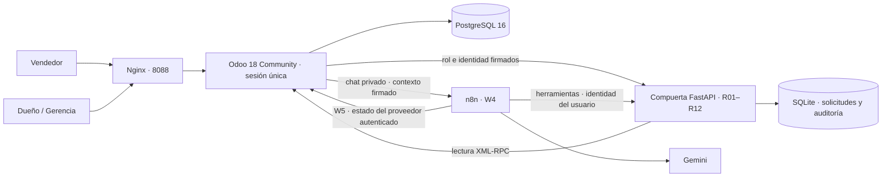

# Arquitectura efectiva · Odoo como interfaz única

Odoo contiene Contactos, CRM (leads y oportunidades), Ventas e Inventario y el addon `mys_erp`. El login y la cookie de sesión siguen siendo los nativos de Odoo. El addon añade una barra lateral Owl, estilo MS Power/MYS, modelos de evaluación/decisión y chat dentro del backend. No usa iframe ni otro login.

## Fuentes y contratos

- **Odoo / PostgreSQL:** contactos, oportunidades, cotizaciones y versiones, ventas confirmadas, reservas, precios y existencias. El lector técnico no tiene permisos de escritura.
- **Compuerta / SQLite:** contrato I03 de nueve referencias, sus cuatro estados, respuestas idempotentes, aceptaciones, autorizaciones por versión y total, escalamientos y auditoría. El motor histórico y sus schemas se preservan.
- **Modelos `mys.evaluation` y `mys.decision`:** reflejan los resultados de la compuerta para mostrarlos en Odoo. `workspace` sincroniza también resultados y solicitudes de revisión originados por herramientas del agente. No sustituyen al registro de decisiones del motor.
- **Modelo `mys.operation.event`:** conserva creación, presentación, aceptación y confirmación/cancelación en la misma transacción Odoo. La trazabilidad combina esos eventos con la bitácora por familia de cotización y los motivos del dueño, limitando el acceso por vendedor y compañía.
- **n8n:** orquesta las herramientas del agente. W4 (chat privado) y W5 (errores del proveedor) están publicados; W1/W2/W3 se conservan despublicados como referencia. No guarda una segunda copia del inventario.

Los 167 productos conservan SKU, fila y hash del Excel suministrado. Las primeras 50 referencias (demostración) equilibran categorías y precios, sin afirmar una clasificación real de ventas; los 8 productos sin categoría en el Excel se clasifican por su descripción y quedan registrados en `datos/procedencia.json`. Los servicios no tienen stock y los cables se venden por metro. Stock, clientes y operaciones son sintéticos. Además se mantienen dos productos y dos reservas de otro cliente del escenario PC3.

## Roles y controles del servidor

El vendedor prepara y acepta cotizaciones de sus oportunidades, solicita evaluaciones y escala excepciones. El dueño accede a los resultados de su compañía y decide con un motivo obligatorio. Las reglas de registros limitan al vendedor a sus evaluaciones/decisiones y al dueño a la compañía activa. El rol no se recibe de un selector del navegador.

Odoo firma un contexto de diez minutos con uid, actor, compañía y rol. La compuerta verifica HMAC, caducidad y compañía. `TOKEN_ODOO` identifica al puente humano; `TOKEN_AGENTE` identifica a las herramientas de n8n y conserva el rol del usuario. El agente tiene prohibidas las operaciones de decisión incluso con rol Gerencia. No recibe herramientas de aprobación.

La firma y los tokens solo existen en servidores. La URL del webhook tampoco se entrega como una interfaz separada. Odoo invoca W4 con una cabecera privada; las herramientas reenvían el contexto firmado. La memoria usa una clave que incluye el uid Odoo y el identificador de conversación.

## Descuentos y versiones

La política por defecto permite 5 %. Una oferta con descuento mayor requiere una autorización humana independiente, vigente, de la misma compañía, versión e importe. Se verifica antes de consultar stock. R08 no puede resolverse con una respuesta generada por el modelo.

Al recibir `DESCUENTO_SIN_APROBACION`, el vendedor solicita una decisión. El dueño dispone de diez minutos para decidir. Aprobar genera una cotización de la versión siguiente con el mismo importe; el vendedor debe prepararla, obtener otra aceptación y evaluarla. Una decisión no transforma el rechazo guardado en aceptación. La familia/version se serializa para evitar duplicados concurrentes.

Una versión evaluada queda inmutable para las cuentas comerciales, incluso vía RPC. Los cambios previos invalidan la aceptación registrada. La versión nueva no hereda aceptaciones, solicitudes ni resultados. `action_confirm` solo permite al vendedor asignado confirmar la oferta vigente, aceptada y evaluada ACEPTADA / VALIDADA. Una autorización mayor al 5 % debe corresponder a la misma versión y total. La acción bloquea el registro, revalida condiciones actuales mediante `/solicitudes/{id}/validar-confirmacion` y ejecuta la confirmación y reserva nativas de Odoo en una sola transacción. Una reserva incompleta revierte la venta. La escritura directa del estado por RPC sigue bloqueada; la excepción interna usa una identidad de Python que no puede construirse desde JSON.

La revalidación ejecuta el mismo motor en una base temporal y registra un evento separado, conservando la respuesta idempotente original. No crea nuevas solicitudes ni señales persistentes. La compuerta y el agente siguen sin escribir pedidos en Odoo; la confirmación es una acción humana explícita. Cotizaciones y Ventas utilizan acciones, listas y búsquedas distintas; comparten criterios de cliente, vendedor y fecha. Confirmar no emite comprobantes ni valida entregas.

Las decisiones de reposición expresan ofrecer parcial, evaluar reposición o descartar. No compran, reservan ni prometen fechas. `PENDIENTE` conserva el identificador y se reanuda cuando la dependencia vuelve.

## Despliegue local

`compose.yaml` conserva el nombre `agente-sie` y sus volúmenes, para reutilizar la instalación anterior. Nginx recibe en 8088 y pasa HTTP y WebSocket a Odoo con `proxy_mode=True`. Las rutas `/api/` del portal anterior responden 404; su backend solo puede habilitarse expresamente para pruebas históricas con `ENABLE_LEGACY_PORTAL=true`.

Los puertos de diagnóstico 8069, 8000 y 5678 están ligados a `127.0.0.1`. Son servicios de una aplicación integrada; el usuario no necesita iniciar sesión en cada uno. El arranque normal actualiza el addon y las cuentas sin refrescar transacciones ni saldos. Los cambios de contraseñas humanas se aplican en Odoo y `.env`; los secretos técnicos son independientes.

Cuando se crea una «Decisión del dueño» (botón del vendedor o sincronización de un escalamiento del chat), Odoo programa una tarea al dueño y le envía un correo con el enlace `/odoo/mys.decision/<id>`; el envío usa el SMTP de `.env` (Mailpit por defecto) y su fallo no impide registrar la excepción.

La consulta de estado Gemini distingue ausencia de clave, rechazo, modelo no disponible, cuota y problemas de red. Una clave verificada no garantiza cuota de generación. La indisponibilidad del chat no interrumpe los módulos nativos ni las reglas deterministas.
