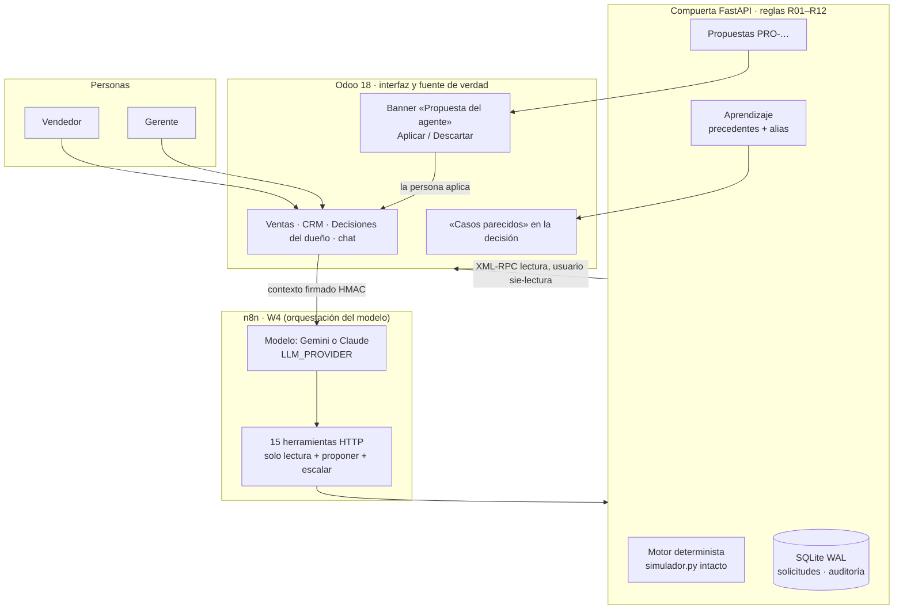

# Arquitectura del Agente SIE · capas, aprendizaje y carga

Complementa [ARQUITECTURA.md](ARQUITECTURA.md). Aquí se describe **cómo trabaja el agente**, **cómo aprende** y **cuánto aguanta**, con números medidos en este equipo (Windows 11, Docker Desktop, todo en una sola máquina).

## 1. Capas y responsabilidades



| Capa | Decide | Nunca hace |
|---|---|---|
| **Persona** (vendedor / gerente) | Aplica propuestas, aprueba o rechaza descuentos, confirma ventas | — |
| **Odoo** | Fuente de clientes, precios, stock y cotizaciones; aplica cambios en una versión nueva | — |
| **Compuerta** | Reglas R01–R12 (motor determinista), idempotencia, bitácora, aprendizaje | Escribir en Odoo |
| **Agente (n8n + modelo)** | Elige qué herramienta usar y redacta la respuesta | Aprobar, confirmar, reservar o modificar una cotización |

El agente **propone** y la persona **decide**. Una propuesta de cambio (`POST /propuestas`) solo trae una vista previa: totales antes y después, y si supera el tope del vendedor. Únicamente un usuario humano desde Odoo puede marcarla APLICADA. La compuerta rechaza con 403 cualquier intento del agente.

## 2. Flujo de un cliente

1. **Lead → oportunidad** (canal de entrada registrado) → cotización `COT-… v1`.
2. El vendedor prepara, presenta y registra la **aceptación** del cliente.
3. **Evaluar reglas** (botón o chat: mismo resultado). El motor devuelve `VALIDADA`, `DESCUENTO_SIN_APROBACION`, `DISPONIBILIDAD_PARCIAL`, `PENDIENTE`…
4. Si el descuento supera el 5 %, se pide una **decisión del dueño**. El gerente la ve en Odoo junto con los **casos parecidos** anteriores. Si aprueba, se genera la v2 y se repite el ciclo.
5. El vendedor confirma la venta. Odoo revalida y reserva stock en una sola transacción.

El chat sirve en todos los pasos para consultar (catálogo, stock, perfil, cotizaciones), analizar un descuento con la secuencia fija de 6 pasos, proponer cambios y escalar. Nunca reemplaza un botón de decisión.

## 3. Aprendizaje (sin reentrenar el modelo)

El sistema aprende **de las decisiones humanas**, no de lo que diga el modelo:

| Qué aprende | De dónde | Dónde se usa |
|---|---|---|
| **Precedentes**: descuento, nivel del cliente, categorías, decisión y motivo | Cada escalamiento DECIDIDO por el gerente (`conocimiento_casos`, sincronización incremental cada ≤30 s) | Herramienta `consultar_precedentes` del agente y bloque «Casos parecidos» en la decisión del gerente |
| **Alias de productos** («el kit de 4 gauge» → `SSK4ANL`) | Solo propuestas **APLICADAS** por una persona (`alias_productos`) | Resolución de productos en nuevas propuestas |
| **Perfil del cliente** (nivel, ticket, categorías, sugerencias) | Cron diario en Odoo con reglas fijas | Herramienta `perfil_cliente` |
| **Puntaje predictivo CRM** (nativo de Odoo) | Cron nocturno que reconstruye la tabla de frecuencias | Probabilidad de las oportunidades |

Los precedentes se muestran como **contexto** («de 12 casos parecidos, 12 aprobados, descuento promedio 10 %») y nunca como una decisión. Un alias solo se aprende si una persona confirmó el producto, así el agente no aprende de sus propios errores. Resumen en vivo: `GET /aprendizaje/resumen`.

## 4. Rendimiento: qué se cambió y por qué

Todas las mejoras salen de mediciones hechas con `scripts/prueba_carga.py`:

| Hallazgo | Cambio | Efecto medido |
|---|---|---|
| Cada lectura de cotización hacía 6–8 viajes XML-RPC a Odoo (≈90 ms c/u) | `web_search_read` con relaciones anidadas: pedido, líneas, cliente y oportunidad en un viaje | Abrir cotización: 6 → 2 viajes (≈1,5 s → 0,3 s). Buscar cotizaciones: 6–8 → 3–5 viajes. **Salida idéntica** (comparada caso por caso) |
| La lista de clientes y el catálogo JSON se releían en cada consulta | Caché de clientes de 60 s y catálogo releído solo si cambia el archivo. **Precios y stock nunca se cachean** | Perfil de cliente: 2 → 1 viaje |
| SQLite en modo `delete`: con varios vendedores, las lecturas bloquean a las escrituras | `journal_mode=WAL` + `synchronous=NORMAL` | Lecturas y escrituras en paralelo |
| WAL dejó visible una **carrera**: dos sesiones del mismo vendedor se pisaban la lista de oportunidades (`NO_AUTORIZADO` en 10 de 80 clientes) | `repo.conexion(exclusiva=True)` (BEGIN IMMEDIATE) en todo «leer y luego escribir»: contexto del vendedor y contadores `ESC-` / `PRO-` | 80/80 correctos. Prueba de regresión que falla sin la corrección |
| El puntaje predictivo nativo de Odoo suma +1 en una tabla global en cada venta ganada: «could not serialize access» entre vendedores | Se omite el incremento en vivo y se activa el cron nocturno nativo que reconstruye la tabla (`models/rendimiento.py`) | 0 conflictos (antes: decenas y 1 venta fallida) |
| El cliente de prueba usaba `localhost` (en Windows prueba IPv6 primero, ≈2 s por conexión) | `127.0.0.1` + cliente HTTP compartido | Medición real de la API |
| Historial de n8n sin límite | `EXECUTIONS_DATA_PRUNE` (7 días / 5000) y SQLite con pool | Base de n8n acotada |

## 5. Resultados de carga (`evidencias/carga/`)

**Flujo completo** (vendedor → aceptación → reglas → gerente → v2), 5 escenarios mezclados: sin descuento, 5 % por volumen, descuento alto con aprobación, falta de stock y descuento sin evidencia.

| Prueba | Clientes | Vendedores en paralelo | Clientes/min | Correctos | Errores |
|---|---|---|---|---|---|
| Línea base (antes) | 40 | 4 | 15,2 | 40/40 | 0 |
| Optimizado | 40 | 4 | 17,6 | 39/40 | 1 (conflicto CRM nativo) |
| Estrés, antes de corregir carreras | 80 | 8 | 31,5 | 64/80 | 0 técnicos, 16 `NO_AUTORIZADO` |
| **Estrés corregido** | **80** | **8** | **29,6** | **80/80** | **0** |

**APIs de consulta** (catálogo, disponibilidad, perfil, buscar cotizaciones, cotización):

| Simultáneas | Solicitudes/s | p50 | p95 | Errores |
|---|---|---|---|---|
| 1 | 5,2 | 0,16 s | 0,40 s | 0 |
| 5 | **9,0** | 0,52 s | 1,06 s | 0 |
| 10 | 8,2 | 1,11 s | 2,14 s | 0 |
| 20 | 6,1 | 2,95 s | 6,18 s | 0 |

Ninguna solicitud falló, ni siquiera con 20 simultáneas. El techo (≈9 sol/s) está en **Odoo**, que corre en modo *threaded* con un solo proceso Python; la compuerta no es el límite.

**Agente** (Gemini `gemini-3.5-flash-lite`): 6/6 respuestas correctas, mediana de 19,5 s y máximo de 36 s. Casi todo ese tiempo son las idas y vueltas al modelo, una por cada herramienta que usa. Para bajarlo:

- `LLM_PROVIDER=anthropic` con `claude-haiku-5-5` ($0.10 / $0.50 por millón de tokens) o `claude-sonnet-5-5` ($2 / $10) para más criterio;
- pensamiento adaptativo con esfuerzo bajo, ya configurado en el nodo.

## 6. Escalar más allá de esta máquina

En orden de impacto:

1. **Odoo con `workers ≥ 2`** (prefork). Requiere pasar el WebSocket del chat por el puerto 8072 en nginx y ~300 MB de RAM por worker. Es el siguiente cuello de botella.
2. **Modelo más rápido** (Claude Haiku) para el chat. No cambia las reglas: el motor es determinista.
3. **PostgreSQL** para la compuerta si se pasa de una sola instancia. Con SQLite WAL alcanza para una tienda: el estrés de 8 vendedores no produjo bloqueos.

## 7. Cómo repetir las pruebas

```powershell
py -3.11 scripts/prueba_carga.py --clientes 40 --concurrencia 4 --api 200 --agente 6 --etiqueta prueba
py -3.11 scripts/prueba_carga.py --clientes 80 --concurrencia 8 --api 0 --agente 0 --semilla 11 --etiqueta estres8
py -3.11 scripts/prueba_carga.py --limpiar      # archiva los clientes CARGA-… creados
```

La prueba crea clientes `CARGA-<hora>-NNN` (no toca los datos de demostración) y guarda el informe JSON en `evidencias/carga/`.
