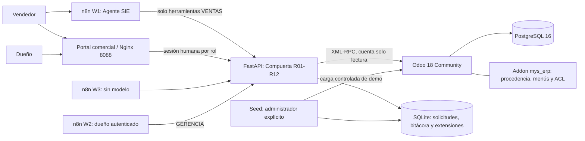

# Arquitectura implementada

## Despliegue local

Las cajas funcionales C01–C08 del informe no son ocho contenedores. Contactos, CRM, Ventas, Inventario y Compras viven en una instancia Odoo. Se conserva la decisión del Agente SIE ya desarrollado: la compuerta C04, las aprobaciones C06 y su bitácora se ejecutan como servicio separado FastAPI/SQLite. La base Odoo/PostgreSQL es la autoridad para contactos, oportunidades, precios, cotizaciones y stock. La extensión SQLite es la autoridad para la decisión del contrato y el seguimiento del agente.

## Componentes y registros

| Responsabilidad | Implementación efectiva | Escritura autorizada |
| --- | --- | --- |
| C01 relación comercial | `crm.lead`, leads y oportunidades Odoo | Personas con rol comercial; seed de demo |
| C02 identidad | `res.partner`; segmento y bandera sintética `mys_*` | Personas autorizadas; seed |
| C03 oferta | `sale.order`, líneas y `client_order_ref` por versión | Ventas en Odoo; seed |
| Aceptación de versión | Tabla `aceptaciones` de compuerta | Operación VENTAS explícita; seed |
| C04 decisión de transición | FastAPI + motor histórico + tablas `requests` y payload | Motor determinista |
| C05 disponibilidad | `stock.quant.quantity - reserved_quantity` en ubicación interna | Inventario Odoo; el agente solo lee |
| C06 aprobación | Tabla `aprobaciones`, ligada a versión, importe y Gerencia | Solo token GERENCIA / sesión del dueño |
| C07 evidencia | `audit` + `audit_ext`, actor/tipo/hora/interfaz/código | Compromiso conjunto del motor y extensiones |
| C08 persistencia | PostgreSQL de Odoo; volumen SQLite de compuerta | Cada servicio sobre su almacenamiento |
| Reposición | `senales_rep`, escalamientos y decisiones | El motor sugiere; dueño decide; no genera compras |
| Conversación IA | Memoria y ejecuciones de n8n | n8n; no es fuente de aprobación |

Las versiones del seed del agente son registros `sale.order` separados referenciados como `COT-... vN`, conservando el desarrollo PC3. Solo la versión no cancelada más alta es vigente. Confirmar un pedido no está conectado a la respuesta de transición en este incremento. No se afirma que este versionado sea nativo de Odoo.

## Recorrido y controles

1. El cliente y la necesidad se registran en Odoo. Las fixtures ya contienen los antecedentes para la demostración.
2. Ventas registra aceptación de una versión exacta.
3. La solicitud I03 contiene exactamente nueve referencias; no admite precios, stock, roles ni un `aprobado=true` enviado por el agente.
4. El adaptador obtiene los datos comerciales desde Odoo. El ID interno de `sale.order.user_id` se mapea al actor autorizado; no es necesario dar al agente acceso general a otros usuarios.
5. El motor evalúa R01–R08. El proveedor de disponibilidad es diferido: **no consulta `stock.quant` hasta R09**, después del descuento. Un reintento recupera la respuesta y no vuelve a consultar stock.
6. R09 distingue dependencia inaccesible de stock cero; R10 informa insuficiencia, con fecha nula; R11 devuelve validación y pedido nulo.
7. Decisión, evento y señal REP se confirman en una misma transacción SQLite. La señal no crea compras.
8. Una excepción se escala al responsable humano. Un formulario autenticado o la sesión del dueño registra su decisión; el texto del chat no la reemplaza.

## Permisos

- **Agente / W1:** credencial HTTP VENTAS; sin herramientas de aprobación ni escrituras XML-RPC.
- **Vendedor humano:** usuario Odoo `ven-demo-01`, sesión Ventas del panel y acceso Basic al chat/W3.
- **Dueño:** usuario Odoo `ger-demo-01`, sesión Gerencia y Basic independiente en W2. Las decisiones vencidas no se aceptan después del plazo de diez minutos.
- **Integración `sie-lectura`:** grupo especial sin heredar el grupo de usuario interno. Las ACL permiten lectura y deniegan crear/editar/borrar. Las reglas restringen contactos demo, cotizaciones COT, oportunidades OPP y stock interno de la compañía.
- **Administrador del seed:** único proceso de inicialización con credencial Odoo de escritura. Esa credencial no se usa como identidad del cliente XML-RPC de producción de la compuerta. Comparte contenedor por conveniencia local: el aislamiento adicional del proceso de carga se contempla para servidor.

La bitácora es de solo inserción por las APIs de aplicación. No se presenta como almacenamiento físicamente inmutable frente a un administrador de base de datos. SHA-256 se usa para idempotencia e integridad, no como firma digital.

## Contrato conservado

Cuatro estados: `ACEPTADA`, `RECHAZADA`, `PROMESA_CONDICIONADA`, `PENDIENTE`. Todos mantienen `order_id = null`. Dinero como cadena de dos decimales; `conditions` como arreglo. El módulo base del simulador y los schemas originales se conservan dentro del paquete.

La unicidad efectiva sigue siendo `(company_id, quotation_id, quotation_version)` para cualquier resultado: corregir una decisión final requiere nueva versión/aceptación/solicitud. `PENDIENTE` se recupera reanudando la misma solicitud. No se aplica la propuesta histórica de unicidad solo para `ACEPTADA`, porque no forma parte del motor actual.

## Continuidad y límites

Los seis escenarios PC3 se conservan. CAT-001/002/003 extienden normal/faltante/descuento a los productos del catálogo. El histórico fuera de `app/` no se usa como dependencia de ejecución; solo una prueba opcional contrasta que el motor no cambió.

Compras está instalado como módulo de Odoo para continuidad de P2P y el proveedor demo existe. No se generan órdenes de compra, recepciones o facturas desde el agente. La facturación electrónica UBLHUB queda como siguiente integración.

Referencias técnicas: [Odoo 18, API externa](https://www.odoo.com/documentation/18.0/developer/reference/external_api.html), [imagen oficial Odoo](https://hub.docker.com/_/odoo), [Docker Compose y nombre del proyecto](https://docs.docker.com/compose/how-tos/project-name/), [autenticación del formulario n8n](https://docs.n8n.io/integrations/builtin/core-nodes/n8n-nodes-base.formtrigger/).
