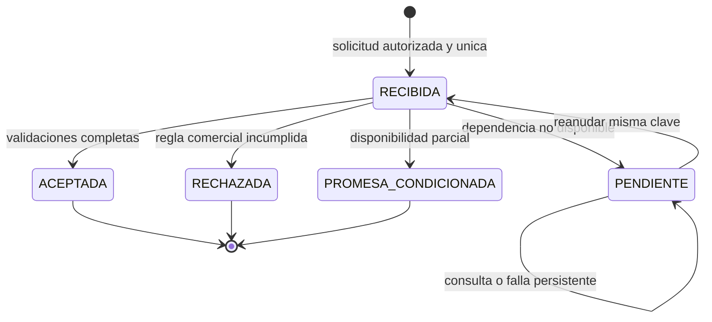

# Contrato de transición CRM–ERP · versión 1.0

**Base:** [componentes C01–C08](../crm-erp-pc2.md). **Autoría asistida:** Codex; revisión propuesta de Gabriel y Jharolym pendiente. **Fecha:** 15/10/2026.  
Especificación funcional y de datos. Los nombres de operación son conceptuales: no son endpoints de Odoo ni métodos ya publicados.

## 1. Límite y condiciones del caso

La entrada I03 solicita evaluar una cotización aceptada. C04 devuelve una decisión con trazabilidad. El contrato **no confirma `sale.order` ni crea otro registro para duplicar la cotización**. `order_id = null` en todas las respuestas de PC2; `ACEPTADA` autoriza continuar posteriormente, sujeto a revalidación. No hay reserva, cobro, comprobante ni llamada a UBLHUB.

Reglas del negocio y parámetros comerciales son supuestos S-01 a S-09 del [registro de fuentes y supuestos](../../fuentes/pc2.md). Los formatos, unicidad y controles son decisiones de diseño D-PC2, no capacidades instaladas.

## 2. Contratos de las siete interfaces

| ID / operación | Entrada confiable y emisor | Salida / proveedor | Errores y mutaciones permitidas |
| --- | --- | --- | --- |
| **I01** `resolver_cliente` | C01: compañía de sesión y referencia de contacto autorizada | C02: `customer_id`, activo y coincidencia revisada | Coincidencia ambigua: revisión de Ventas. Puede crear ficha solo tras búsqueda y autorización; no crea pedido |
| **I02** `preparar_cotizacion` | C01: oportunidad, cliente, SKU, cantidad y campaña; precios consultados en C03 | C03: `quotation_id`, `quotation_version`, estado, líneas, total y vigencia | Producto/precio inválido: corregir. Crea/actualiza cotización; cada cambio relevante incrementa versión e invalida aceptación/aprobación anterior |
| **I03** `solicitar_transicion` / `consultar_transicion` | C01: solicitud según JSON Schema; actor autenticado fuera del payload | C04: respuesta según JSON Schema y estado persistido | Sin acceso: `NO_AUTORIZADO`. Conflicto de clave: `IDEMPOTENCIA_CONFLICTO`. Solo crea/consulta solicitud y bitácora |
| **I04** `leer_snapshot` | C04: compañía, oportunidad, cliente, cotización y versión | C03: snapshot comercial, aceptación y versión de catálogo/precio | Vínculos distintos, caducidad o versión obsoleta: rechazo. Lectura sin cambiar líneas ni confirmar pedido |
| **I05** `consultar_disponibilidad` | C04: compañía, ubicación y SKUs/cantidades de I04 | C05: cantidad disponible, ubicación y hora de observación | Stock parcial: promesa condicionada; proveedor no disponible: pendiente. Lectura sin reserva ni salida |
| **I06** `verificar_aprobacion` | C04: cotización, versión, vendedor, total y descuento de I04 | C06: decisión registrada por gerencia, ámbito y vigencia | Sin aprobación, autoaprobación o aprobación de otra versión: rechazo. No acepta un booleano del solicitante; no aprueba desde C04 |
| **I07** `autorizar_y_auditar` | C01–C06: identidad de sesión, operación y referencias | C07: autorización y evento con actor, hora, interfaz y código | Denegación bloquea la acción. No escribe cuerpos sensibles completos; no modifica permisos ni decisiones comerciales |

I01 e I02 son preparación humana/asistida; las fixtures representan sus resultados. El simulador ejecuta I03–I07 con proveedores locales controlados, no los módulos Odoo. `consultar_transicion(company_id, request_id)` comprueba acceso por compañía y oportunidad antes de devolver un resultado. Una referencia de conversación no sirve como clave única: puede generar varias cotizaciones legítimas.

## 3. Mensaje I03 y validación estructural

[JSON Schema de solicitud](solicitud-pedido-v1.schema.json) y [JSON Schema de respuesta](respuesta-pedido-v1.schema.json). UTF-8, nombres y enum sensibles a mayúsculas. Se rechazan campos adicionales. El payload tiene solo referencias; no admite actor, rol, precio, stock ni indicador de aprobación.

```json
{
  "contract_version": "1.0",
  "company_id": "MYS-DEMO",
  "request_id": "SOL-DEMO-001",
  "correlation_id": "COR-DEMO-001",
  "opportunity_id": "CRM-DEMO-001",
  "customer_id": "CLI-DEMO-001",
  "quotation_id": "COT-DEMO-001",
  "quotation_version": 1,
  "acceptance_id": "ACE-DEMO-001"
}
```

| Campo | Regla | Fuente / control |
| --- | --- | --- |
| `contract_version` | Exactamente `1.0` | Incompatibilidad rechazada antes de decidir |
| `company_id` | Identificador de compañía autorizada | Se compara con sesión y todos los maestros |
| `request_id` | Único por compañía, estable durante reintentos | Clave de idempotencia; máximo 64 caracteres |
| `correlation_id` | Referencia estable del recorrido | Une oportunidad, solicitud y eventos; no es clave de deduplicación |
| `opportunity_id` | Oportunidad existente y asignada al vendedor | C01 / permisos por registro |
| `customer_id` | Cliente existente, activo y con coincidencia resuelta | C02 / no se exige documento personal en la evidencia |
| `quotation_id` | Cotización de C03 de la misma compañía, cliente y oportunidad | No puede sustituirse por otra cotización con precio parecido |
| `quotation_version` | Entero positivo; versión vigente | Bloquea aceptación o aprobación obsoleta |
| `acceptance_id` | Aceptación registrada de esa cotización y versión | Fuente confiable I04; cambiar condiciones exige nueva aceptación |

Los identificadores admiten letras ASCII, números, guion y guion bajo. El cliente no genera la compañía ni el actor efectivos: el servidor los contrasta con su contexto autorizado. Dinero en snapshots y respuestas usa cadenas decimales de dos posiciones y operaciones `Decimal`; nunca flotantes binarios. Moneda didáctica `PEN`; el precio final del ejemplo no modela impuestos ni emite documentos fiscales.

## 4. Orden de evaluación y reglas

| Regla | Comprobación / resultado | Fuente o decisión |
| --- | --- | --- |
| R01 | Estructura conforme al schema; si falla `CONTRATO_INVALIDO` | D-PC2-03 |
| R02 | Actor de sesión con rol Ventas, compañía y oportunidad asignada; de lo contrario `NO_AUTORIZADO` | D-PC2-04; F-PC2-06 |
| R03 | Misma clave + mismo payload: devuelve estado existente; distinto payload: `IDEMPOTENCIA_CONFLICTO` | D-PC2-05 |
| R04 | Otra clave para la misma compañía/cotización/versión: `COTIZACION_YA_EVALUADA` | D-PC2-05 |
| R05 | Cliente activo, coincidencia resuelta y vínculos coherentes | D-PC2-04 |
| R06 | Versión actual, estado de cotización `sent`, vigencia y aceptación exacta válidos | D-PC2-06; S-04 |
| R07 | Líneas con SKU activo, cantidad positiva, precio y moneda de catálogo, descuento 0–100 y total recalculado | D-PC2-03; S-02 |
| R08 | Descuento hasta 5 % permitido; superior requiere decisión de Gerencia distinta del vendedor y de esa versión/total | S-03; D-PC2-07 |
| R09 | Consultar disponibilidad; si el proveedor falla, `PENDIENTE` sin prometer stock | D-PC2-08 |
| R10 | Disponible menor que solicitado: `PROMESA_CONDICIONADA`, sin fecha comprometida inventada | S-05; D-PC2-08 |
| R11 | Todos los controles superados: `ACEPTADA`, `VALIDADA`, sin efectos operativos | D-PC2-01 |
| R12 | Guardar decisión y eventos atómicamente; no borrar historial | D-PC2-05 |

R01–R02 se comprueban antes de leer resultados idempotentes. En reintento de un estado final se devuelve el resultado original, aunque posteriormente cambien precios o stock: es evidencia histórica, no una nueva autorización operativa. En producción la decisión final se debe vincular a un snapshot bloqueado/versionado, y revalidarse antes de confirmar el pedido. Las reglas se aplican en este orden; un descuento no aprobado se rechaza antes de ofrecer disponibilidad parcial.

## 5. Estados, eventos y recuperación

| Estado | Significado | Evento / siguiente paso | Responsable |
| --- | --- | --- | --- |
| `RECIBIDA` | Evento interno tras admitir la solicitud | Validar R05–R10; no es una respuesta final de I03 | C04 |
| `PENDIENTE` | No se pudo consultar una dependencia; no hay decisión comercial | Consultar misma clave; recuperar servicio y reanudar misma solicitud | Administrador + Ventas |
| `ACEPTADA` | Solicitud validada para continuar después | Informar al vendedor; pedido operativo pendiente | Ventas |
| `RECHAZADA` | Regla incumplida, con código y acción | Corregir cotización; nueva versión, aceptación y solicitud | Ventas / Gerencia |
| `PROMESA_CONDICIONADA` | Se ofrece revisar cantidad o plazo por disponibilidad insuficiente | Cliente acepta nuevas condiciones documentadas; nueva cotización/versionado y solicitud | Ventas / Almacén / Cliente |



`RECIBIDA` vive en la bitácora y dentro de la transacción; si el proceso cae antes del commit, el reintento no encuentra una decisión parcial. Una solicitud pendiente sí se persiste. Solo esa solicitud puede reanudarse; sus parámetros no se cambian. Si la cotización cambió entretanto, la reanudación la rechaza por versión. El simulador ofrece `submit`, `get` y `resume` bajo el mismo contexto de Ventas; administración recupera la dependencia y no se atribuye permisos comerciales.

## 6. Respuestas y excepciones

Todas las respuestas incluyen versión, referencias recibidas, estado, código, mensaje, responsable, acción, total/moneda cuando estén validados y `order_id: null`. Los errores estructurales pueden devolver referencias `null` porque no existe una solicitud válida. Para interoperabilidad HTTP futura se podrán mapear los códigos a estados de transporte; **no se fija una API HTTP en PC2**.

| Código | Estado | Acción |
| --- | --- | --- |
| `VALIDADA` | ACEPTADA | Continuar posteriormente con confirmación controlada |
| `DESCUENTO_SIN_APROBACION` | RECHAZADA | Gerencia decide; Ventas genera nueva versión y aceptación |
| `DISPONIBILIDAD_PARCIAL` | PROMESA_CONDICIONADA | Revisar cantidad/plazo con cliente; no reservar ni fijar fecha sin evidencia |
| `DEPENDENCIA_NO_DISPONIBLE` | PENDIENTE | Recuperar dependencia, consultar y reanudar misma solicitud |
| `CONTRATO_INVALIDO` / `NO_AUTORIZADO` | RECHAZADA | Corregir formato o acceso; no consume clave ni crea registro comercial |
| `IDEMPOTENCIA_CONFLICTO` | RECHAZADA | Consultar original; no reemplazar payload ni decisión almacenada |
| `COTIZACION_YA_EVALUADA` | RECHAZADA | Consultar la solicitud original; no crea segunda evaluación |
| `DATOS_INCONSISTENTES` / `CLIENTE_NO_VALIDADO` | RECHAZADA | Corregir vínculos/cliente bajo permisos |
| `VERSION_OBSOLETA` / `COTIZACION_NO_ENVIADA` / `COTIZACION_VENCIDA` | RECHAZADA | Preparar y aceptar versión vigente |
| `ACEPTACION_INVALIDA` / `PRECIO_INVALIDO` | RECHAZADA | Revisar evidencia comercial y recalcular desde catálogo |

En promesa, `conditions` incluye SKU, cantidad solicitada/disponible, `promised_date: null` y `requires_customer_acceptance: true`. `PENDIENTE` no ofrece estas condiciones porque aún no hay lectura confiable de stock.

## 7. Concurrencia, auditoría y datos

- Huella: SHA-256 del JSON completo con claves ordenadas y versión normalizada a entero (`1` y `1.0` son equivalentes según JSON Schema), sin campos de identidad suministrados por el cliente. La identidad efectiva se audita aparte.
- SQLite en simulación usa transacción `BEGIN IMMEDIATE`, PK de clave idempotente y restricción única de cotización/versión. En Odoo se deberá implementar el equivalente transaccional en PostgreSQL; una búsqueda seguida de un alta sin restricción no basta.
- Una solicitud final es inmutable. Repetirla agrega un evento `REINTENTO` y devuelve la misma decisión. Un conflicto agrega evidencia y conserva intacta la decisión original.
- El resultado de negocio y sus eventos se confirman juntos. Formato/autorización inválidos no crean solicitud; solo eventos mínimos de denegación, sin cuerpos sensibles.
- La identidad/rol de gerencia se consulta en el proveedor de aprobaciones; el payload no puede fabricarlos. La sesión comercial no puede aprobar sus propios descuentos.
- No se ingresan conversaciones reales, DNI, RUC de clientes, teléfonos ni credenciales. Se usan referencias sintéticas. En producción falta aprobar retención, acceso a logs y copias de seguridad.

## 8. Evidencia y límites de implementación

La [simulación reproducible](../../pruebas/pc2/README.md) valida reglas, mensajes y persistencia local. No instala Odoo, no configura ACL reales, no confirma `sale.order` y no valida disponibilidad concurrente del almacén real. Para cerrar implementación se requiere configurar CRM/Contactos/Ventas/Inventario, desarrollar la extensión, verificar seguridad por cada vía de entrada, versionado, restricciones y auditoría, y ejecutar casos en Odoo con evidencia revisada por el equipo.
