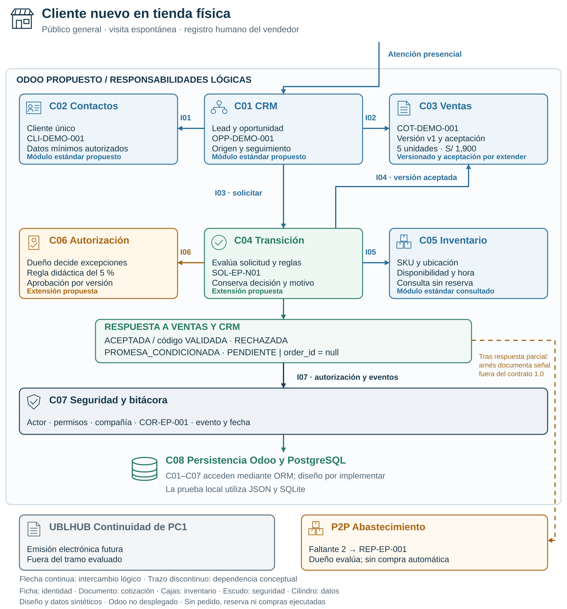
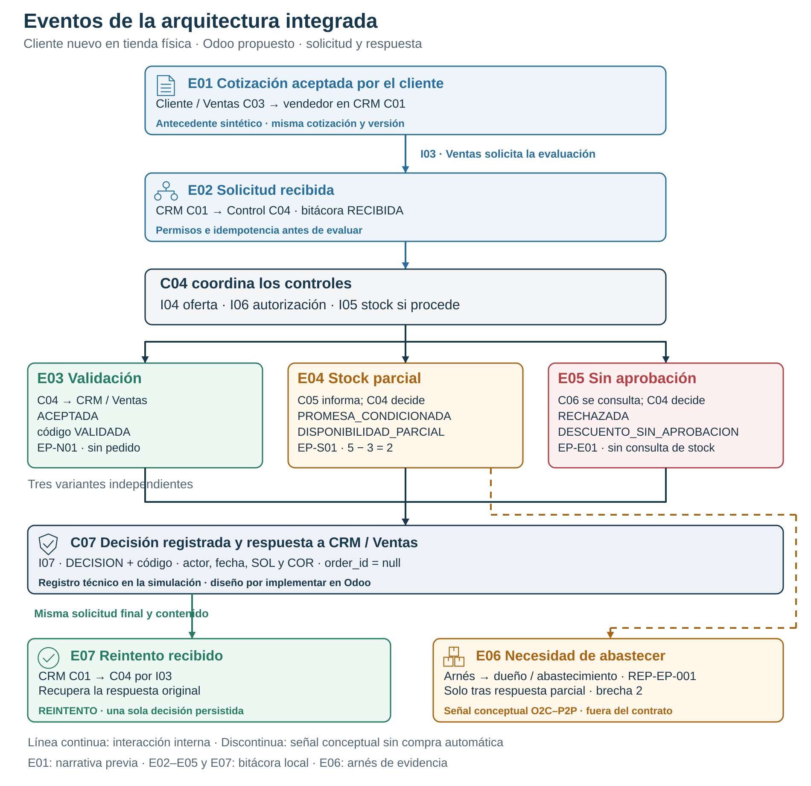
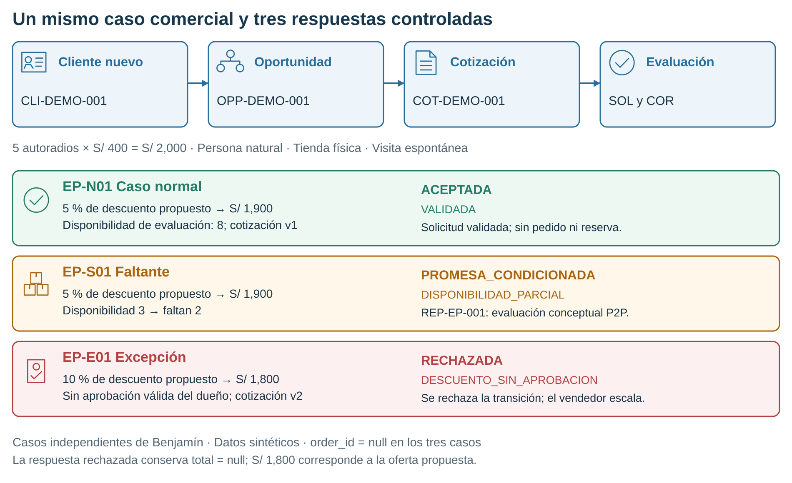

# Arquitectura integrada para el examen parcial

**Empresa:** IMPORTACIONES MYS HERMANOS S.A.C.  
**Responsable:** Jharolym Friendly Paucarcaja Ramos.  
**Versión:** EP 1.0 · 22/10/2026 · contrato de referencia 1.0.  
**Escenario:** cliente nuevo del público general, atención en tienda física y visita espontánea.  
**Estado:** diseño documentado y evidencia local compartida; revisión de Jharolym pendiente.

## Decisión y alcance

Proponemos mantener Odoo como plataforma integrada para identificar al cliente, registrar su necesidad y conservar una cotización vinculada a la oportunidad. Contactos, CRM, Ventas e Inventario mantienen responsabilidades propias; el control de transición consulta esos registros y conserva una respuesta motivada. Compartir plataforma no elimina la necesidad de definir quién mantiene cada dato y quién autoriza una excepción.

El caso conserva el incremento comercial delimitado en [PC2 v2.1](../documentos/pc2/entrega-pc2.md): una persona natural nueva del público general llega al local por visita espontánea y consulta cinco autoradios para uso final. El vendedor busca coincidencias antes de registrar `CLI-DEMO-001`, documenta la necesidad y relaciona `OPP-DEMO-001` con `COT-DEMO-001 v1`. El uso en vehículos familiares es un supuesto académico; la cantidad por sí sola no acredita reventa.

PC2 desarrolla el tramo comercial previo al pedido. En el parcial se ubican la solicitud, sus controles y la respuesta siguiendo el [recorrido de Benjamín](../documentos/ep/benjamin/aporte-benjamin.md). La evaluación termina en esa respuesta: `ACEPTADA` con código `VALIDADA` conserva `order_id = null`. La confirmación del pedido, reserva, compra, facturación, cobro y entrega corresponden a incrementos posteriores.

## Continuidad de las decisiones

| Elemento | Decisión conservada o precisada | Efecto sobre esta arquitectura |
| --- | --- | --- |
| Núcleo de PC1 | Odoo integrado; UBLHUB para emisión futura | Un mismo entorno lógico para las responsabilidades comerciales; emisión fuera del caso |
| Cliente de PC2 | Público general nuevo y persona natural | Búsqueda previa y datos mínimos autorizados en Contactos |
| Canal y origen de PC2 | Tienda física y visita espontánea | Registro humano por Ventas; sin atribuir campaña al ejemplo |
| Gestión comercial de PC2 | Lead, oportunidad, seguimiento y cotización versionada | CRM conserva la gestión; Ventas mantiene la oferta |
| Parcial | Solicitud, controles y respuesta trazables | C04 coordina consultas a Ventas, Inventario y autorizaciones |
| Relación O2C–P2P | Un faltante requiere evaluar abastecimiento | Señal conceptual vinculada a la necesidad; sin orden de compra |

La [arquitectura técnica anterior](crm-erp-pc2.md) conserva los identificadores C01–C08 e I01–I07 y sus decisiones de diseño. Esta vista aplica esos identificadores al escenario presencial vigente; no cambia el contrato 1.0 ni modifica el simulador histórico.

## Diagrama lógico con módulos e iconos



**Figura 2.1.** Las cajas representan responsabilidades, no servidores diferentes. Ficha: identidad; red: CRM; documento: cotización; cajas: inventario; aprobación: decisión del dueño; escudo: seguridad; cilindro: persistencia. Los colores y las etiquetas complementan los iconos. El trazo discontinuo identifica la dependencia conceptual de abastecimiento.

[Fuente Mermaid](diagramas/componentes-crm-erp-ep.mmd) · [Generador SVG](diagramas/generar_diagramas_ep.py). El SVG es una composición nativa con iconos; Mermaid documenta su semántica y no pretende reproducir exactamente su disposición.

## Módulos y sistemas de registro

| ID | Responsabilidad y registro de referencia | Naturaleza y límite |
| --- | --- | --- |
| C01 CRM | Lead, oportunidad, origen presencial, necesidad y siguiente actividad; `crm.lead` | Módulo estándar propuesto; etapas por configurar |
| C02 Contactos | Identidad única del cliente y datos de contacto necesarios y autorizados; `res.partner` | Estándar propuesto; deduplicación por validar |
| C03 Ventas y catálogo | Cotización, líneas, moneda, precio y vínculo con oportunidad; `sale.order` y `sale.order.line` | Base estándar; versionado y evidencia de aceptación requieren extensión |
| C04 Control de transición | Solicitud, versión del contrato, huella del mensaje, estado y resultado; diseño `mys.crm.transition` | Extensión propuesta; evaluación representada por el simulador local |
| C05 Inventario | Disponibilidad por SKU y ubicación, con fuente y fecha de consulta | Lectura propuesta; sin reserva ni movimientos físicos |
| C06 Autorizaciones | Decisión del dueño vinculada a cotización, versión, importe y aprobador; diseño `mys.discount.approval` | Extensión propuesta; autorización humana independiente |
| C07 Seguridad y bitácora | Identidad de sesión, permisos, compañía y eventos correlacionados; diseño `mys.transition.event` | Accesos y bitácora específica por implementar y probar en Odoo |
| C08 Persistencia | Registros, unicidad y transacciones de Odoo/PostgreSQL mediante ORM | Arquitectura objetivo; JSON y SQLite solo representan la prueba local |

CRM relaciona la oportunidad con la oferta; Ventas conserva la cotización. Una futura confirmación cambia el estado del registro de Ventas: no corresponde duplicar la cotización como otro pedido. Los modelos `mys.*`, el versionado y el control obligatorio de la transición son decisiones del proyecto, no funciones implantadas que la simulación acredite.

## Interfaces y controles

| ID | Consumidor → proveedor | Intercambio y control |
| --- | --- | --- |
| I01 | CRM → Contactos | Resolver la identidad y vincular el cliente; una coincidencia ambigua requiere revisión |
| I02 | CRM → Ventas | Preparar o vincular la cotización y su versión, conservando líneas y precios |
| I03 | CRM → Control de transición | Solicitar o consultar la evaluación con SOL y COR, referencias, permisos e idempotencia |
| I04 | Control de transición → Ventas | Leer la versión aceptada, vigencia, importes y vínculos desde el registro confiable |
| I05 | Control de transición → Inventario | Consultar SKU, ubicación, disponibilidad y hora; consultar no reserva unidades |
| I06 | Control de transición → Autorizaciones | Verificar una decisión válida del dueño para la misma versión e importe |
| I07 | C01–C06 → Seguridad y bitácora | Autorizar y registrar actor, compañía, interfaz, evento, motivo y correlación |

Son intercambios funcionales internos del Odoo propuesto. El [contrato 1.0](contratos/crm-erp-v1.md) detalla las entradas, salidas y restricciones; Gabriel desarrolla su defensa. La identidad del actor proviene de la sesión y no de un rol enviado por el solicitante. Los importes y el stock se contrastan con los registros confiables, no con valores declarados libremente en I03.

La arquitectura sostiene estas reglas:

1. **Versión y aceptación:** evaluar la oferta vigente que el cliente aceptó. Cambiar cantidad, descuento o condiciones exige otra versión y nueva aceptación.
2. **Autorización independiente:** el vendedor solicita una excepción; la aprobación del dueño queda vinculada a la oferta. No existe autoaprobación del vendedor.
3. **Disponibilidad fechada:** leer existencias no garantiza disponibilidad futura. Una confirmación posterior deberá revalidarla.
4. **Respuesta motivada:** conservar estado, código, responsable y acción siguiente. `PENDIENTE` por dependencia inaccesible no equivale a stock cero.
5. **Reintento:** la misma solicitud y contenido recuperan la respuesta persistida; no duplican la decisión. SOL identifica la solicitud; COR une los eventos del recorrido.

## Eventos que articulan la arquitectura

Un evento expresa un hecho ocurrido; la interfaz indica cómo se consulta o solicita una acción y el estado describe el resultado conservado. Por ejemplo, **solicitud recibida** es el hecho, I03 transporta la solicitud y `ACEPTADA` es un posible estado de respuesta. Esta vista muestra qué activa cada interacción y quién debe atenderla dentro de la plataforma integrada propuesta.

Los identificadores E01–E07 son etiquetas documentales para la exposición; no agregan campos ni operaciones al contrato 1.0. La columna de evidencia distingue la narrativa del recorrido, los registros realmente producidos por el simulador y la señal conceptual hacia P2P.

| ID / hecho ocurrido | Origen y destinatario | Acción que habilita y control | Evidencia y alcance |
| --- | --- | --- | --- |
| E01 · Cotización aceptada por el cliente | Cliente / Ventas C03 → vendedor en CRM C01 | El vendedor puede solicitar la evaluación por I03; C04 verifica por I04 la aceptación de la misma cotización y versión | `ACE-EP-001` para v1; antecedente sintético del recorrido, no evento ejecutado por el simulador |
| E02 · Solicitud recibida | CRM C01 → Control de transición C04, por I03 | Comprobar identidad, permisos e idempotencia; consultar oferta y controles | Bitácora `event_type = RECIBIDA`, `code = RECIBIDA`; casos EP-N01, EP-S01 y EP-E01 |
| E03 · Evaluación terminada con validación | Control C04 → CRM / Ventas; registro en C07 por I07 | Comunicar `ACEPTADA` / `VALIDADA`; confirmación operativa posterior pendiente | Bitácora `DECISION` / `VALIDADA` en EP-N01; `order_id = null` |
| E04 · Evaluación terminada con disponibilidad parcial | Inventario C05 informa por I05; C04 → CRM / Ventas | Comunicar `PROMESA_CONDICIONADA` / `DISPONIBILIDAD_PARCIAL`; revisar cantidades o condiciones con el cliente | Bitácora `DECISION` / `DISPONIBILIDAD_PARCIAL` en EP-S01; 5 solicitadas, 3 disponibles, brecha 2 |
| E05 · Evaluación terminada por descuento sin aprobación | Autorizaciones C06 se consulta por I06; C04 → CRM / Ventas | Comunicar `RECHAZADA` / `DESCUENTO_SIN_APROBACION`; escalar al dueño y corregir la oferta según su decisión | Bitácora `DECISION` / `DESCUENTO_SIN_APROBACION` en EP-E01; ocurre antes de consultar inventario |
| E06 · Necesidad de abastecimiento identificada | Arnés de evidencia tras la respuesta parcial → dueño / abastecimiento, como relación conceptual O2C–P2P | Evaluar el faltante con producto, ubicación y referencias; la señal no autoriza una compra | `REP-EP-001` en EP-S01; fuera del contrato 1.0, `automatic_action = false` |
| E07 · Solicitud final repetida | CRM C01 → Control C04, por I03 | Recuperar la respuesta original con la misma clave y contenido; conservar una sola decisión | Bitácora `REINTENTO` y código original en las tres variantes; no vuelve a evaluar ni confirma pedido |



**Figura 2.2.** Eventos E01–E07, responsables y respuestas. Las ramas son variantes independientes. El trazo discontinuo representa la señal conceptual de abastecimiento. [Fuente Mermaid](diagramas/eventos-crm-erp-ep.mmd) · [PNG para Word](diagramas/eventos-crm-erp-ep.png).

Este flujo complementa el diagrama de componentes y muestra las tres variantes del ejemplo; el estado `PENDIENTE` y su recuperación siguen definidos en el contrato. C07 conserva los eventos técnicos con `event_id`, `company_id`, `request_id`, `correlation_id`, `actor_id`, `interface_id`, `event_type`, `code` y `occurred_at`. SOL identifica la solicitud; COR permite seguir el recorrido. La decisión y su bitácora se guardan atómicamente según el diseño.

La arquitectura representa solicitudes, respuestas y registros de hechos dentro de Odoo; no presupone un bus de mensajes instalado. E01 es un antecedente del caso y E06 una señal conceptual: no deben presentarse como eventos emitidos por el simulador. Esta sección explicita la relación entre eventos e integración; el cumplimiento literal debe contrastarse con la rúbrica oficial, cuya revisión no se acredita en los insumos de este aporte.

## Aplicación al recorrido de Benjamín



**Figura 2.3.** Las tres ramas son corridas independientes de la misma recreación académica. El generador lee los resultados existentes de Benjamín y los contrasta con las expectativas de sus fixtures. No vuelve a ejecutar ni altera el simulador.

| Caso | Datos del ejemplo | Punto de control | Respuesta y siguiente acción |
| --- | --- | --- | --- |
| EP-N01 | 5 × S/ 400 = S/ 2,000; 5 % = S/ 1,900; disponibilidad 8; v1 | C04 lee la oferta de C03 y consulta C05/C06 | `ACEPTADA` / `VALIDADA`; `order_id = null`; comunicar evaluación validada |
| EP-S01 | Misma oferta; disponibilidad 3; déficit 2 | C05 informa la restricción; C04 devuelve disponibilidad parcial | `PROMESA_CONDICIONADA` / `DISPONIBILIDAD_PARCIAL`; revisar condiciones |
| EP-E01 | v2 solicita 10 %: S/ 1,800; sin aprobación | C06 no acredita autorización válida; se rechaza antes de consultar inventario | `RECHAZADA` / `DESCUENTO_SIN_APROBACION`; escalar al dueño |

En EP-E01, S/ 1,800 es el total **propuesto en la cotización**, no un importe validado por la respuesta: esa respuesta conserva `total = null` y `currency = null`. `ACEPTADA` es un estado y `VALIDADA` su código; no son dos etapas sucesivas ni equivalen a aceptación del cliente o pedido confirmado.

### Dependencia de abastecimiento

En EP-S01, el arnés de evidencias documenta `REP-EP-001` después de leer la respuesta parcial. Conserva producto, ubicación, cantidades, oportunidad, solicitud y fuente del snapshot. Es una **señal conceptual fuera del contrato 1.0**, no una operación emitida por un módulo Compras instalado. `automatic_action = false`; orden de compra, reserva y fecha prometida permanecen nulas.

El dueño y abastecimiento evalúan esa necesidad antes de decidir cantidades, proveedor o plazo. Dos unidades faltantes no determinan automáticamente cuánto comprar. Una recepción futura podría actualizar inventario, como contexto del O2C/P2P completo.

## Datos y evidencias compartidas

El caso normal conserva la cadena `CLI-DEMO-001 → LEAD-EP-001 → OPP-DEMO-001 → COT-DEMO-001 v1 → ACE-EP-001 → SOL-EP-N01`, con `COR-EP-001`. EP-E01 usa v2 y `ACE-EP-002`. La matriz detallada de [datos y controles de Benjamín](../documentos/ep/benjamin/aporte-benjamin.md#11-datos-controles-e-interfaces-del-recorrido) describe responsables y fallas por momento.

| Evidencia existente | Qué permite revisar |
| --- | --- |
| [Panel de Benjamín](../documentos/ep/benjamin/panel-benjamin.html) | Mapa, línea de tiempo y navegación de los casos |
| [EP-N01](../pruebas/ep-benjamin/evidencias/EP-N01.json) | Respuesta normal, correlación y reintento |
| [EP-S01](../pruebas/ep-benjamin/evidencias/EP-S01.json) | Disponibilidad parcial y señal conceptual P2P |
| [EP-E01](../pruebas/ep-benjamin/evidencias/EP-E01.json) | Rechazo por falta de aprobación |
| [Ejecución registrada](../pruebas/ep-benjamin/evidencias/ejecucion.json) | Insumos, hashes, entorno y fecha real de ejecución |
| [Resultados](../pruebas/ep-benjamin/evidencias/resultados.md) | Esperado frente a observado y comprobaciones ejecutadas |

Las evidencias existentes reportan tres casos y 112 comprobaciones. La integración de este aporte no vuelve a atribuir esas pruebas a Jharolym ni demuestra un despliegue en Odoo. Los límites y parámetros se detallan en el [registro de fuentes del aporte](../fuentes/ep-jharolym.md).

## Reproducción y revisión

Desde la raíz del repositorio, con Python 3 y solo biblioteca estándar:

```powershell
python arquitectura/diagramas/generar_diagramas_ep.py
python arquitectura/diagramas/generar_diagramas_ep.py --check
```

El primer comando regenera los tres SVG. El segundo comprueba su vigencia frente al generador, la coherencia de las evidencias y el XML de los gráficos sin modificar archivos. Si se cambian fixtures, seguir primero la [reproducción de Benjamín](../pruebas/ep-benjamin/README.md), revisar las nuevas evidencias y después regenerar los diagramas.

La [sección para la exposición](../documentos/ep/jharolym/aporte-jharolym.md) contiene el texto integrado, contribución, guion y preguntas de defensa. Odoo, permisos reales, PostgreSQL y concurrencia permanecen por validar; el criterio del parcial es defender el diseño y sus evidencias locales.
