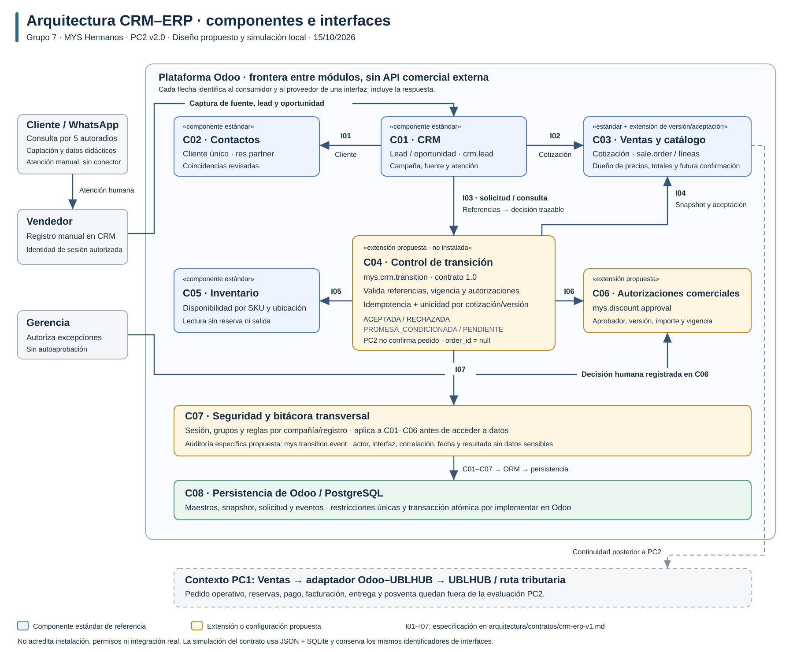

# Arquitectura CRM–ERP · PC2, revisión de Semana 6

**Grupo 7 · IMPORTACIONES MYS HERMANOS S.A.C. · PC2 v2.1 · 16/10/2026.**
Propuesta y simulación local; sin instalación de Odoo acreditada. Base académica: `GE703_S6_Presentacion.pdf`, pp. 9, 11, 14–19, 21 y 31. El PDF orienta el diseño; la rúbrica fija el cierre evaluable en solicitud/respuesta.

## 1. Componentes de Odoo y sistemas externos

[Fuente Mermaid editable](diagramas/componentes-crm-erp-pc2.mmd). La vista muestra responsabilidades e interacciones dentro de una misma plataforma. Las flechas no implican microservicios, endpoints REST ni servidores separados.

| Componente Odoo | Responsabilidad y sistema de registro | Estándar / adaptación propuesta |
| --- | --- | --- |
| **CRM** | Fuente/campaña, lead, oportunidad, vendedor y seguimiento (`crm.lead`) | Estándar por configurar; proyección de la decisión y tarea de atención propuestas |
| **Contactos** | Ficha única del cliente (`res.partner`), identidad y canal autorizado | Estándar; revisión de coincidencias y evidencia de finalidad/canal/vigencia por definir |
| **Ventas** | Cotización y líneas (`sale.order`), producto/precio, aceptación, solicitud y decisión | Cotización estándar; snapshot/versionado, control de solicitud y aprobación específica por desarrollar dentro de Ventas |
| **Inventario** | Disponibilidad por producto, compañía y ubicación | Estándar por configurar; consulta sin reserva ni movimiento en PC2 |

La integración funcional CRM–Ventas se apoya en las cotizaciones asociadas a oportunidades de Odoo. La cotización y el futuro pedido corresponden al mismo `sale.order`; no se crea un segundo pedido para representar la transición. Referencias oficiales: [cotizaciones](https://www.odoo.com/documentation/19.0/applications/sales/sales/sales_quotations.html) y [crear cotizaciones](https://www.odoo.com/documentation/19.0/applications/sales/sales/sales_quotations/create_quotations.html).

Permisos, aprobación y trazabilidad son **controles internos transversales**. Gerencia es un actor que decide; no se dibuja como aplicación. El almacenamiento mediante ORM/PostgreSQL es un detalle de despliegue. La revisión sustituye la antigua descomposición C01–C08; las funciones de control y aprobación se agrupan en Ventas, sin inventar aplicaciones instaladas.

| Elemento fuera de Odoo | Tipo / interacción | Alcance |
| --- | --- | --- |
| **WhatsApp móvil** | Canal externo atendido por el vendedor, quien registra manualmente el contexto y la aceptación | Origen del caso PC2; sin conector ni API automática |
| **Adaptador Odoo–UBLHUB** | Componente propio de integración: mapeo, correlación, autenticación y reintentos | Propuesta de PC1, posterior a PC2; no es módulo estándar de Odoo ni servicio de SUNAT |
| **UBLHUB** | Servicio externo seleccionado en PC1 para emisión electrónica | Continuidad posterior; API, compatibilidad y sandbox pendientes de validar |
| **SUNAT** | Sistema tributario externo por la ruta que se valide con UBLHUB | Contexto de PC1; ninguna llamada directa ni contrato tributario implementado en PC2 |

El trazo discontinuo conserva la continuidad arquitectónica; no afirma que el flujo evaluado emita documentos. Pedido operativo, entrega, pago, facturación y posventa permanecen fuera del incremento.

## 2. Contratos del proceso derivados de la vista

| Evento | Información mínima | Control de entrada | Respuesta / excepción | Responsable |
| --- | --- | --- | --- | --- |
| Lead calificado → oportunidad | Fuente, necesidad, cantidad, cliente revisado y vendedor | Identidad única, finalidad/canal autorizado y oportunidad asignada | Oportunidad o revisión de datos | Ventas |
| Oportunidad → cotización enviada | SKU/unidad, cantidad, precio, descuento, moneda, vigencia, versión, pago y entrega | Catálogo oficial; cualquier cambio relevante invalida aceptación/aprobación de la versión anterior | Cotización identificada o corrección | Ventas; Gerencia autoriza excepciones |
| Cotización aceptada → solicitud | Compañía, oportunidad, cliente, cotización/versión, aceptación y claves de solicitud/correlación | Sesión autorizada, versión vigente, aceptación exacta, descuento y disponibilidad | Aceptación de solicitud, rechazo, promesa condicionada o pendiente técnico | Ventas evalúa; Gerencia/Almacén resuelven según causa |
| Decisión de Ventas → seguimiento CRM | Respuesta, estado, causa, objeto afectado, responsable, acción y plazo | Persistir decisión, seguimiento y eventos juntos; no duplicar en reintentos | Resultado visible; excepción con tarea abierta; oportunidad conservada | Ventas; responsable indicado en la respuesta |

La información comercial completa se consulta en los módulos dueños del dato: el mensaje no debe duplicar precios ni aceptar un rol o permiso aportado por el solicitante. Esto realiza las dimensiones de identidad, oferta, promesa, trazabilidad y gobernanza de S6, pp. 14–15.

## 3. Interfaces e implementación comprobable

| ID | Emisor → proveedor | Función |
| --- | --- | --- |
| I01 | CRM → Contactos | Resolver y vincular cliente; coincidencia ambigua requiere revisión |
| I02 | CRM → Ventas | Preparar/vincular cotización de la oportunidad |
| I03 | CRM → Ventas | Solicitar o consultar evaluación idempotente |
| I04 | Ventas → función interna de Ventas | Leer snapshot, aceptación, pago y entrega |
| I05 | Ventas → Inventario | Consultar disponibilidad sin reservar |
| I06 | Ventas → función interna de aprobación | Verificar decisión humana de Gerencia para la versión/total exactos |
| I07 | Módulos → control transversal | Autorizar por sesión/compañía/registro y auditar |
| **I08** | **Ventas → CRM** | **Devolver decisión y actualizar seguimiento: estado, causa, acción, responsable y plazo** |

I01/I02 son preparación funcional; las fixtures representan sus resultados. El [simulador](../pruebas/pc2/README.md) verifica I03–I08 con JSON y SQLite, incluyendo seguimiento CRM persistido. Ninguna interfaz conceptual se presenta como API nativa publicada. Detalle: [contrato 1.1](contratos/crm-erp-v1.md).

`ACEPTADA` significa **solicitud validada**. En el perfil local `order_state=NO_CONFIRMADO` y `order_id=null`; la interfaz admite una referencia de pedido futura solo con confirmación explícita. Rechazar una solicitud por descuento abre `PENDIENTE_APROBACION`; no pierde ni cierra automáticamente la oportunidad.

## 4. Controles, métricas y límites

Se conservan identidad desde sesión, catálogo oficial, cálculo decimal, snapshot/versionado, autorización independiente, idempotencia por compañía/solicitud y unicidad de cotización/versión. Un resultado final se conserva; solo `PENDIENTE` puede reanudarse explícitamente tras recuperar la dependencia. La decisión y el retorno CRM son atómicos en la simulación.

El caso MYS supone contado, recojo local, fecha solicitada y evidencia sintética del canal. El plazo de atención de excepciones de **24 horas es un supuesto didáctico**, no un SLA empresarial. No se promete reposición sin fecha conocida ni se considera una consulta de stock como reserva. Las reglas de crédito y consentimiento real siguen pendientes de validación.

Se definen [dos métricas](../documentos/pc2/metricas-s6.md) con fórmula, fuente, propietario y vacíos, y una [calibración Andina](../documentos/pc2/calibracion-andina-s6.md) independiente de los supuestos MYS. Falta elegir versión/edición/alojamiento, configurar los módulos, implementar extensiones mínimas y proteger todas las rutas de confirmación en Odoo/PostgreSQL. Las pruebas locales no acreditan ese despliegue.
