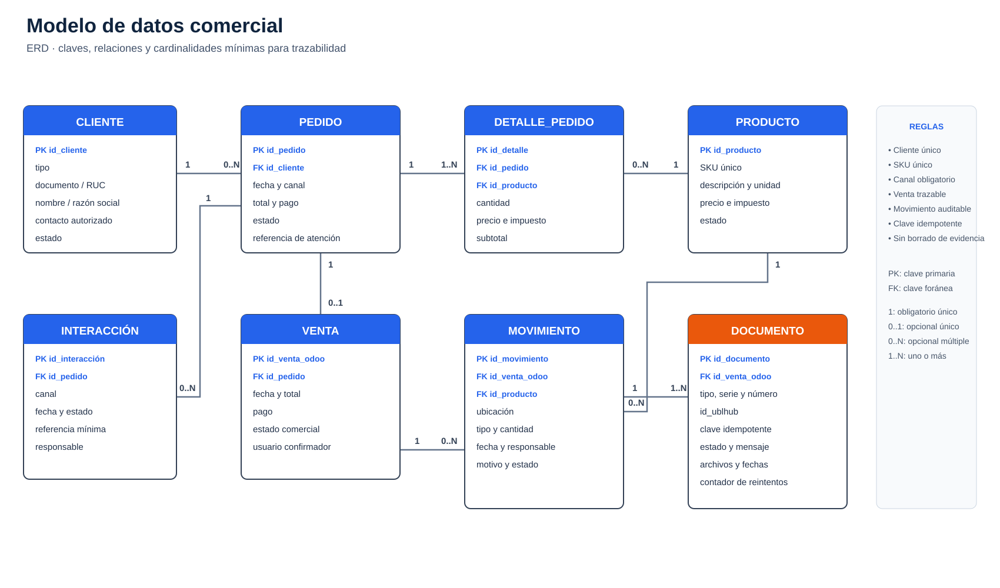

# Inventario de datos y fuentes operativas

## Fuentes para el levantamiento

| Fuente | Datos útiles | Estado y límite |
| --- | --- | --- |
| Ficha de la empresa | productos, clientes, canales, proceso actual y necesidades | Fuente del contexto y alcance adoptado |
| Ficha de comparación de ERPs | capacidades, brechas y razones de selección | Evidencia de la decisión Odoo + UBLHUB |
| Ficha de implementación base del ERP | alcance, fases, integración, controles y riesgos | Especificación técnica base |
| Odoo | clientes, productos, pedidos, ventas, inventario y estados | Sistema central seleccionado |
| UBLHUB | solicitudes, identificadores, documentos, respuestas y errores | Servicio tributario seleccionado |
| WhatsApp móvil | conversación y referencia del pedido | Canal manual; evitar copiar conversaciones completas sin autorización |

## Diccionario mínimo

*El ERD conecta cliente, pedido, detalle, producto, venta, movimiento, documento e interacción con cardinalidades explícitas.*

| Entidad | Campos mínimos | Regla |
| --- | --- | --- |
| Cliente | ID, tipo, documento/RUC, nombre o razón social, contacto autorizado, estado | Un registro por persona o empresa; controlar duplicados |
| Producto | SKU, descripción, unidad, precio, impuestos, estado | SKU único |
| Pedido | ID, fecha, canal, cliente, líneas, total y estado | Canal obligatorio: ERP/presencial o WhatsApp móvil |
| Inventario | SKU, ubicación, disponible, reservado y movimiento | Conciliar antes y después |
| Venta | ID Odoo, pedido, cliente, total, pago y estado | Trazable al pedido |
| Documento electrónico | tipo, serie/número, ID de venta, ID UBLHUB, estado, archivos y error | Idempotencia y trazabilidad |
| Interacción | referencia de pedido, canal, fechas y estado | No almacenar más datos de conversación de los necesarios |

## Fuentes y entidades para el incremento comercial PC2

Para la fase comercial previa al pedido evaluada en la PC2, se amplía el inventario con las siguientes entidades y fuentes de control (a cargo de Ballack Quintanilla):

| Entidad / Fuente | Atributos mínimos | Origen / Sistema dueño | Tratamiento y control |
| :--- | :--- | :--- | :--- |
| **Cuenta / Contacto** | ID cliente (`res.partner`), nombre/razón social, canal preferente | C02 Contactos | Búsqueda previa obligatoria (`identity_reviewed`); consentimiento de atención comercial. |
| **Lead / Oportunidad** | ID oportunidad (`crm.lead`), necesidad (SKU/cant.), probabilidad | C01 CRM | Origen presencial / WhatsApp; calificado por vendedor antes de cotizar. |
| **Cotización Snapshot** | ID cotización (`sale.order`), versión, líneas, total, vigencia | C03 Ventas | Snapshot inmutable; precios oficiales tomados de catálogo C03. |
| **Aceptación** | ID aceptación, fecha/hora, versión exacta aceptada | C03 Extensión | Evidencia documental de la voluntad del cliente; no compromete stock por sí sola. |
| **Aprobación Descuento**| ID aprobación, aprobador (Gerencia), % descuento, vigencia | C06 Extensión | Requerida si descuento > 5%; bloqueo de autoaprobaciones. |
| **Solicitud Transición** | Clave compuesta `(company_id, request_id)`, estado, código | C04 Transición | Idempotencia y atomicidad transaccional; siempre devuelve `order_id: null` en PC2. |

## Datos de prueba y privacidad

Usar SKU, clientes, documentos, teléfonos y cantidades ficticios (`CLI-DEMO-*`, `COT-DEMO-*`, `AUT-DEMO-*`). No incluir DNI, teléfonos, direcciones, correos, credenciales ni conversaciones reales en capturas o archivos de prueba. Los datos productivos solo se migran con autorización, respaldo, reglas de limpieza y conciliación.

