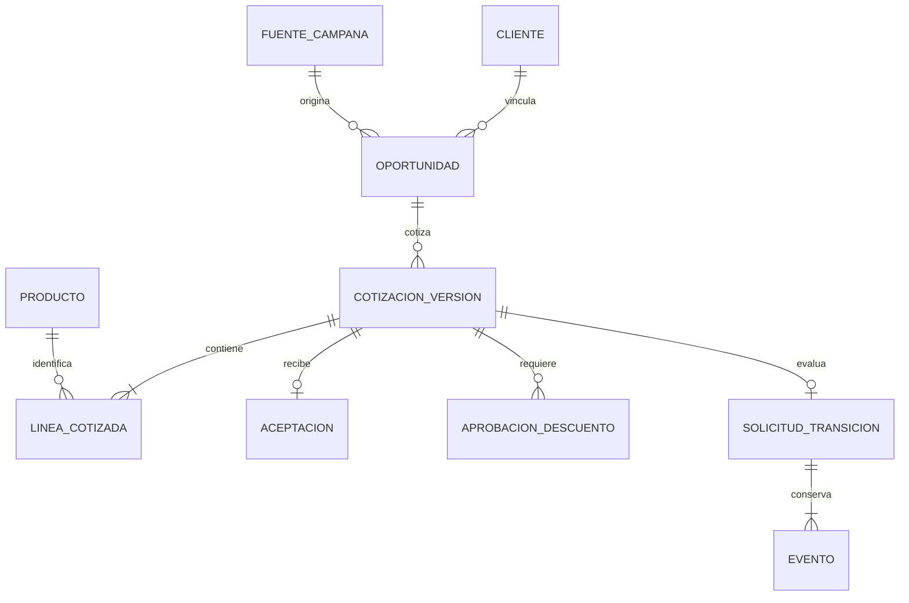

# Datos, controles y trazabilidad · incremento PC2

**Revisión propuesta:** Ballack Quintanilla; coordinación Gabriel/Jharolym. Datos sintéticos, sin validación empresarial todavía. Esta vista amplía el [modelo PC1](modelo-datos.md) exclusivamente hasta la solicitud de pedido. [Arquitectura base de esta vista](../arquitectura/crm-erp-pc2.md).

## 1. Entidades y relaciones

`OPORTUNIDAD` incluye la etapa previa lead: en el modelo estándar de Odoo ambos son `crm.lead`, con distinto `type`. `COTIZACION_VERSION` representa el snapshot propuesto de una versión de `sale.order`, no una nueva tabla estándar de Odoo. `ACEPTACION` es la evidencia efectiva por versión; conservar historial de aceptaciones revocadas requerirá una relación histórica adicional. Un pedido operativo queda fuera de esta vista.

## 2. Diccionario mínimo y sistema de registro

| Entidad / campos | Clave y relación | Sistema dueño / validación |
| --- | --- | --- |
| Cliente: `customer_id`, compañía, nombre autorizado, activo, identidad revisada | ID técnico de `res.partner`; referencia desde oportunidad y cotización | C02; búsqueda previa, coincidencia ambigua resuelta por una persona; no duplicar por campaña |
| Lead/oportunidad: `opportunity_id`, `type`, compañía, cliente, vendedor, campaña, fuente, medio y referencia de atención | `crm.lead`; el cambio lead → oportunidad conserva identidad | C01; responsable asignado y compañía coherente |
| Producto/precio: SKU, compañía, activo, moneda, precio vigente | SKU único dentro del catálogo/compañía | C03; origen del precio oficial, no un campo libre en I03 |
| Cotización: `quotation_id`, `version`, `state`, `valid_until`, cliente, oportunidad, vendedor, moneda y total | ID `sale.order` + versión propuesta; líneas por SKU | C03; snapshot versionado, `sent`, vigente y total recalculado |
| Línea: SKU, cantidad, precio unitario y descuento | Cotización/versión + número de línea | C03; cantidad entera positiva; Decimal; stock agregado por SKU aunque haya varias líneas |
| Aceptación: `acceptance_id`, cotización, versión, cliente, total y hora | Vinculada al snapshot exacto | C03, extensión; fecha válida y evidencia autorizada, sin conversación real en el repositorio |
| Aprobación: aprobador, cotización, versión, total, estado, fecha y vigencia | Vinculada al snapshot y al usuario de gerencia | C06, extensión; sin autoaprobación ni reutilización para otra versión |
| Solicitud: campos de I03, huella, estado y respuesta | PK `(company_id, request_id)`; única `(company_id, quotation_id, quotation_version)` | C04, extensión; payload inmutable, resultados finales persistidos |
| Evento: compañía, actor, interfaz, tipo, código, correlación y fecha | ID técnico y referencia a compañía/solicitud cuando existe | C07, extensión; se persiste junto con la decisión; denegación puede no tener solicitud |
| Disponibilidad: compañía, ubicación, SKU, cantidad y hora de consulta | SKU/compañía/ubicación | C05; lectura confiable, no reserva ni garantía futura |

## 3. Matriz de eventos, controles y riesgos

| Evento | Datos / interfaz | Control verificable | Riesgo prevenido | Responsable / evidencia |
| --- | --- | --- | --- | --- |
| Captación registrada | Campaña, fuente, lead / I01–I02 | Separar campaña hipotética de campaña ejecutada; asignar responsable | Atribuir resultados de marketing inexistentes | Shirley / escenario y S-01 |
| Cliente vinculado | Cliente y compañía / I01 | Revisar coincidencia antes de elegir o crear ficha | Cliente duplicado o identidad equivocada | Ventas / `identity_reviewed` en fixture |
| Cotización aceptada | Versión, líneas, vigencia, total y aceptación / I02–I04 | Recalcular desde catálogo; aceptación de versión exacta | Precio alterado o aceptación obsoleta | Ventas / tests de precio, versión y aceptación |
| Solicitud recibida | Referencias / I03 | Schema cerrado; no admite precio, rol ni aprobación del usuario | Inyección de autorización o importes | C04 / schema y pruebas de payload |
| Actor autorizado | Sesión y oportunidad / I07 | Ventas, compañía y acceso al registro antes de cualquier replay | Fuga de resultados o transición ajena | Administrador / pruebas locales de denegación; ACL Odoo pendientes |
| Descuento revisado | Descuento del snapshot / I06 | >5 % requiere gerencia, versión/total vigentes y persona distinta al vendedor | Autoaprobación o autorización reciclada | Gerencia / PC2-E01 y pruebas adicionales |
| Disponibilidad consultada | SKU/cantidad/ubicación / I05 | Agregar líneas del mismo SKU y diferenciar falla de stock parcial | Sobrepromesa, omisión de cantidad o falso rechazo comercial | Almacén / PC2-P01 y PC2-T01 |
| Solicitud repetida | Clave, huella y versión / I03 | PK + UNIQUE y respuesta persistida | Doble evaluación con la misma u otra clave | C04 / persistencia y concurrencia SQLite |
| Decisión registrada | Estado, código, actor y correlación / I07 | Transacción con rollback ante falla | Resultado sin evidencia o evento sin decisión | C04/C07 / prueba de rollback |

## 4. Calidad, privacidad, consentimiento y contexto del cliente

Siguiendo la rúbrica oficial de la PC2 respecto al **Contexto comercial del cliente**, se definen los propósitos de uso y la actualización mínima de datos sin exceder la frontera hacia contratos técnicos:

- **Propósito de uso comercial:** La captura de datos de la cuenta y contacto tiene como único propósito calificar el lead, remitir la cotización solicitada y gestionar la promesa de entrega comercial. No se reutilizan datos comerciales para fines publicitarios no autorizados.
- **Canal y consentimiento:** En el canal WhatsApp, el consentimiento del cliente se presume y registra tácitamente al iniciar este la consulta sobre autoradios; no obstante, cualquier registro en la ficha de cliente (`res.partner`) requiere validación del vendedor para no registrar datos innecesarios.
- **Actualización mínima de la cuenta:** La ficha de cliente solo requiere: nombre o razón social identificado, canal preferente de contacto (WhatsApp/teléfono) y confirmación de identidad revisada (`identity_reviewed = True`). Direcciones de entrega y condición tributaria definitiva (RUC/DNI) quedan expresamente diferidas para el tramo posterior de pedido y facturación (fuera de PC2).
- **Moneda y cálculo:** Moneda `PEN`; importes como cadenas con dos decimales. Redondeo didáctico por línea `ROUND_HALF_UP`, suma de subtotales y sin cálculo tributario adelantado.
- **Datos sintéticos y anonimización:** IDs de demostración `CLI-DEMO-*`, `CRM-DEMO-*`, `COT-DEMO-*`, `SOL-DEMO-*`. No son IDs emitidos por una instalación real de Odoo ni contienen números de teléfono o personas reales.
- **Conservación y límites:** La evidencia local en SQLite acredita persistencia transaccional y reglas de negocio, sin afirmar una política de retención definitiva en producción ni almacenar credenciales.

## 5. Trazabilidad de ejemplo y evidencia verificable

`CAM-DEMO-AUTORADIOS → ATN-DEMO-001 → CRM-DEMO-001 → CLI-DEMO-001 → COT-DEMO-001/v1 → ACE-DEMO-001 → SOL-DEMO-001 → COR-DEMO-001 → eventos I03/I04/I06/I05/I07`.

El caso de excepción usa `COT-DEMO-002/v1`, `ACE-DEMO-002` y `SOL-DEMO-002`. Es una alternativa del mismo caso didáctico, no otra compra empresarial acreditada. Las fixtures y los resultados generados están en [pruebas PC2](../pruebas/pc2/README.md) y fueron comprobados localmente con `python pruebas/pc2/generar_evidencias.py`.

---
*Revisión técnica efectiva y verificación de datos registrada por: Ballack Zidane Quintanilla Huamanraime (16/10/2026).*
