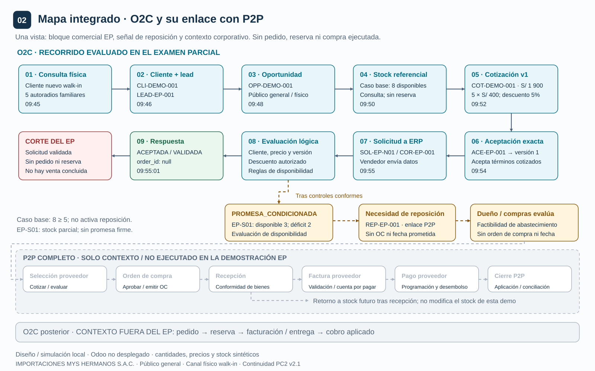
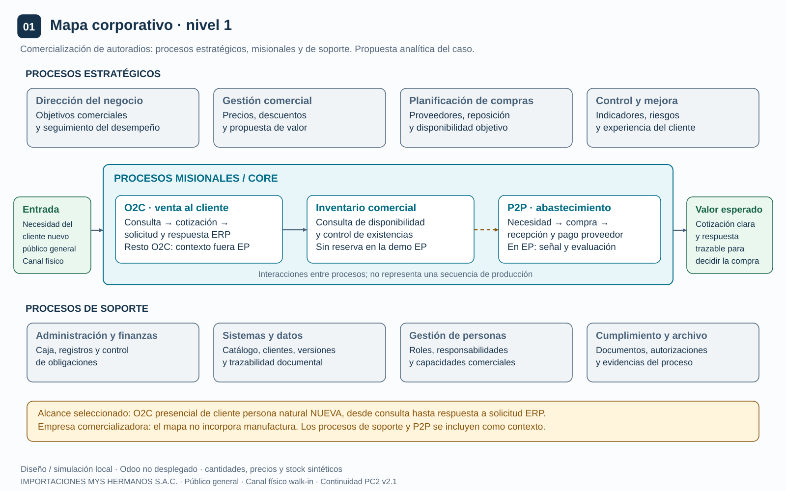
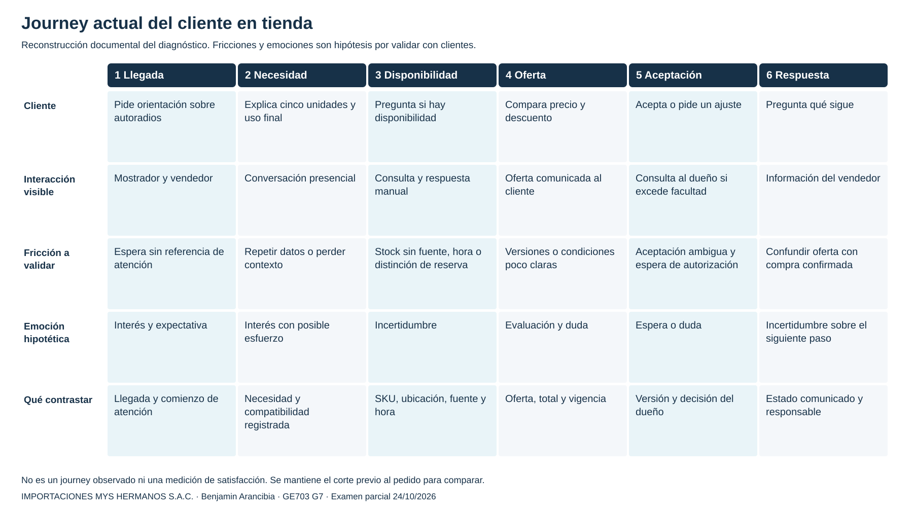
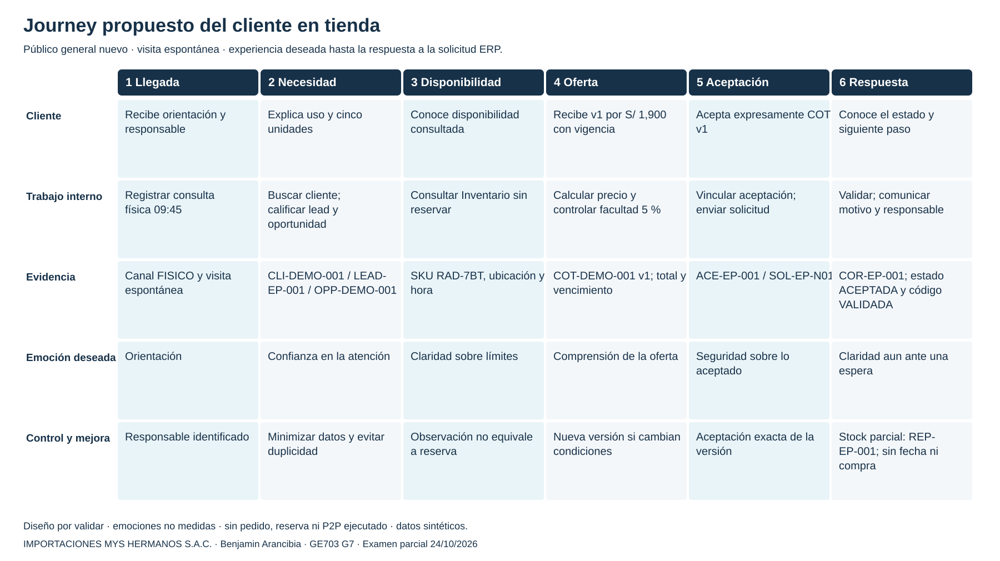
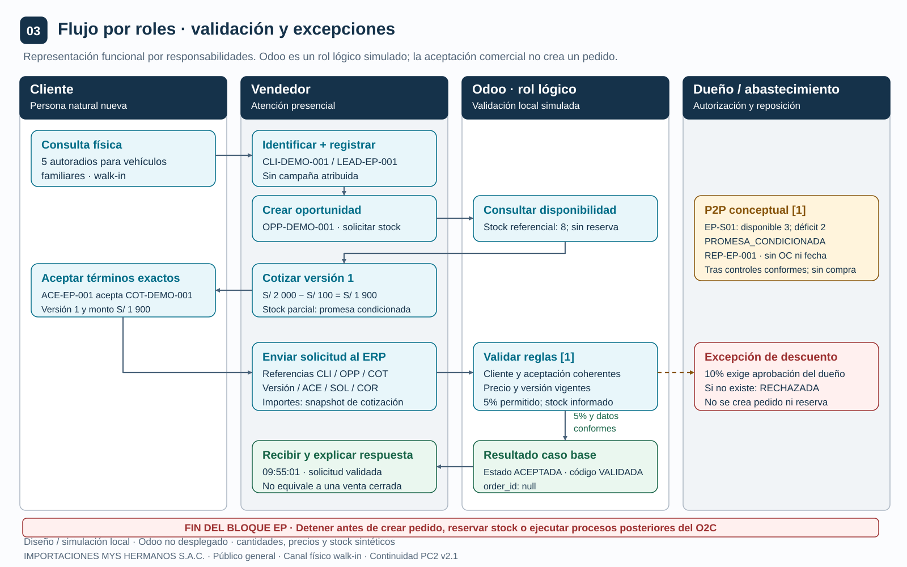
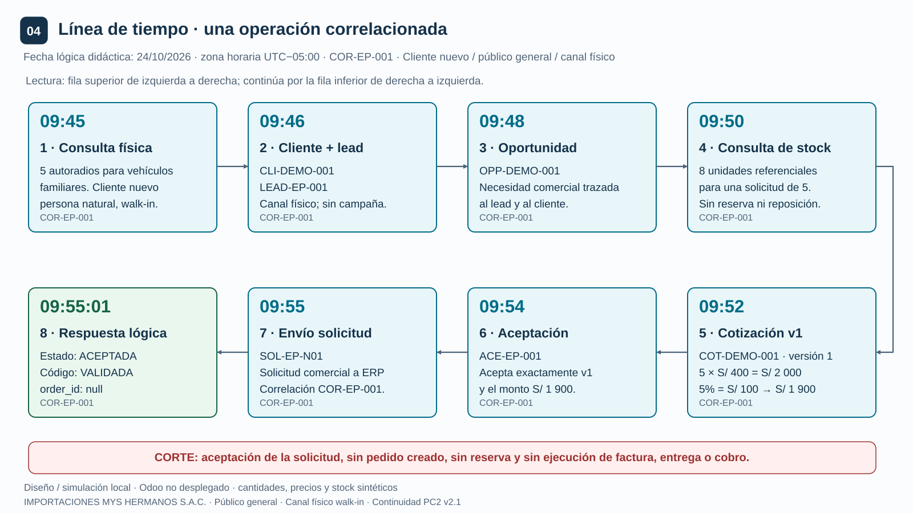

# Recorrido O2C para el examen parcial

IMPORTACIONES MYS HERMANOS S.A.C. · GE703 · UNI FIIS · Grupo 7 · 2026-2  
Benjamín Francis Arancibia Ynga · Sección 3 de la plantilla · 24 de octubre de 2026 · Intervención de 04:00 a 06:00

## 1 Decisión que defiende Benjamin

Proponemos aprobar de forma condicionada un recorrido comercial trazable para **un cliente nuevo del público general que visita la tienda física**. La necesidad se registra, se convierte en una oportunidad, recibe una cotización versionada y, tras su aceptación, origina una solicitud de evaluación al ERP. La respuesta conserva identificadores y motivos. Si falta disponibilidad, se registra una necesidad de reposición para evaluación de P2P; esa señal no autoriza una compra ni una fecha de atención.

El éxito del diseño se comprueba al reconstruir **cliente → lead → oportunidad → cotización y versión → aceptación → solicitud → respuesta**, identificando al responsable y el control de cada transición. La aceptación comercial del cliente y el estado `ACEPTADA` de la solicitud son hechos distintos; ninguno confirma automáticamente un pedido ni reserva inventario.

### Texto para la sección 3 de la plantilla Word

**Responsable:** Benjamín Francis Arancibia Ynga. **Evidencia:** panel local, mapa integrado O2C–P2P, línea de tiempo y resultados EP-N01 y EP-S01. **Desarrollo:** Un cliente nuevo del público general llega al local de Importaciones MYS Hermanos S.A.C. y solicita cinco autoradios para uso final. Ventas registra `CLI-DEMO-001`, califica `LEAD-EP-001`, vincula `OPP-DEMO-001` y presenta `COT-DEMO-001 v1`. La base académica de 5 × S/ 400 es S/ 2,000; el descuento permitido en la simulación del 5 % equivale a S/ 100 y deja S/ 1,900. La consulta de ocho unidades disponibles registra fuente y hora, sin reserva. El cliente acepta esa versión vigente; Ventas envía `SOL-EP-N01` y la evaluación devuelve estado `ACEPTADA`, código `VALIDADA` y `order_id = null`. En la variante con tres unidades disponibles, la diferencia de dos unidades origina `REP-EP-001`, una señal de necesidad de reposición que el dueño y el responsable funcional de abastecimiento deben evaluar. No se crea orden de compra ni se promete plazo. El recorrido evaluado termina en la respuesta documentada; pedido confirmado, reserva, entrega, facturación y cobro corresponden a incrementos posteriores.

### Fila para la matriz de integrantes

| Integrante | Contribución verificable | Decisión que defenderá |
| --- | --- | --- |
| Arancibia Ynga, Benjamin Francis | Mapa O2C–P2P, journeys actual y propuesto, SIPOC, flujo por roles, línea de tiempo y evidencias EP-N01 y EP-S01 | Mantener una cadena trazable hasta la respuesta a la solicitud y activar evaluación de reposición ante faltante, sin comprometer stock ni compras |

## 2 Alcance y continuidad del proyecto

| Etapa | Decisión conservada o ampliada | Límite |
| --- | --- | --- |
| PC1 | Odoo como núcleo propuesto para contactos, ventas e inventario; UBLHUB para emisión futura | Arquitectura documentada; no acredita instalación |
| PC2 v2.1 | Cliente nuevo, persona natural, visita espontánea, cotización y decisiones comerciales | El caso evaluable terminaba antes de solicitar el pedido; sin reserva |
| Examen parcial | Se explicita la solicitud CRM–ERP, sus datos, controles y respuestas, conectada con O2C y P2P | Se evalúa el diseño y una simulación local; no se confirma pedido ni se ejecuta P2P |

El segmento seleccionado es consumidor final; cinco unidades para vehículos familiares **no convierten al cliente en mayorista**. El canal es el mostrador físico y la fuente es visita espontánea. No se atribuyen campañas ni captación por WhatsApp. El medio de contacto solo se recoge si es necesario y autorizado; no se exige correo ni se publican datos personales.

O2C completo significa llevar la necesidad comercial hasta el cobro aplicado y el tratamiento de sus excepciones. P2P completo va de una necesidad de abastecimiento autorizada al pago conciliado al proveedor. Conocer ambos extremos permite explicar su relación; el parcial desarrolla únicamente el tramo comercial hasta la respuesta de transición. Los tramos posteriores aparecen como contexto, sin secuencia operativa detallada.

**Parámetros de la recreación EP:** 24/10/2026, hora Perú `-05:00`; 5 autoradios de SKU sintético `RAD-7BT`; precio final académico S/ 400; moneda PEN; descuento ordinario 5 %; disponibilidad normal 8 y variante de faltante 3; vigencia hasta las 18:00. No se descompone IGV ni se calcula un documento tributario. Contado y boleta son condiciones comerciales previstas por validar; no se registra un pago ni una emisión.

## 3 Mapa integrado O2C y P2P



El evento conector es la **disponibilidad insuficiente de una necesidad trazable**. En EP-S01, `max(0, 5 − 3) = 2` unidades faltantes originan `REP-EP-001`, vinculada a la oportunidad, solicitud y snapshot. El dueño y abastecimiento evalúan existencias, compras pendientes y presupuesto; la señal no aprueba compras ni plazos. Una recepción futura validada podría actualizar stock para O2C. Ese retorno es contexto y no se ejecuta aquí.

## 4 Mapa de procesos de nivel uno



La empresa comercializa autoradios y accesorios. Estrategia fija precios y autorizaciones; los procesos operativos conectan cliente, disponibilidad y abastecimiento; soporte aporta personas, datos y control. Se adapta el caso docente a comercio, sin incorporar fabricación. Ventas, Inventario y Abastecimiento son **funciones del diseño**, no departamentos comprobados. Una persona puede asumir varias funciones; el dueño conserva la decisión independiente sobre excepciones de precio.

## 5 SIPOC del tramo evaluado

**Propósito:** transformar una consulta física en una respuesta comercial trazable, conservando la versión aceptada y las restricciones de disponibilidad. **Inicio:** consulta del cliente en tienda. **Fin:** solicitud evaluada y respuesta registrada, o espera/corrección documentada antes del envío. **Dueño propuesto:** responsable comercial, con decisión del dueño sobre excepciones.

| S Proveedores | I Entradas | P Pasos principales | O Salidas | C Destinatarios |
| --- | --- | --- | --- | --- |
| Cliente | Necesidad, uso final y cantidad | 1 Capturar e identificar | Cliente y consulta vinculados | Cliente y Ventas |
| Cliente y Ventas | Necesidad viable y siguiente acción | 2 Calificar lead y oportunidad | Oportunidad con responsable | Ventas |
| Catálogo, Inventario y dueño | SKU, precio, disponibilidad fechada y facultades | 3 Preparar cotización versionada | Oferta con importe y condiciones | Cliente |
| Cliente y Ventas | Oferta vigente y respuesta expresa | 4 Registrar aceptación exacta | Aceptación ligada a la versión | Ventas y evaluación ERP |
| Ventas y registros comerciales | Referencias y actor autorizado | 5 Solicitar y validar transición | Solicitud identificada y controles | Evaluación ERP |
| Evaluación ERP y responsables | Decisión y motivo | 6 Responder y comunicar | ACEPTADA, RECHAZADA, PROMESA_CONDICIONADA o PENDIENTE; señal P2P si procede | Cliente, Ventas y dueño |

Una cotización no aceptada continúa en seguimiento, recotización o cierre por desistimiento. No debe construirse una solicitud ficticia para completar el gráfico. Los pasos tercero y quinto consultan disponibilidad para momentos distintos: preparar una oferta y revalidar al evaluar la transición.

## 6 SIPOC de contexto de los macroprocesos

Estos contratos de alto nivel permiten explicar los extremos de la teoría de Semana 5. Sus actividades posteriores al corte **no se ejecutan ni se desarrollan en el parcial**.

| Elemento | O2C completo como contexto | P2P completo como contexto |
| --- | --- | --- |
| Propósito y límites | De la necesidad del comprador al cobro aplicado o excepción registrada | De la necesidad de abastecimiento aprobada al pago conciliado o excepción registrada |
| S Proveedores | Cliente, Ventas, catálogo, Inventario y funciones financieras | O2C/Inventario, dueño, proveedor y datos maestros |
| I Entradas | Necesidad, SKU, cantidad, precios, autorizaciones y condiciones | Necesidad justificada, especificación, presupuesto, proveedor y condiciones |
| P entre cuatro y siete pasos | Capturar necesidad; aprobar oferta; validar pedido; cumplir operación; documentar; aplicar cobro | Evaluar necesidad; aprobar solicitud; seleccionar fuente; ordenar; recibir; verificar documento; pagar y conciliar |
| O Salidas | Oferta y pedido trazables; cumplimiento y cobro como resultado final posterior | Abastecimiento conforme, disponibilidad actualizada y pago sustentado |
| C Destinatarios | Comprador, Ventas, Inventario, Finanzas y dueño | Inventario/O2C, proveedor, Finanzas y dueño |
| Evidencia en este aporte | Solo hasta solicitud y respuesta; sin cobro, comprobante ni salida | Solo señal conceptual REP-EP-001; sin solicitud aprobada, orden, recepción ni pago |

**Relación defendible:** el inventario es un dato compartido que O2C consulta para no ofrecer una disponibilidad inexistente y P2P puede aumentar mediante una recepción futura validada. La cantidad faltante de una venta es una entrada para revisar abastecimiento; no determina automáticamente cuánto comprar ni a qué proveedor.

## 7 Journey actual del cliente



El recorrido actual se reconstruye a partir del diagnóstico documental de registros dispersos y consultas manuales. Los puntos de dolor y emociones son hipótesis de análisis; no provienen de observación cronometrada ni de entrevistas nuevas. Cada etapa llega al límite previo al pedido para compararse con el journey propuesto.

| Etapa | Acción y pregunta del cliente | Contacto visible | Riesgo o fricción a validar | Evidencia necesaria para contrastar |
| --- | --- | --- | --- | --- |
| Llegada | Entra y pide orientación sobre autoradios | Mostrador y vendedor | Espera sin referencia de atención | Registro anonimizado de hora de llegada y atención |
| Necesidad | Explica uso, cantidad y compatibilidad deseada | Conversación presencial | Repetir datos o perder contexto | Registro mínimo de necesidad y criterios técnicos |
| Disponibilidad | Pregunta si hay cinco unidades | Respuesta del vendedor | Consulta manual sin hora o fuente; confundir existencia con disponibilidad | Fuente y hora de consulta, SKU y ubicación |
| Oferta | Compara precio, descuento y condiciones | Comunicación verbal o soporte disponible | Diferencias entre versiones o condiciones incompletas | Copia de oferta, importe, vigencia y autorizaciones |
| Decisión | Acepta o solicita ajuste | Vendedor y eventual consulta al dueño | Espera de autorización y aceptación ambigua | Decisión del dueño y respuesta de esa versión |
| Estado | Pregunta qué sigue y si su compra está confirmada | Comunicación del vendedor | Confundir interés, oferta y compromiso operativo | Estado comunicado, motivo y responsable |

## 8 Journey propuesto del cliente



La mejora propuesta consiste en mantener la relación entre la experiencia visible y la evidencia interna. El cliente recibe un precio y un estado claros; Ventas conserva la necesidad y el siguiente paso. Las emociones muestran una experiencia deseada, no un resultado medido. La compatibilidad se verifica contra especificaciones del producto y del vehículo; este ejemplo no acredita una prueba técnica real.

| Etapa | Interacción visible | Trabajo interno y sistema lógico | Evidencia y control | Resultado esperado para el cliente |
| --- | --- | --- | --- | --- |
| Llegada | Vendedor recibe y explica la atención | Registra consulta física y fuente visita espontánea | Evento con hora y responsable | Sabe quién lo atiende |
| Necesidad | Se acuerdan cinco unidades para uso final | Busca identidad; registra lead y oportunidad en Contactos/CRM | CLI, LEAD y OPP vinculados; datos mínimos | No repite innecesariamente su necesidad |
| Disponibilidad | Se informa disponibilidad consultada y su límite | Inventario devuelve SKU, ubicación, cantidad y hora | Snapshot identificado; no hay reserva | Distingue existencia observada de compromiso |
| Oferta | Recibe v1 por S/ 1,900 y vigencia | Ventas calcula desde catálogo; controla 5 % | COT v1 y condiciones; dueño decide excepciones | Conoce exactamente qué puede aceptar |
| Aceptación | Acepta expresamente esa versión | Ventas vincula ACE y solicita evaluación | Nueva versión invalida aceptación anterior | Su respuesta no se aplica a otra oferta |
| Respuesta | Vendedor explica validación, espera o alternativa | Evaluación ERP registra estado y motivo; faltante genera señal P2P | SOL y COR; order_id nulo; ninguna reserva | Conoce el siguiente paso sin falsa promesa |

La rama de stock insuficiente no mejora la experiencia inventando una fecha: mejora la claridad del estado, asigna una persona para resolverlo y conserva seguimiento. Si se modifican cantidad, descuento o plazo, debe presentarse otra versión y obtener una nueva aceptación.

## 9 Flujo por roles y responsabilidades



| Función | Ejecuta o decide | Evidencia que conserva |
| --- | --- | --- |
| Cliente | Expone necesidad y acepta o rechaza condiciones | Respuesta comercial vinculada a versión |
| Vendedor | Identifica, califica, cotiza, solicita evaluación y comunica | Necesidad, oportunidad, cotización, aceptación y solicitud |
| Dueño | Decide descuentos superiores a la facultad simulada y criterios de abastecimiento | Decisión independiente con alcance, motivo y versión |
| Inventario y abastecimiento | Informan disponibilidad y evalúan necesidad de reposición | SKU, ubicación, snapshot y análisis de REP-EP-001 |
| Evaluación lógica ERP | Contrasta referencias, permisos, vigencia, condiciones y disponibilidad | Estado, código, correlación, fecha y bitácora |

Las cajas de Odoo representan responsabilidades propuestas de Contactos, CRM, Ventas e Inventario. El control de transición es un diseño local simulado: que todos compartan plataforma no elimina la necesidad de gobernar el paso de intención comercial a compromiso operativo. Ninguna caja demuestra configuración productiva.

## 10 Línea de tiempo del caso normal



Todas las horas corresponden al reloj lógico del ejemplo **24/10/2026, UTC−05:00**. La ejecución del script conserva por separado su fecha real. Las horas no representan tiempos observados en la empresa ni metas de atención.

| Hora lógica | Evento y responsable | Objeto o dato | Regla y evidencia |
| --- | --- | --- | --- |
| 09:45 | Cliente consulta en tienda; Ventas atiende | Consulta presencial, cinco autoradios | Canal físico y visita espontánea; sin campaña |
| 09:46 | Ventas busca identidad y registra necesidad | CLI-DEMO-001 y LEAD-EP-001 | Evitar duplicidad; no exponer datos personales |
| 09:48 | Ventas califica y asigna acción | OPP-DEMO-001 | Necesidad y cantidad explícitas; mismo cliente |
| 09:50 | Ventas consulta Inventario | SKU RAD-7BT, disponible 8, ubicación TIENDA-DEMO | Registrar fuente/hora; consulta sin reserva |
| 09:52 | Ventas presenta oferta | COT-DEMO-001 v1, total S/ 1,900 | Precio y 5 % según supuesto; vigencia 18:00 |
| 09:54 | Cliente acepta; Ventas documenta | ACE-EP-001 sobre COT v1 | Aceptación exacta y vigente |
| 09:55 | Ventas solicita evaluación | SOL-EP-N01, COR-EP-001 | Actor autorizado; vínculos y versión correctos |
| 09:55:01 | Evaluación responde; Ventas comunica | ACEPTADA / VALIDADA, order_id null | Decisión trazable; no confirma pedido ni altera stock |

## 11 Datos controles e interfaces del recorrido

| Momento | Datos mínimos y fuente lógica | Control y responsable | Falla y contención |
| --- | --- | --- | --- |
| Identidad | ID de cliente, estado y referencia mínima; Contactos | Ventas busca antes de crear; resuelve coincidencia | Identidad ambigua: corregir, no duplicar |
| Calificación | Lead, oportunidad, necesidad, cantidad y siguiente acción; CRM | Ventas mantiene mismo cliente y asignación | Contexto incompleto: seguimiento, no simular aprobación |
| Oferta | ID, versión, SKU, cantidad, moneda, precio, descuento, total y vencimiento; Ventas | Recalcular; vincular precio de catálogo | Oferta vencida o cambiada: nueva versión y aceptación |
| Aceptación | ID y hora de respuesta, ID y versión aceptados; registro comercial | Ventas verifica coincidencia con versión vigente | Aceptación de otra versión: bloquear transición |
| Autorización | Regla y decisión del dueño por versión y total; registro de aprobaciones | Evaluación comprueba autorización independiente | 10 % sin dueño: RECHAZADA, sin compromiso |
| Disponibilidad | SKU, ubicación, unidades disponibles y fecha; Inventario | Evaluación consulta de nuevo; no descuenta unidades | Menos de cinco: PROMESA_CONDICIONADA; escalar |
| Solicitud | Empresa, SOL, COR, CLI, OPP, COT, versión y ACE | Actor de sesión, idempotencia y vínculos; evaluación ERP | Reintento idéntico: mismo resultado; no duplicar |
| Respuesta | Estado, código, motivo, responsable y acción; bitácora | Ventas comunica sin convertir validación en pedido | Dependencia inaccesible: PENDIENTE, no afirmar disponibilidad |

**Interfaces lógicas:** cliente–Ventas registra necesidad; CRM–Contactos resuelve identidad; CRM–Ventas vincula oportunidad/cotización; evaluación–Inventario consulta disponibilidad; evaluación–autorizaciones verifica al dueño; evaluación–Ventas devuelve decisión. La señal de reposición conecta con la función P2P. Son intercambios funcionales dentro del Odoo propuesto y proveedores locales de prueba; no se afirma una API externa instalada.

El mensaje de solicitud transporta referencias; los importes, roles y stock se contrastan con registros confiables. Un indicador `aprobado=true` escrito por el vendedor no reemplaza la decisión del dueño. La bitácora registra actor, hora, evento e identificador; no necesita nombres, documentos ni teléfonos reales.

## 12 Dimensiones ERP e indicadores

| Dimensión de Semana 5 | Aplicación a O2C en el parcial | Dependencia P2P y límite |
| --- | --- | --- |
| Resultado | Respuesta de transición explicada y correlacionada | Necesidad de reposición identificada, sin compra |
| Actores | Cliente, Ventas, dueño y evaluación lógica ERP | Función Inventario/Abastecimiento y dueño evalúan |
| Eventos | Consulta, oferta, aceptación, solicitud y respuesta | Detección de brecha produce señal REP |
| Datos | CLI, OPP, COT/versión, SKU, cantidad, COR y SOL | Mismo SKU/ubicación y cantidad faltante justificable |
| Documentos | Cotización y constancia de aceptación | Registro de señal, no orden ni documento de proveedor |
| Sistemas | Contactos, CRM, Ventas, Inventario y bitácora propuestos | Disponibilidad compartida; recepción futura como contexto |
| Controles | Identidad, versión, descuento, permisos e idempotencia | Evaluación humana antes de autorizar abastecimiento |
| Indicadores | Trazabilidad completa y transición sin reproceso | Señales con responsable y fuente identificados |

| Indicador propuesto | Fórmula y fuente | Responsable y criterio |
| --- | --- | --- |
| Solicitudes con trazabilidad completa | Solicitudes con CLI, OPP, COT/versión, ACE, SOL y COR coherentes ÷ solicitudes evaluadas × 100; bitácora | Ventas; objetivo de prueba 100 %. Sin línea base empresarial medida |
| Transición validada al primer intento | Solicitudes ACEPTADA/VALIDADA en primera evaluación ÷ solicitudes evaluadas × 100; respuestas | Responsable comercial; medir normal y excepciones por separado, sin premiar omisión de controles |
| Señales de reposición sustentadas | Señales con SKU, ubicación, déficit, fuente/hora y responsable ÷ señales generadas × 100 | Abastecimiento; objetivo de diseño 100 %. No mide compras ejecutadas |

Un agente futuro podría leer estados autorizados, advertir faltantes y recomendar seguimiento. Debe escalar descuentos, cambios de condiciones y decisiones de abastecimiento al humano competente. La simulación no despliega un agente ni le atribuye facultades comerciales.

## 13 Casos y resultados comprobables

| Caso | Entrada diferencial | Resultado esperado | Control y siguiente acción |
| --- | --- | --- | --- |
| EP-N01 normal | 5 unidades, 5 %, S/ 1,900; disponible 8; v1 aceptada vigente | Estado ACEPTADA; código VALIDADA; order_id null; stock intacto | Ventas comunica que se validó la solicitud; confirmación operativa posterior pendiente |
| EP-S01 enlace P2P | Misma necesidad; disponibilidad de evaluación 3 | PROMESA_CONDICIONADA / DISPONIBILIDAD_PARCIAL; déficit 2; sin fecha prometida | Señal REP-EP-001; dueño/abastecimiento evalúan; cliente debe aceptar nuevas condiciones |
| EP-E01 coordinación con Adrián | v2 solicita 10 %, total S/ 1,800; sin autorización del dueño | RECHAZADA / DESCUENTO_SIN_APROBACION; order_id null | Vendedor escala al dueño y conserva condiciones pendientes; no ofrece 10 % como aprobado |

Los casos son **corridas independientes**, no tres ventas del mismo cliente. EP-S01 cambia deliberadamente el snapshot confiable de disponibilidad respecto del caso normal para comprobar la rama P2P. El 10 % no se acumula al 5 %: ambos se calculan sobre S/ 2,000. La falta de aprobación comercial se controla antes de evaluar el faltante.

En el contrato existente, `ACEPTADA` es el **estado** y `VALIDADA` es el **código** de la misma respuesta normal. No son dos etapas sucesivas ni equivalen a pedido confirmado. `PROMESA_CONDICIONADA` describe una propuesta por revisar, no una promesa firme: la fecha continúa nula. `PENDIENTE` significa que no pudo verificarse una dependencia; no equivale a stock cero.

El [informe de ejecución](../../../pruebas/ep-benjamin/evidencias/resultados.md) registra el resultado **observado**, comparado con expectativas fijas, y los controles realmente ejecutados. Los JSON contienen datos de entrada, respuestas y trazas. La señal de reposición se documenta localmente como evidencia del enlace; no crea una transacción en Compras. Las verificaciones no acreditan ERP instalado, disponibilidad real ni política comercial aprobada.

## 14 Cómo reproducir y navegar la evidencia

1. Abrir `panel-benjamin.html` y seleccionar **Mapa integrado**. Explicar qué evento conecta O2C con P2P.
2. Seleccionar **Línea de tiempo** y seguir CLI-DEMO-001, OPP-DEMO-001 y COT-DEMO-001 v1 hasta SOL-EP-N01.
3. Abrir **Caso normal**: contrastar S/ 1,900, estado ACEPTADA, código VALIDADA y ausencia de pedido.
4. Abrir **Faltante y P2P**: mostrar disponibilidad 3, déficit 2, señal REP-EP-001 y fecha prometida nula.
5. Mostrar brevemente **Descuento**, que enlaza con el quiebre de Adrián; la explicación contractual detallada continúa con Gabriel.

Desde la raíz del repositorio, ejecutar con Python 3:

```powershell
python pruebas/ep-benjamin/generar_evidencias.py
```

El generador usa la biblioteca estándar y reutiliza el simulador local existente. Reproduce snapshots sintéticos, contrasta respuestas con expectativas y actualiza resultados y hashes de sus entradas. El informe de ejecución indica qué se verificó realmente. Para inspección independiente se puede cambiar el stock de la fixture de prueba en una copia y volver a ejecutar; una expectativa que deje de cumplirse debe producir un fallo visible, no un resultado favorable escrito manualmente.

No se deben presentar las pruebas históricas de PC2 como prueba de este nuevo canal sin adaptación. Tampoco corresponde afirmar que los journeys se validaron con clientes por ejecutar un script de transición. El panel local es material de Benjamin para integrar al panel único del grupo; publicar el enlace accesible del comité sigue siendo una tarea grupal.

## 15 Guion de dos minutos y coordinación

**04:00–04:20 | Decisión y contexto.** “Defiendo que el recorrido del cliente sea trazable hasta la respuesta a la solicitud, y que un faltante active evaluación de reposición sin autorizar compras. Nuestro cliente es una persona natural nueva que llega a la tienda; mantenemos el canal físico de PC2.”

**04:20–04:55 | Hilo normal.** “Ventas identifica CLI-DEMO-001, califica el lead y vincula OPP-DEMO-001. Cotiza cinco autoradios a 400 soles: base 2,000, descuento permitido en el ejemplo del 5 %, total 1,900. La consulta de ocho unidades tiene fuente y hora; todavía no reserva nada. El cliente acepta COT-DEMO-001 v1 dentro de su vigencia.”

**04:55–05:20 | Solicitud y evidencia.** “La aceptación se enlaza con SOL-EP-N01 y con COR-EP-001. Aquí comprobamos la respuesta del simulador: estado ACEPTADA, código VALIDADA y order_id nulo. La validación permite continuar posteriormente; no confirma el pedido. Los registros conservan actor, versión y momento.”

**05:20–05:45 | Conexión P2P.** “En la variante EP-S01 solo hay tres unidades disponibles para cinco solicitadas. La brecha de dos produce REP-EP-001. El dueño y abastecimiento deben evaluar esa necesidad: no hay compra automática ni plazo comprometido. El cliente recibe una condición por revisar y debe aceptar cualquier cambio de oferta.”

**05:45–06:00 | Límite y transición.** “Precios, cantidades y stock son sintéticos; P2P no fue ejecutado. Llegamos a la respuesta de evaluación, antes de pedido, reserva y los tramos posteriores. Gabriel explicará ahora qué datos, estados y autorizaciones hacen válida esa transición.”

El guion debe ensayarse con la navegación real para no superar dos minutos. Jharolym entrega la arquitectura lógica al iniciar el bloque; Benjamin usa los mismos sistemas e identificadores y entrega el contrato a Gabriel. Adrián amplía el descuento sin autorización. Ballack contrasta resultados y pendientes. Shirley conserva la vocería del minuto final; las preguntas siguientes son de preparación, no un registro de la pregunta real del vocal.

## 16 Matriz de cumplimiento de la rúbrica individual

| Criterio oficial | Puntos | Cómo lo demuestra Benjamin | Evidencia local |
| --- | --- | --- | --- |
| Dominio funcional y contexto | 4 | Explica cliente físico, O2C completo y corte evaluado; justifica conexión P2P sin compras | Alcance, mapa integrado y dos SIPOC |
| Integración y arquitectura | 4 | Vincula CRM, Contactos, Ventas, Inventario, autorizaciones y bitácora por responsabilidades | Mapa, flujo por roles y matriz de interfaces |
| Datos controles y trazabilidad | 3 | Sigue CLI, OPP, COT/versión, ACE, SOL y COR; muestra descuento y snapshot | Línea de tiempo, tabla de controles y JSON |
| Reproducibilidad y evidencia | 3 | Navega normal y excepción; contrasta esperado con observado y muestra reintento | Generador, resultados, trazas y manifiesto |
| Argumentación y comunicación individual | 3 | Defiende una decisión y un límite, dentro de dos minutos | Guion y panel navegable |
| Contribución y coordinación | 2 | Entrega artefactos identificables y transición coherente al contrato de Gabriel | Fila de contribución, archivos y enlace al bloque siguiente |
| Ética y propiedad intelectual | 1 | Declara fuentes, IA, datos sintéticos y revisión humana pendiente | Registro de fuentes, supuestos y límites |

**Total: 20 puntos.** Esta es una matriz de cobertura del aporte, no una calificación otorgada. Todos los criterios se aplican a Benjamin; los puntos no se reparten entre miembros del grupo. La revisión humana y el ensayo de Benjamin deben completarse antes de la exposición.

## 17 Preguntas para preparar la defensa

**¿En qué evento se vinculan O2C y P2P?** En la detección de disponibilidad insuficiente para una necesidad comercial identificada. REP-EP-001 vincula producto, ubicación y brecha con oportunidad y solicitud. Esa señal debe evaluarse; no aprueba una compra.

**¿Por qué la cotización no compromete inventario?** Registra condiciones comerciales y una consulta fechada. La simulación no ejecuta reserva y mantiene order_id nulo. Antes de una futura confirmación debe revalidarse disponibilidad y aplicar los controles operativos correspondientes.

**¿Por qué cinco autoradios siguen siendo público general?** La clasificación depende del uso final y del perfil de persona natural del caso; la cantidad por sí sola no demuestra reventa. El uso en vehículos familiares es un supuesto explícito que debe confirmarse con el cliente.

**¿Por qué mostrar P2P si no se compra?** Porque abastecimiento condiciona lo que comercial puede ofrecer. Mostrar la dependencia, su dueño y su evidencia satisface la visión integrada; ejecutar una compra ampliaría el alcance.

**¿Qué significa ACEPTADA si no hay pedido?** Significa que la solicitud pasó los controles de esta evaluación, con código VALIDADA. Es diferente de la aceptación de la cotización por el cliente y de una futura confirmación del pedido.

**¿Pueden prometer una fecha con tres unidades disponibles?** No con esta evidencia. La fecha es nula; el dueño y abastecimiento evalúan alternativas y Ventas obtiene una nueva aceptación si cambian las condiciones. La consulta de un proveedor no sustituye esa decisión.

**¿Y si el dueño no responde al 10 %?** El vendedor no se autoautoriza. Se conserva la solicitud comercial en seguimiento y se comunica la espera; si se intenta la transición sin autorización, la prueba devuelve DESCUENTO_SIN_APROBACION. Rechazar la solicitud técnica no significa perder automáticamente la oportunidad.

**¿Se comprobó esto en Odoo real?** No. Se ejecutó una simulación local del contrato y se comprobaron sus resultados. El despliegue, permisos reales y concurrencia de inventario permanecen por validar antes de cualquier operación.

## 18 Fuentes supuestos y revisión

| Referencia | Uso y localización | Consulta |
| --- | --- | --- |
| GE703 EP Instrucciones y Rúbrica Comité, material docente | Págs. 1–2: alcance hasta solicitud/respuestas; mapa O2C–P2P; siete criterios, total 20 | 21/10/2026 |
| Reparto Parcial, propuesta de equipo | Págs. 1 y 3: Benjamin, sección 3, dos minutos y enlace por faltante; pág. 7: consistencia y límites | 21/10/2026 |
| Plantilla GE703 EP G7, Word adjunto | Sección 3 y fila de contribución; se prepara texto para integrar sin llenar aportes ajenos ni pregunta real | 21/10/2026 |
| GE703 S5 Presentación, Enrique Chaparro, UNI FIIS | Págs. PDF 10–19, 21–27 y 29–33: proceso, mapa, SIPOC, dimensiones, eventos y conexión O2C–P2P. Desde PDF pág. 31 la numeración impresa se desplaza | 21/10/2026 |
| [PC2 consolidada en Markdown](../../pc2/entrega-pc2.md) y Word oficial en raíz | Cliente físico nuevo, cinco autoradios, precios, IDs, alcance comercial y supuestos | 21/10/2026 |
| [Contexto empresarial](../../contexto-y-alcance.md) y [macroprocesos históricos](../../../macroproesos%20ERP/macroprocesos-o2c.md) | Diagnóstico de fragmentación y estructura previa; se adapta al corte EP | 21/10/2026 |
| [Contrato local v1](../../../arquitectura/contratos/crm-erp-v1.md) | Estado ACEPTADA y código VALIDADA, idempotencia, controles, order_id null; el escenario histórico se adapta | 21/10/2026 |
| [Odoo 19 documentación de cotizaciones desde CRM](https://www.odoo.com/documentation/19.0/applications/sales/crm/acquire_leads/send_quotes.html) | Referencia técnica de vinculación oportunidad–cotización; no prueba despliegue MYS | 21/10/2026 |
| [Odoo 19 documentación de reposición](https://www.odoo.com/documentation/19.0/applications/inventory_and_mrp/inventory/warehouses_storage/replenishment/report.html) | Referencia de evaluación de necesidades; la señal didáctica no configura automatismos | 21/10/2026 |

**Criterio de consistencia entre fuentes.** El Word oficial de PC2 menciona cinco unidades disponibles; su Markdown menciona ocho. Se fija **ocho** como dato explícito de esta nueva recreación EP, coherente con las fixtures, y se prueban tres en la variante. No se afirma reproducción literal de PC2. Las fechas y vigencias se renuevan al reloj lógico de 24/10; no se reutiliza como vigente una oferta de 16/10.

El reparto atribuye el límite de descuento a una entrevista, mientras los entregables PC2 lo etiquetan como supuesto. Al no disponer en estos insumos del registro primario de esa entrevista, el aporte conserva **5 % como regla didáctica por validar con el dueño** y no acredita una política empresarial real. El diagnóstico actual tampoco acredita Odoo operativo: la arquitectura se expresa como propuesta.

**Hechos documentales:** empresa y giro, foco presencial/público general de PC2, reparto y alcance del parcial. **Supuestos:** cantidades, SKU, precios, descuentos, disponibilidad, tiempos, condiciones, uso familiar y emociones de journeys. **Diseño:** reglas de transición, IDs nuevos, señal REP, roles funcionales e indicadores. **Resultados observados:** únicamente los producidos y registrados por el generador local.

Se utilizó Codex de OpenAI el 21/10/2026 para leer insumos, contrastar el alcance, redactar, programar la recreación y elaborar diagramas SVG/Mermaid. No se realizaron nuevas entrevistas ni operaciones en Odoo. Los diagramas son elaboración del aporte, asistida por IA; se atribuye el material docente y no se redistribuyen sus archivos originales. No se publica información personal de clientes, credenciales ni fuentes privadas. Benjamin debe revisar contenido, cifras y navegación; el grupo debe aprobar la política comercial y completar el panel común y su enlace accesible. La revisión humana no se registra como ya realizada.
