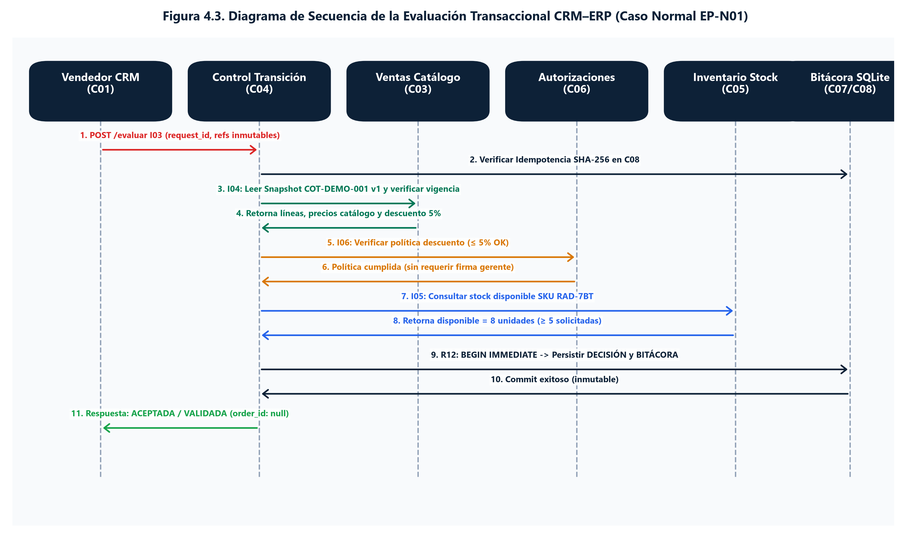
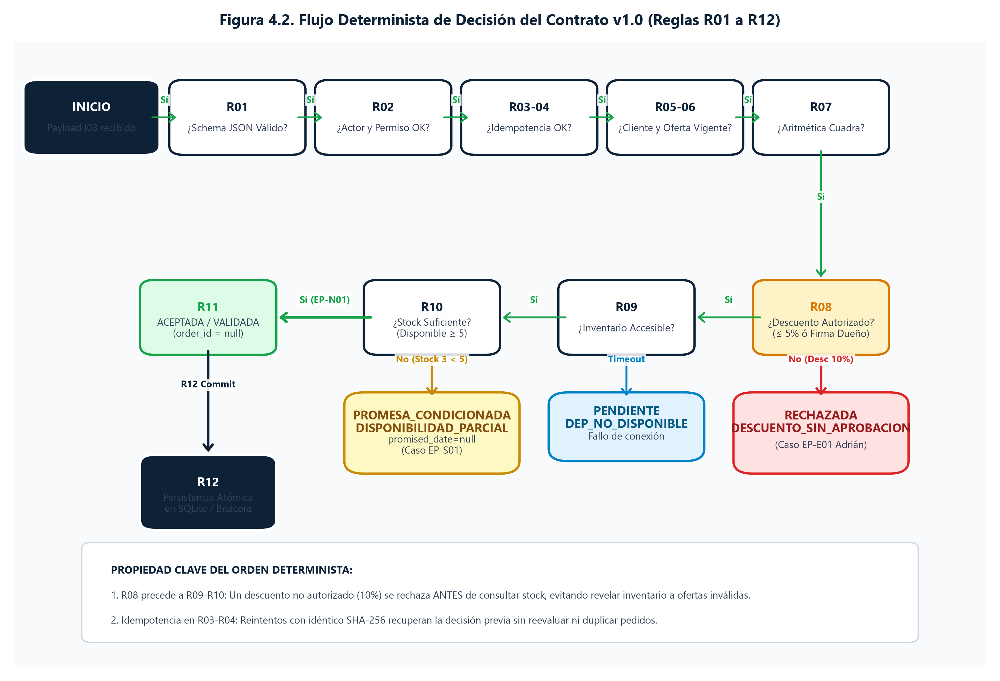

# Contrato de integración CRM–ERP para el examen parcial

IMPORTACIONES MYS HERMANOS S.A.C. · GE703 · UNI FIIS · Grupo 7 · 2026-2  
Gabriel Omar Chavez Mendoza · Sección 4 de la plantilla · 24 de octubre de 2026 · Intervención de 06:00 a 09:00

## 1 Decisión que defiende Gabriel

Propongo que la transición de una intención comercial registrada en el CRM a un compromiso operativo gobernado por el ERP debe estar regulada por un **contrato técnico explícito** que especifique qué datos viajan, qué controles se aplican, en qué orden, y qué respuestas tipificadas se conservan con trazabilidad completa. Sin este contrato, una cotización aceptada por el cliente podría convertirse en un pedido sin verificar identidad, vigencia, autorización de descuento ni disponibilidad real.

El contrato de transición v1.0 define que el mensaje de solicitud (I03) transporta **únicamente referencias** — nunca importes, roles ni indicadores de aprobación que el solicitante pueda fabricar. Los datos comerciales se contrastan con los **sistemas de registro confiables** (Ventas, Inventario, Autorizaciones) en el servidor, no con valores declarados en el payload. La respuesta conserva estado, código, motivo, responsable y acción siguiente; `order_id` permanece nulo porque este contrato evalúa, no confirma.

### Texto para la sección 4 de la plantilla Word

**Responsable:** Gabriel Omar Chavez Mendoza. **Evidencia:** contrato técnico v1.0 con 7 interfaces documentadas (I01–I07), 12 reglas de evaluación (R01–R12) en orden de precedencia, JSON Schemas formales de solicitud y respuesta (Draft 2020-12), simulador local con 4 estados y 15 códigos de respuesta y resultados compartidos con Benjamín (3 casos, 112 comprobaciones). **Desarrollo:** El contrato de transición CRM–ERP garantiza que ninguna cotización cruce al compromiso operativo sin cumplir precondiciones explícitas de identidad, oferta vigente, autorización comercial y disponibilidad verificada. El mensaje de solicitud I03 transporta nueve campos de referencia inmutables — `contract_version`, `company_id`, `request_id`, `correlation_id`, `opportunity_id`, `customer_id`, `quotation_id`, `quotation_version` y `acceptance_id` — y rechaza campos adicionales. Los importes, precios y stock se leen desde los sistemas de registro confiables (C03 Ventas, C05 Inventario, C06 Autorizaciones) mediante las interfaces I04, I05 e I06; nunca desde el payload del solicitante. La evaluación sigue un orden determinista: primero valida la estructura del mensaje (R01), luego la autorización del actor (R02), después la idempotencia (R03–R04), la consistencia del cliente y los vínculos comerciales (R05–R06), la integridad aritmética de la oferta (R07), la política de descuentos y aprobación del dueño (R08), y finalmente la disponibilidad de inventario (R09–R10). Solo cuando todos los controles se superan, la solicitud alcanza el estado `ACEPTADA` con código `VALIDADA` y `order_id = null` (R11). La decisión y sus eventos de bitácora se persisten atómicamente (R12); un reintento con el mismo contenido recupera la respuesta original sin duplicar la evaluación. El contrato devuelve cuatro estados posibles — `ACEPTADA`, `RECHAZADA`, `PROMESA_CONDICIONADA` y `PENDIENTE` — cada uno con su código específico, responsable asignado y acción siguiente documentada. Este diseño permite que Benjamín demuestre las tres variantes del recorrido (normal, faltante y excepción) y que Adrián analice el quiebre del descuento sin aprobación, manteniendo una arquitectura coherente con los módulos identificados por Jharolym.

### Fila para la matriz de integrantes

| Integrante | Contribución verificable | Decisión que defenderá |
| --- | --- | --- |
| Chavez Mendoza, Gabriel Omar | Contrato de transición v1.0 con 7 interfaces, 12 reglas, JSON Schemas, adaptación del caso Andina a MYS, frontera conceptual CRM–ERP con precondiciones y estados tipificados | Regular la transición CRM–ERP mediante un contrato técnico que impida compromisos operativos sin verificar identidad, oferta vigente, autorización y disponibilidad |

## 2 El problema que resuelve el contrato

Sin un contrato de transición explícito, la integración CRM–ERP presenta riesgos concretos que el Ing. Chaparro identifica en las Sesiones 6 y 7:

| Riesgo | Consecuencia sin contrato | Control que aporta el contrato |
| --- | --- | --- |
| Un vendedor envía un descuento del 10 % como si fuera aprobado | El ERP compromete un pedido con condiciones no autorizadas | R08: el contrato verifica que exista una aprobación **independiente** del dueño, vinculada a la misma versión e importe; el vendedor no puede autoaprobarse |
| Se crea un pedido con una cotización vencida | Se comprometen recursos sobre condiciones que el cliente puede ya no aceptar | R06: el contrato verifica que la cotización esté en estado `sent`, con vigencia activa y aceptación exacta de esa versión |
| Se promete entrega sin verificar stock | El cliente recibe una confirmación y el almacén no puede cumplir | R09–R10: la consulta de disponibilidad se realiza **dentro de la evaluación**, y si es insuficiente la respuesta es `PROMESA_CONDICIONADA`, no una confirmación |
| Se duplica una evaluación por reenvío del mismo mensaje | Dos pedidos o dos decisiones para la misma cotización | R03–R04: idempotencia por SHA-256 del contenido y clave única por compañía/cotización/versión |
| Se pierde la trazabilidad de quién decidió qué | Auditoría imposible; no se puede reconstruir el flujo | R12: la decisión y los eventos de bitácora se persisten atómicamente con actor, interfaz, código, correlación y fecha |

El contrato no es un formalismo académico: es la **barrera técnica que impide que una intención comercial se convierta en un compromiso operativo sin las verificaciones necesarias**.

## 3 Frontera conceptual CRM vs. ERP

La Sesión 6 del Ing. Chaparro establece que el CRM y el ERP tienen responsabilidades diferenciadas aunque compartan plataforma (Odoo). El contrato de transición materializa esa frontera:

| Dimensión | CRM (Contexto y relación) | Contrato de transición (Frontera) | ERP (Compromiso y ejecución) |
| --- | --- | --- | --- |
| **¿Qué gestiona?** | Identidad del cliente, lead, oportunidad, interacciones, versiones de cotización y aceptación | Solicitud de evaluación con referencias inmutables; verificación de precondiciones; respuesta tipificada | Pedido confirmado, reserva, movimientos de almacén, factura, cobro y contabilidad |
| **¿Qué decide?** | Si la oferta comercial es viable y el cliente la acepta | Si la empresa **puede y debe** comprometer recursos: identidad verificada, oferta vigente, descuento autorizado, stock consultado | Cuándo ejecutar la operación: reservar, despachar, facturar y cobrar |
| **¿Qué conserva?** | Contexto comercial: historial de interacciones, versiones y respuestas del cliente | Decisión motivada: estado, código, responsable, acción siguiente, correlación y bitácora atómica | Compromiso operativo: pedido, movimientos, comprobantes y asientos contables |
| **Alcance en el parcial** | Dentro: lead, oportunidad, cotización v1/v2, aceptación | Dentro: solicitud, evaluación, respuesta con `order_id = null` | Fuera: pedido, reserva, factura, boleta, cobro y entrega |

**Principio fundamental (Sesión 6, diapositiva 9):** *"Una oportunidad no reserva inventario ni genera cuenta por cobrar; una cotización aceptada por el cliente es un acuerdo comercial, pero solo el ERP valida si la empresa puede comprometer operativamente la entrega."* El contrato v1.0 implementa esta verificación.


## 4 Estructura del contrato de transición v1.0

### 4.1 Mensaje de solicitud I03

El payload de I03 contiene **exclusivamente referencias**. No admite importes, roles, indicadores de aprobación ni campos adicionales:

```json
{
  "contract_version": "1.0",
  "company_id": "MYS-DEMO",
  "request_id": "SOL-EP-N01",
  "correlation_id": "COR-EP-001",
  "opportunity_id": "OPP-DEMO-001",
  "customer_id": "CLI-DEMO-001",
  "quotation_id": "COT-DEMO-001",
  "quotation_version": 1,
  "acceptance_id": "ACE-EP-001"
}
```

| Campo | Propósito | Fuente y control |
| --- | --- | --- |
| `contract_version` | Exactamente `1.0`; versión incompatible se rechaza antes de evaluar | Protección contra evolución no coordinada del contrato |
| `company_id` | Compañía autorizada del actor | Se contrasta con la sesión y todos los maestros; no se confía en un valor libre |
| `request_id` | Clave de idempotencia, única por compañía | Máximo 64 caracteres; estable durante reintentos; deduplicación por SHA-256 |
| `correlation_id` | Referencia estable del recorrido completo | Une oportunidad, solicitud y eventos en la bitácora; **no es clave de deduplicación** |
| `opportunity_id` | Oportunidad asignada al vendedor | C01/CRM; el vendedor solo puede evaluar oportunidades que le pertenecen |
| `customer_id` | Cliente existente, activo y con identidad verificada | C02/Contactos; coincidencia resuelta antes de solicitar la transición |
| `quotation_id` | Cotización del mismo cliente, oportunidad y compañía | C03/Ventas; no se acepta una cotización ajena como equivalente |
| `quotation_version` | Entero positivo; versión vigente de la cotización | Impide evaluar una versión obsoleta o una aceptación de otra versión |
| `acceptance_id` | Evidencia de que el cliente aceptó **esa** cotización y versión | C03/extensión; una nueva versión invalida aceptaciones anteriores |

**¿Por qué no viaja el precio ni el total?** Porque si el vendedor pudiera declarar el importe en la solicitud, podría enviar un total manipulado. El contrato lee los importes desde el **snapshot comercial confiable** en C03/Ventas (interfaz I04) y los recalcula desde el catálogo. Este principio de **datos confiables del servidor, no del solicitante**, es central en la Sesión 6 del docente.

**¿Por qué no viaja el rol ni un indicador `aprobado=true`?** Porque la identidad del actor proviene de la sesión autenticada (C07), no de un campo del payload. Una aprobación declarada por el vendedor en su propio mensaje no sustituye la decisión independiente del dueño registrada en C06.

### 4.2 Las siete interfaces del contrato

| ID | Consumidor → Proveedor | Intercambio | Control |
| --- | --- | --- | --- |
| I01 | CRM → Contactos (C02) | Resolver identidad del cliente; vincular cuenta | Coincidencia ambigua → revisión humana; no duplicar |
| I02 | CRM → Ventas (C03) | Preparar cotización con versión, líneas y precios de catálogo | Producto o precio inválido → corregir; cambio relevante incrementa versión |
| **I03** | **CRM → Control de transición (C04)** | **Solicitar o consultar evaluación con SOL, COR y referencias** | **Schema cerrado; no admite precio, rol ni aprobación del solicitante** |
| I04 | Control de transición (C04) → Ventas (C03) | Leer snapshot comercial: versión aceptada, vigencia, líneas e importes | Vínculos distintos o versión obsoleta → rechazo |
| I05 | Control de transición (C04) → Inventario (C05) | Consultar SKU, ubicación, cantidad disponible y hora | Consultar ≠ reservar; stock parcial → `PROMESA_CONDICIONADA` |
| I06 | Control de transición (C04) → Autorizaciones (C06) | Verificar decisión del dueño para la misma versión e importe | Autoaprobación, versión distinta o aprobación vencida → rechazo |
| I07 | C01–C06 → Seguridad y bitácora (C07) | Autorizar y registrar actor, compañía, evento, código y correlación | Denegación bloquea la acción; no escribe cuerpos sensibles |

I01 e I02 son preparación humana/asistida antes de la solicitud. El contrato evalúa a partir de I03; las interfaces I04 a I06 son consultas internas del evaluador a los sistemas de registro confiables, y I07 registra la auditoría transversalmente.



### 4.3 Las doce reglas de evaluación en orden

El contrato aplica las reglas en un **orden determinista**. Un descuento no autorizado se rechaza **antes** de consultar inventario; una versión obsoleta se rechaza **antes** de verificar el descuento. Este orden previene evaluaciones innecesarias y garantiza que cada rechazo identifique la **primera** regla incumplida.



| Regla | Comprobación | Resultado si falla | Interfaz |
| --- | --- | --- | --- |
| R01 | Estructura conforme al JSON Schema; campos exactos | `RECHAZADA` / `CONTRATO_INVALIDO` | I03 |
| R02 | Actor de sesión con rol Ventas, compañía y oportunidad asignada | `RECHAZADA` / `NO_AUTORIZADO` | I07 |
| R03 | Misma clave (`request_id`) + mismo contenido → devolver estado existente | Retorno idempotente (no es falla) | I03 |
| R04 | Misma clave + contenido distinto, u otra clave para la misma cotización/versión | `RECHAZADA` / `IDEMPOTENCIA_CONFLICTO` o `COTIZACION_YA_EVALUADA` | I03 |
| R05 | Cliente activo, identidad revisada y vínculos coherentes (compañía, oportunidad) | `RECHAZADA` / `CLIENTE_NO_VALIDADO` o `DATOS_INCONSISTENTES` | I04 |
| R06 | Cotización en estado `sent`, vigencia activa, versión actual y aceptación exacta válida | `RECHAZADA` / `VERSION_OBSOLETA`, `COTIZACION_NO_ENVIADA`, `COTIZACION_VENCIDA` o `ACEPTACION_INVALIDA` | I04 |
| R07 | Líneas con SKU activo, cantidad positiva, precio de catálogo, descuento 0–100 y total recalculado | `RECHAZADA` / `PRECIO_INVALIDO` | I04 |
| R08 | Descuento ≤ 5 % permitido; superior requiere aprobación de Gerencia (persona distinta del vendedor, misma versión/total) | `RECHAZADA` / `DESCUENTO_SIN_APROBACION` | I06 |
| R09 | Consultar disponibilidad; si el proveedor de stock falla: `PENDIENTE` sin prometer | `PENDIENTE` / `DEPENDENCIA_NO_DISPONIBLE` | I05 |
| R10 | Disponible < solicitado → `PROMESA_CONDICIONADA`, sin fecha inventada | `PROMESA_CONDICIONADA` / `DISPONIBILIDAD_PARCIAL` | I05 |
| R11 | Todos los controles superados | `ACEPTADA` / `VALIDADA`; `order_id = null` | I07 |
| R12 | Guardar decisión y eventos atómicamente; no borrar historial | Rollback si falla el commit | I07/C08 |

**R01–R02 se comprueban antes de leer reintentos idempotentes.** Un mensaje con estructura inválida o actor no autorizado ni siquiera consume la clave de solicitud. Esto protege contra inyección de payloads malformados.

**R08 precede a R09–R10.** El caso EP-E01 demuestra este orden: la solicitud con 10 % de descuento sin aprobación del dueño se rechaza con `DESCUENTO_SIN_APROBACION` **sin llegar a consultar inventario**. Esto evita revelar información de stock a un contexto comercial que aún no cumple las condiciones mínimas.

### 4.4 Estados y códigos de respuesta

La respuesta siempre incluye: `contract_version`, `request_id`, `correlation_id`, `quotation_id`, `quotation_version`, `status`, `code`, `message`, `responsible_role`, `required_action`, `total`, `currency`, `order_id` y `conditions`.

| Estado | Significado operativo | Código(s) asociados | `order_id` | Responsable |
| --- | --- | --- | --- | --- |
| `ACEPTADA` | Solicitud validada; confirmación operativa pendiente en otro incremento | `VALIDADA` | `null` | VENTAS |
| `RECHAZADA` | Regla incumplida; la respuesta indica cuál, quién debe corregir y qué hacer | `DESCUENTO_SIN_APROBACION`, `CONTRATO_INVALIDO`, `NO_AUTORIZADO`, `IDEMPOTENCIA_CONFLICTO`, `COTIZACION_YA_EVALUADA`, `DATOS_INCONSISTENTES`, `CLIENTE_NO_VALIDADO`, `VERSION_OBSOLETA`, `COTIZACION_NO_ENVIADA`, `COTIZACION_VENCIDA`, `ACEPTACION_INVALIDA`, `PRECIO_INVALIDO` | `null` | VENTAS o GERENCIA |
| `PROMESA_CONDICIONADA` | Disponibilidad parcial; no promete fecha; requiere nueva aceptación del cliente | `DISPONIBILIDAD_PARCIAL` | `null` | VENTAS |
| `PENDIENTE` | Dependencia inaccesible (ej. servicio de stock no responde); no hay decisión comercial | `DEPENDENCIA_NO_DISPONIBLE` | `null` | ADMINISTRADOR_Y_VENTAS |

**`ACEPTADA` ≠ pedido confirmado.** `ACEPTADA` es el estado de la solicitud de evaluación y `VALIDADA` es su código. No son dos etapas sucesivas ni equivalen a un pedido operativo. El `order_id` es `null` en todas las respuestas de este contrato.

**`PROMESA_CONDICIONADA` ≠ promesa firme.** La respuesta incluye `conditions` con SKU, cantidad solicitada, cantidad disponible, `promised_date: null` y `requires_customer_acceptance: true`. No se inventa una fecha de reposición.

**`PENDIENTE` ≠ stock cero.** Significa que un servicio del que depende la evaluación no respondió. La solicitud se puede reanudar cuando se recupere la dependencia; no se rechaza comercialmente al cliente por un fallo técnico.

### 4.5 Idempotencia, huella y persistencia atómica

El contrato garantiza que un reintento con el **mismo `request_id` y mismo contenido** recupera la respuesta original sin duplicar la evaluación:

1. Se calcula la huella SHA-256 del JSON completo con claves ordenadas.
2. Si existe una solicitud con la misma clave y la misma huella → se devuelve el resultado persistido y se registra un evento `REINTENTO`.
3. Si existe una solicitud con la misma clave pero **huella distinta** → `IDEMPOTENCIA_CONFLICTO`.
4. Si existe **otra solicitud** para la misma cotización/versión → `COTIZACION_YA_EVALUADA`.

La decisión de negocio y sus eventos de bitácora se confirman **en la misma transacción** (R12). Si el proceso cae antes del commit, el reintento no encuentra una decisión parcial. En el simulador local esto se implementa con `BEGIN IMMEDIATE` en SQLite; en producción requiere el equivalente transaccional en PostgreSQL/ORM de Odoo.


## 5 Calibración con el caso Andina (Sesión 7)

La Sesión 7 del Ing. Chaparro presenta el caso de Andina Manufactura como ejemplo de referencia para calibrar el contrato. La calibración consiste en verificar que el contrato produce las respuestas correctas ante escenarios representativos:

| Escenario Andina (B2B, manufactura) | Respuesta del contrato de Andina | Escenario MYS equivalente (B2C, comercio presencial) | Respuesta del contrato v1.0 de MYS |
| --- | --- | --- | --- |
| Pedido de 1,000 unidades, descuento 3 % autorizado, stock completo | Evaluación validada; pedido procede | EP-N01: 5 autoradios, descuento 5 % permitido, stock 8 | `ACEPTADA` / `VALIDADA`; `order_id = null` |
| Descuento del 8 % solicitado sin aprobación del gerente comercial | Rechazo por falta de autorización; escalar a gerencia | EP-E01: descuento 10 % (v2) sin aprobación del dueño | `RECHAZADA` / `DESCUENTO_SIN_APROBACION`; responsable `GERENCIA` |
| Stock disponible 650 de 1,000 solicitados | Promesa condicionada; entrega parcial con saldo de 350 pendiente | EP-S01: stock 3 de 5 solicitados | `PROMESA_CONDICIONADA` / `DISPONIBILIDAD_PARCIAL`; déficit 2; `promised_date: null` |
| Factura única al completar las 1,000 unidades | Regla de cumplimiento antes de ingreso; factura diferida | Boleta de venta al contado por retiro en tienda | Condición de facturación diferida; fuera del alcance del parcial |
| Proveedor con reposición atrasada | Señal de reposición documentada sin prometer fecha | EP-S01: señal `REP-EP-001` con déficit 2 | Señal conceptual P2P; sin compra, reserva ni fecha comprometida |

**Diferencias clave entre Andina y MYS que el contrato adapta:**

| Dimensión | Andina Manufactura | MYS Hermanos |
| --- | --- | --- |
| Segmento | B2B, cliente industrial recurrente | B2C, consumidor final nuevo (persona natural) |
| Volumen | 1,000 unidades, entregas parciales | 5 autoradios, retiro completo en tienda |
| Crédito | A plazo, con límite y condiciones | Al contado, pago íntegro sin crédito |
| Facturación | Factura única al completar el cumplimiento | Boleta de venta por retiro (fuera del parcial) |
| Descuento | Umbral por acuerdo contractual | Umbral didáctico del 5 % para vendedor |
| Comprobante | Factura posterior al cumplimiento | Boleta al contado; emisión fuera del corte EP |

El contrato v1.0 es **neutral al segmento**: las 12 reglas se aplican igual a B2B y B2C. Lo que cambia son los **parámetros de los maestros** (umbral de descuento, condición de facturación, tipo de comprobante), no la lógica de evaluación.


## 6 Aplicación al recorrido: cómo el contrato gobierna los tres casos

### 6.1 EP-N01 · Caso normal

**Entrada:** `SOL-EP-N01`, `COT-DEMO-001 v1`, 5 × S/ 400, descuento 5 %, total S/ 1,900, stock 8.

1. R01: estructura válida ✓
2. R02: actor `VEN-DEMO-01` con rol Ventas y oportunidad asignada ✓
3. R03–R04: primera solicitud; no hay conflicto ✓
4. R05: cliente `CLI-DEMO-001` activo y verificado ✓
5. R06: cotización v1, estado `sent`, vigente hasta 18:00, aceptación `ACE-EP-001` de la misma versión ✓
6. R07: 5 × S/ 400 = S/ 2,000; descuento 5 % = S/ 100; total S/ 1,900 ✓
7. R08: 5 % ≤ 5 % → permitido sin aprobación ✓
8. R09–R10: 8 disponibles ≥ 5 solicitados ✓
9. R11: **`ACEPTADA` / `VALIDADA`**; `order_id = null`

**Bitácora:** `RECIBIDA` → `SNAPSHOT_COMERCIAL` → `POLITICA_DESCUENTO` → `DISPONIBILIDAD` → `VALIDADA`.

### 6.2 EP-S01 · Disponibilidad parcial (enlace P2P)

**Entrada:** misma solicitud; snapshot de disponibilidad alterado a 3.

1. R01–R08: todos los controles pasan (misma oferta v1, 5 % permitido) ✓
2. R09: consulta de stock → 3 disponibles
3. R10: 3 < 5 → **`PROMESA_CONDICIONADA` / `DISPONIBILIDAD_PARCIAL`**

**Condiciones:** `{ sku: "RAD-7BT", requested: 5, available: 3, promised_date: null, requires_customer_acceptance: true }`.

**Señal P2P:** `REP-EP-001` con déficit 2, generada por el arnés de evidencia **fuera del contrato**, como enlace conceptual O2C–P2P. No crea compra, reserva ni fecha.

### 6.3 EP-E01 · Descuento sin aprobación (enlace con Adrián)

**Entrada:** `SOL-EP-E01`, `COT-DEMO-001 v2`, descuento 10 %, total S/ 1,800, sin aprobación del dueño.

1. R01–R07: estructura, actor, cliente, versión y aritmética válidos ✓
2. R08: 10 % > 5 % → requiere aprobación de Gerencia → C06 no acredita → **`RECHAZADA` / `DESCUENTO_SIN_APROBACION`**
3. R09–R10: **no se ejecutan** (el rechazo ocurre antes de consultar inventario)

**Bitácora:** `RECIBIDA` → `SNAPSHOT_COMERCIAL` → `POLITICA_DESCUENTO` → `DESCUENTO_SIN_APROBACION`.

**¿Por qué no se consulta inventario?** Porque el contrato aplica las reglas en orden: si el descuento no está autorizado, no tiene sentido revelar información de stock a un contexto comercial que no cumple las precondiciones. Este es el mismo caso que Adrián analizará como quiebre en la sección 5.


## 7 Seguridad, auditoría y datos

- **Huella de integridad:** SHA-256 del JSON completo con claves ordenadas y versión normalizada. Protege contra alteración del payload entre envío y evaluación.
- **Transacción atómica:** en el simulador, `BEGIN IMMEDIATE` en SQLite; en Odoo, PostgreSQL con ORM. PK `(company_id, request_id)` y restricción UNIQUE `(company_id, quotation_id, quotation_version)`. Una solicitud final es **inmutable**.
- **Bitácora correlacionada:** cada evento registra `event_id`, `company_id`, `request_id`, `correlation_id`, `actor_id`, `interface_id`, `event_type`, `code` y `occurred_at`. El `correlation_id` permite seguir todo el recorrido; el `request_id` identifica la solicitud específica.
- **Segregación de funciones:** el vendedor solicita; el dueño aprueba; el evaluador verifica. El payload no puede fabricar identidad ni aprobación. La sesión comercial no puede aprobar sus propios descuentos.
- **Datos sintéticos:** no se ingresan conversaciones reales, DNI, RUC de clientes, teléfonos ni credenciales. Se usan referencias sintéticas (`CLI-DEMO-001`, `VEN-DEMO-01`, etc.).

## 8 Indicadores del contrato

| Indicador | Fórmula y fuente | Responsable | Criterio |
| --- | --- | --- | --- |
| Solicitudes con trazabilidad completa | Solicitudes con CLI, OPP, COT/versión, ACE, SOL y COR coherentes ÷ solicitudes evaluadas × 100 | Ventas | Meta: 100 %. Mide si todas las transiciones conservan la cadena de referencia |
| Reintentos sin conflicto | Reintentos que recuperan la respuesta original ÷ reintentos totales × 100 | Administrador | Meta: 100 %. Mide la efectividad de la idempotencia |
| Rechazos con causa y responsable | Rechazos con código, responsable y acción siguiente documentados ÷ rechazos totales × 100 | Ventas / Gerencia | Meta: 100 %. Asegura que todo rechazo sea accionable, no genérico |
| Evaluaciones sin consulta a inventario innecesaria | Rechazos por R01–R08 sin haber ejecutado I05 ÷ rechazos por R01–R08 × 100 | Evaluación ERP | Meta: 100 %. Verifica que el orden de reglas se respeta |

Los indicadores miden el **comportamiento del contrato**, no métricas de negocio. No hay línea base empresarial medida; los valores se verifican con el simulador local.

## 9 Guion de tres minutos

**06:00–06:30 · Decisión y problema.** "Defiendo que la transición de una intención comercial a un compromiso operativo necesita un contrato técnico explícito. Sin este contrato, un vendedor podría enviar un descuento no autorizado y el ERP lo aceptaría; una cotización vencida se convertiría en pedido; un stock inexistente se prometería. El contrato v1.0 previene estos tres riesgos."

**06:30–07:15 · Estructura del mensaje y principio de datos confiables.** "El mensaje de solicitud I03 transporta nueve campos de referencia: empresa, solicitud, correlación, oportunidad, cliente, cotización, versión y aceptación. No viajan importes, roles ni indicadores de aprobación. ¿Por qué? Porque los importes se leen desde el sistema de registro confiable — Ventas y su catálogo — y se recalculan. Un campo `aprobado=true` escrito por el vendedor no sustituye la decisión independiente del dueño."

**07:15–08:00 · Reglas en orden y tres variantes.** "Las doce reglas se aplican en orden determinista. Primero validamos estructura y permisos; después idempotencia; luego la oferta vigente y aceptada; después la política de descuentos; y al final el inventario. En EP-N01, las doce reglas pasan: ACEPTADA, VALIDADA, order_id nulo. En EP-S01, el stock de tres unidades produce PROMESA_CONDICIONADA sin inventar una fecha. Y en EP-E01, el 10 % sin aprobación del dueño se rechaza **antes** de consultar inventario. Este orden es intencional: no revelamos stock a un contexto que no cumple las condiciones comerciales."

**08:00–08:30 · Idempotencia y auditoría.** "Si el vendedor reenvía la misma solicitud, el contrato devuelve exactamente la misma respuesta: una sola solicitud, una sola decisión, un evento de reintento auditado. Si cambia el contenido con la misma clave, se rechaza por conflicto. La decisión y su bitácora se persisten atómicamente: actor, interfaz, código y correlación."

**08:30–09:00 · Calibración y transición.** "Calibré el contrato con el caso Andina de la Sesión 7: descuento no autorizado, stock parcial y factura diferida producen las mismas categorías de respuesta en MYS. La diferencia está en los parámetros — B2C, contado, retiro en tienda — no en la lógica. El contrato es neutral al segmento. Adrián mostrará ahora qué sucede cuando el 10 % se escala al dueño y la decisión debe formalizarse."

## 10 Preguntas para la defensa

**¿Por qué necesitan un contrato si todo está en Odoo?** Porque compartir plataforma no elimina la necesidad de gobernar la transición. Sin reglas explícitas, un módulo podría crear un pedido sin verificar que la cotización esté vigente o que el descuento esté aprobado. El contrato formaliza las precondiciones que cualquier implementación debe cumplir.

**¿Qué pasa si el dueño aprueba el 10 % después del rechazo?** La solicitud rechazada es inmutable (decisión histórica). Ventas prepara una nueva versión con las condiciones autorizadas, el cliente acepta esa nueva versión y se envía una nueva solicitud con nuevo `request_id`. No se modifica la decisión anterior.

**¿Por qué `order_id` es siempre nulo?** Porque este contrato **evalúa**, no confirma. La evaluación valida que las precondiciones se cumplan. La confirmación del pedido corresponde a un incremento posterior donde se reserva inventario, se aplica el cobro y se emite el comprobante.

**¿Qué diferencia hay entre `ACEPTADA` por el contrato y la aceptación del cliente?** La aceptación del cliente (`acceptance_id`) es un hecho que alimenta la solicitud: el cliente acepta una oferta comercial. `ACEPTADA` es el estado de la evaluación técnica: la empresa verifica que puede comprometer recursos bajo esas condiciones. Son hechos distintos registrados por sistemas distintos.

**¿Cómo se verifica que el contrato funciona?** Con el simulador local que aplica las 12 reglas sobre fixtures sintéticas. Los 3 casos (EP-N01, EP-S01, EP-E01) producen 112 comprobaciones verificables. No acredita Odoo desplegado, permisos reales ni concurrencia de inventario.

**¿Por qué se aplica R08 antes de R09?** Para no revelar información de stock a un contexto comercial que aún no cumple la política de descuentos. Si el descuento no está autorizado, no tiene sentido evaluar si hay existencias. Además, corregir el descuento es responsabilidad de Gerencia; corregir el stock es responsabilidad de Almacén. Mezclar ambas responsabilidades en un solo rechazo complica la acción correctiva.

**¿Qué pasaría en producción con concurrencia?** El simulador usa `BEGIN IMMEDIATE` en SQLite. En Odoo/PostgreSQL se necesita el equivalente transaccional con restricciones UNIQUE y bloqueo adecuado. La simulación demuestra la lógica; la verificación de concurrencia real queda pendiente de implementación.

**¿Cómo se compara con el caso Andina?** Las mismas categorías de respuesta aplican: validación, rechazo por descuento, promesa condicionada por stock parcial. La diferencia es que Andina es B2B con entregas parciales y factura diferida, mientras MYS es B2C con retiro completo y boleta al contado. El contrato es neutral al segmento; los parámetros cambian en los maestros.

## 11 Cobertura de la rúbrica individual

| Criterio oficial | Puntos | Cómo lo demuestra Gabriel | Evidencia local |
| --- | --- | --- | --- |
| Dominio funcional y contexto | 4 | Explica la frontera CRM–ERP, la necesidad del contrato y las diferencias con Andina; justifica por qué una cotización aceptada no es un pedido y la facturación queda fuera | Frontera CRM–ERP, calibración Andina–MYS y principios de la Sesión 6 |
| Integración y arquitectura | 4 | Sustenta las 7 interfaces (I01–I07) y cómo C04 coordina consultas a C03, C05, C06 y C07 dentro de la plataforma propuesta | Tabla de interfaces, diagrama de estados y sistemas de registro |
| Datos, controles y trazabilidad | 3 | Detalla los 9 campos del payload, las 12 reglas en orden, la idempotencia SHA-256 y la bitácora atómica | JSON Schema, reglas R01–R12, huella y persistencia transaccional |
| Reproducibilidad y evidencia | 3 | Referencia los 3 casos de Benjamín (112 comprobaciones) y demuestra el simulador con la estructura del contrato | Simulador, fixtures, resultados y manifiesto de ejecución |
| Argumentación y comunicación individual | 3 | Defiende una decisión concreta en tres minutos con el guion; explica el orden de reglas sin leer diapositivas | Guion cronometrado y preguntas de defensa preparadas |
| Contribución y coordinación | 2 | Recibe la posta de Benjamín (recorrido) y la entrega a Adrián (quiebre); mantiene los mismos identificadores y arquitectura de Jharolym | Transiciones explícitas, fila de contribución e identificadores coherentes |
| Ética y propiedad intelectual | 1 | Declara datos sintéticos, cita las Sesiones 6 y 7 del Ing. Chaparro, explicita uso de IA y reconoce que el despliegue no se ha verificado | Fuentes, supuestos y declaración de IA |

**Total: 20 puntos.** Esta es una matriz de cobertura del aporte, no una calificación otorgada. Todos los criterios se aplican a Gabriel; los puntos no se reparten entre miembros del grupo. La revisión humana y el ensayo deben completarse antes de la exposición.

## 12 Fuentes, supuestos y revisión

| Referencia | Uso y localización | Consulta |
| --- | --- | --- |
| GE703 Sesión 6 Presentación, Enrique Chaparro, UNI FIIS | Frontera CRM–ERP, precondiciones de transición, principio de datos confiables, respuestas tipificadas | 22/10/2026 |
| GE703 Sesión 7 Presentación, Enrique Chaparro, UNI FIIS | Caso Andina como calibración; factura única al cumplimiento; descuento industrial vs. comercial | 22/10/2026 |
| GE703 EP Instrucciones y Rúbrica Comité, material docente | Alcance hasta solicitud/respuesta; siete criterios individuales, total 20 | 22/10/2026 |
| Reparto Parcial G7, propuesta de equipo | Gabriel, sección 4, tres minutos, contrato de integración CRM–ERP | 22/10/2026 |
| Plantilla GE703 EP G7, Word adjunto | Sección 4 y fila de contribución; se prepara texto para integrar | 22/10/2026 |
| [Contrato local v1.0](../../../arquitectura/contratos/crm-erp-v1.md) | Interfaces, reglas, estados, respuestas, idempotencia y persistencia | 22/10/2026 |
| [JSON Schema de solicitud](../../../arquitectura/contratos/solicitud-pedido-v1.schema.json) | Estructura cerrada del payload I03 | 22/10/2026 |
| [JSON Schema de respuesta](../../../arquitectura/contratos/respuesta-pedido-v1.schema.json) | Respuestas tipificadas con validaciones condicionales | 22/10/2026 |
| [PC2 consolidada](../../pc2/entrega-pc2.md) | Cliente nuevo, precios, IDs, frontera comercial y Sección 3 de Gabriel | 22/10/2026 |
| [Resultados EP de Benjamín](../../../pruebas/ep-benjamin/evidencias/resultados.md) | Tres casos, 112 comprobaciones como evidencia compartida | 22/10/2026 |
| [Arquitectura integrada de Jharolym](../../../arquitectura/crm-erp-ep.md) | Sistemas de registro C01–C08, interfaces I01–I07 y eventos E01–E07 | 22/10/2026 |
| [Odoo 19 documentación de flujo de ventas](https://www.odoo.com/documentation/19.0/applications/sales/sales/send_quotations/get_paid_to_validate.html) | Referencia técnica de validación de cotizaciones; no prueba despliegue MYS | 22/10/2026 |

**Hechos documentales:** empresa y giro, foco presencial/público general de PC2, reparto y alcance del parcial. **Supuestos:** cantidades, SKU, precios, descuentos, disponibilidad, umbral del 5 % como regla didáctica (pendiente de validar con el dueño), tiempos y condiciones. **Diseño:** contrato v1.0, reglas de transición, IDs, estados y señal REP. **Resultados observados:** producidos por el simulador local del bloque de Benjamín.

Se utilizó Codex de OpenAI el 22/10/2026 para organizar la estructura, redactar y articular los contratos con el material del equipo. No se realizaron nuevas entrevistas ni operaciones en Odoo. Gabriel debe revisar contenido, cifras y defensa; el grupo debe aprobar la política comercial y completar el panel común. La revisión humana no se registra como ya realizada.
