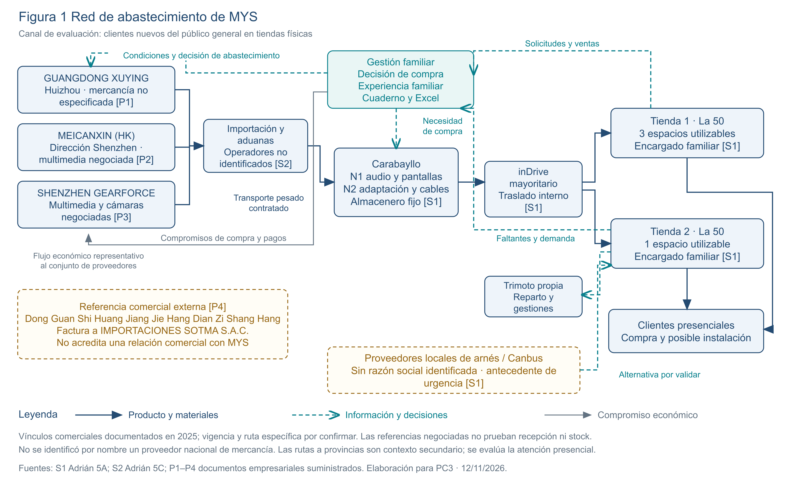
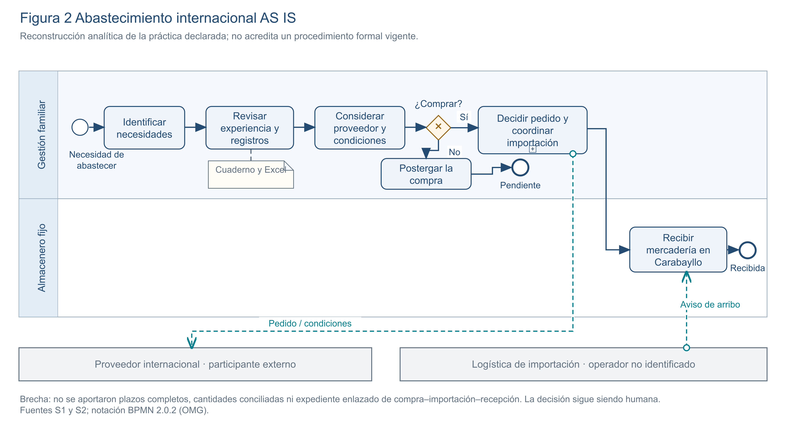
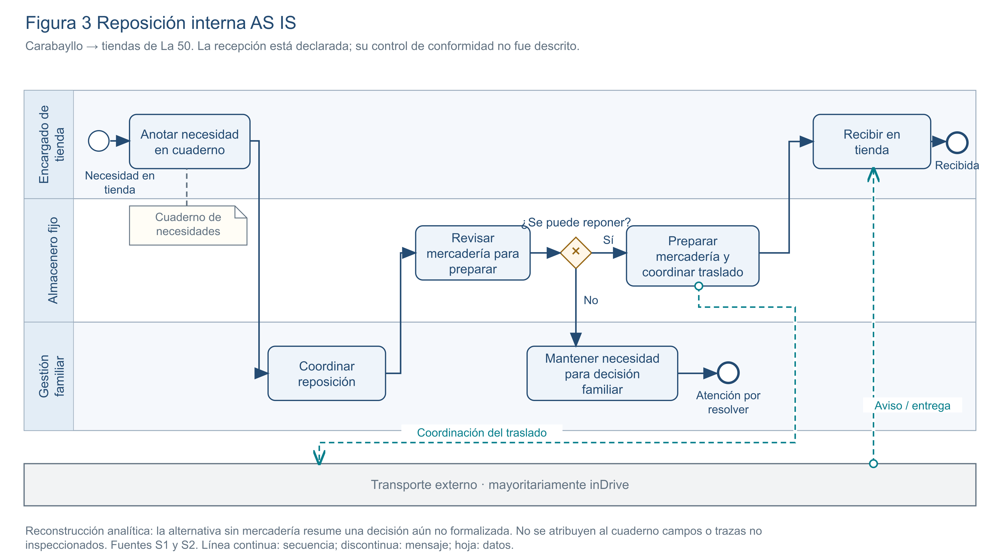
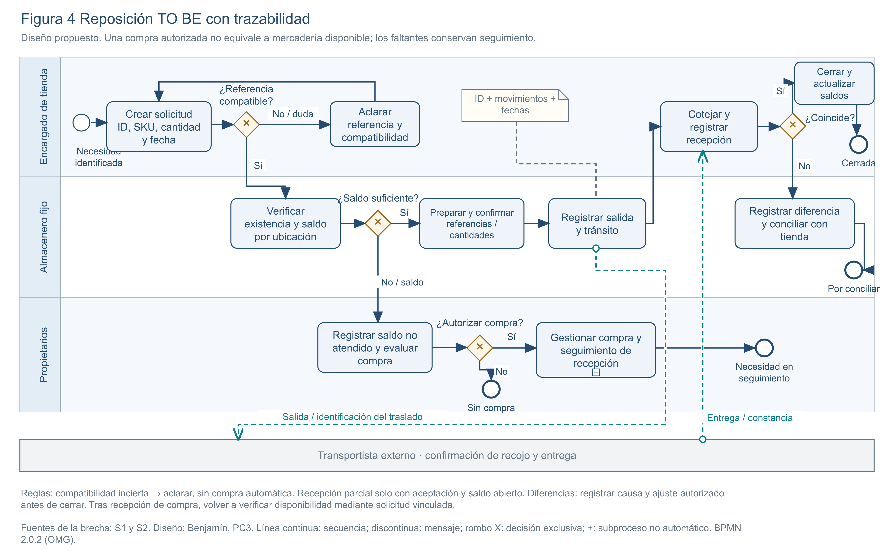

# 5B Cadena de suministro Parte I

**Importaciones MYS Hermanos S.A.C. | GE703 PC3 | UNI FIIS | Grupo 7**

**Responsable:** Benjamín Francis Arancibia Ynga. **Corte documental:** 12 de noviembre de 2026, Lima.

**Base:** `main`, commit `f8613b65993ab8d489fe7f17d8c0ae7785a4daf7`.

La decisión propuesta es implantar primero un registro enlazado de necesidades, existencias por ubicación, despachos y recepciones; la gestión familiar conservará la decisión de compra. La evidencia describe cuaderno y Excel como apoyo vigente y no acredita una cadena digital integrada. Esta brecha de trazabilidad dificulta comprobar qué necesidad fue atendida y cuándo; su magnitud todavía no está medida [S1, S2].

El análisis comprende el abastecimiento empresarial que sostiene la atención de **clientes nuevos del público general que llegan presencialmente a las tiendas físicas**. Los inventarios y recursos son compartidos con otros clientes; los resultados del segmento deberán filtrarse por tipo de cliente y canal. PC1 aporta la selección conceptual de Odoo; PC2 delimita el segmento; el parcial aporta controles y trazabilidad. PC3 examina el sistema de suministro, sin usar una venta aislada como hilo conductor [S3, S4].

## 5B.1 Caracterización de la cadena de suministro

MYS articula dos circuitos: **abastecimiento internacional hacia Carabayllo** y **reposición interna de Carabayllo hacia dos tiendas de La 50, Naranjal, Independencia**. La familia decide compras a China por experiencia y revisión de cuaderno y Excel. Un hijo de la propietaria atiende cada tienda y otro es almacenero fijo. Carabayllo concentra audio y pantallas en el primer nivel y consolas, arneses y cables en el segundo [S1, §5A.1; S2, §5C.2].

| Actor o recurso | Función y relación documentada |
| --- | --- |
| Proveedores internacionales | Tres relaciones históricas identificadas con MYS; detalle y límites en 5B.3. |
| Propietarios y gestión familiar | Evalúan necesidad y compra; coordinan abastecimiento y compromisos económicos. |
| Almacenero fijo de Carabayllo | Localiza y prepara mercadería para las necesidades de las tiendas. |
| Encargados de tienda | Registran necesidades en cuaderno y articulan atención, componentes e instalación. |
| Transporte contratado | Transporte pesado desde Aduanas a Carabayllo; inDrive mayoritario entre almacén y tiendas. Operadores de importación no identificados. |
| Trimoto propia | Reparto y gestiones locales de La 50; no se considera el medio mayoritario de reposición desde Carabayllo. |
| Proveedores locales no identificados | Antecedente de búsqueda urgente de arneses/Canbus; alternativa por validar, sin catálogo o plazo garantizado. |
| Clientes presenciales | Reciben producto y, cuando corresponde, instalación; sus solicitudes y faltantes retroalimentan el abastecimiento. |

El **flujo físico** une proveedores, importación, almacén y tiendas; los componentes compatibles acompañan a los equipos. El **flujo informativo** lleva necesidades desde las tiendas hacia almacén y familia y devuelve confirmaciones de existencia y traslado. El **flujo económico** comprende cobro al cliente, compromisos con proveedores y contratación de transporte. Las cartas históricas declaran pago al contado; no acreditan condiciones de todas las compras actuales. La PC3 no desarrolla conciliación financiera [S1, S2, P1–P3].

*Figura 1. Red empresarial y retroalimentación. Las referencias sin vínculo acreditado con MYS se separan de la red documentada. Fuente: S1, S2 y P1–P4; elaboración para PC3.*

## 5B.2 Diagnóstico AS IS

Los BPMN distinguen responsabilidades y alternativas. Son una **reconstrucción analítica de la operación declarada**, no procedimientos formalmente implantados. Los puntos cuya ejecución o registro no se acredita se explican como brechas; la agrupación de importación no asigna un agente aduanero inexistente en las fuentes [S1, S2].

| Circuito | Entrada y secuencia reconstruida | Decisión, salida y brecha |
| --- | --- | --- |
| Compra internacional | Necesidades y registros → revisión familiar → consulta de referencias y condiciones del proveedor → decisión de compra → importación y transporte → ingreso a Carabayllo. | La familia decide comprar o postergar. Salida: mercadería para almacén o necesidad pendiente. No hay serie aportada de pedidos, plazos y conformidades enlazadas. |
| Reposición interna | Necesidad en tienda → anotación en cuaderno → coordinación → localización por almacenero → preparación → transporte contratado → recepción en tienda. | La existencia y compatibilidad condicionan lo que puede enviarse. Salida: mercadería recibida o necesidad no resuelta. No se ha documentado un registro enlazado de cantidades solicitadas, despachadas y recibidas. |

La disponibilidad insuficiente requiere coordinación familiar, sin poder afirmar una regla actual de compra automática. La documentación tampoco acredita una política uniforme de entregas parciales o recepción con diferencias. Los puntos de control que deben formalizarse son identificación de referencia compatible, confirmación antes del despacho y cotejo en destino. Los aproximadamente 40 minutos mencionados para un traslado tienen recorrido pendiente de precisar y no miden todo el ciclo de reposición [S1, §5A.1; S2, §5C.2].

*Figura 2. Compra internacional e ingreso a Carabayllo. Fuente: S1, S2; interpretación del proceso declarado, con decisiones familiares y participantes externos.*

*Figura 3. Reposición hacia cualquiera de las dos tiendas. Fuente: S1, S2. El detalle de confirmaciones actuales requiere evidencia operativa.*

## 5B.3 Proveedores y dependencias

Los cuatro archivos entregados no constituyen un padrón vigente homogéneo: tres son cartas que vinculan operaciones de 2025 con MYS; el cuarto es un documento comercial dirigido a **Importaciones SOTMA S.A.C.**. La denominación del archivo no sustituye la identificación del comprador. Las tres relaciones con MYS tienen domicilio documentado en China; ello evidencia concentración geográfica de esta muestra, sin permitir calcular participación de compras ni dependencia exclusiva [P1–P4].

| Proveedor y origen | Suministro verificable | Función y límite de la evidencia |
| --- | --- | --- |
| GUANGDONG XUYING TECHNOLOGY CO., LTD; Huizhou, China [P1] | Familia de mercancía no especificada en la carta. | Relación comercial histórica con MYS; no asignar productos. Carta con fecha de emisión sin completar. |
| MEICANXIN ELECTRONICS TECHNOLOGY (HK) CO., LIMITED; domicilio operativo Shenzhen, China [P2] | Referencias negociadas de multimedia T100/8163 de 9 y 10 pulgadas, placa de repuesto y amplificador DSP. | Carta dirigida a SUNAT y anexos de negociación vinculados a MYS. No prueban recepción ni existencia actual. “HK” es parte de la razón social. |
| SHENZHEN GEARFORCE TECHNOLOGY CO., LTD; Shenzhen, China [P3] | Referencias negociadas 9210B/9210 de 9 y 10 pulgadas y cámaras. | Relación histórica con MYS y negociación documentada; no acredita puntualidad, calidad recibida o inventario vigente. |
| DONG GUAN SHI HUANG JIANG JIE HANG DIAN ZI SHANG HANG; Dongguan, China [P4] | Marcos plásticos con cable, cajas, MP5 de 7 pulgadas con cámara y AB017/AB010 CarPlay/Android Auto. | Referencia comercial dirigida a SOTMA; posible alternativa por verificar. No es proveedor confirmado de MYS. |

Los anexos de Meicanxin y Gearforce sustentan negociación por WeChat y ausencia de proforma formal en esas operaciones; conviene conservar una ficha de condiciones aprobadas junto a la referencia y decisión de compra. No corresponde transferir la condición EXW de P4 a los proveedores de MYS. La muestra no identifica razones sociales de proveedores nacionales de mercancía; inDrive es un servicio de transporte, no proveedor de componentes [P2–P4; S2].

La dependencia relevante combina **origen internacional, compatibilidad y trazabilidad proveedor–SKU**. Dos proveedores con productos multimedia no son automáticamente sustitutos: deben contrastarse conectores, dimensiones, firmware, vehículo y soporte. Se propone evaluar cada compra con referencia y compatibilidad aprobadas, cantidad y unidad, condición comercial, fecha prometida, recepción, diferencias y respuesta ante fallas. Estos criterios habilitan posteriormente una comparación verificable; hoy no justifican rankings de costo o puntualidad.

## 5B.4 Demanda y señales de abastecimiento

La experiencia familiar y la revisión de cuaderno y Excel orientan las compras; no hay un pronóstico integrado acreditado [S1]. Para atender al público presencial se necesitan dos señales complementarias: ventas realizadas y solicitudes no atendidas. Las ventas solas omiten demanda perdida por falta de producto, componente o capacidad. Una instalación puede requerir equipo, marco, arnés, cables y, según el vehículo, interfaz compatible; no basta sumar equipos vendidos.

El original **VEN-01**, `REPORTE_DE_PRODUCTOS_VENDIDOS_20261111_234239.xlsx`, no está disponible entre los archivos revisados. El análisis previo de Adrián describe la hoja `Worksheet`, encabezado A2:T2, 93 filas A3:T95 y 92 códigos distintos, moneda PEN y ausencia de fecha transaccional. Registra `VENOM65PRO` en dos filas y observaciones de unidad y montos cero. Se conserva como evidencia secundaria; no se recalcularon sus cifras ni se eliminó el código repetido [S1, fuente VEN-01]. El nombre del archivo no acredita el periodo de ventas; por ello no se obtiene demanda diaria, rotación, cobertura o ABC de valor.

El registro propuesto tendrá una fila por solicitud o línea vendida, con fecha/hora, tienda, SKU, unidad, cantidad, vehículo/compatibilidad, canal, cliente nuevo o recurrente, resultado y causa de no atención. Se enlazará con ventas y reposiciones mediante identificadores. La revisión semanal distinguirá referencias solicitadas, vendidas y no atendidas por tienda, validará duplicados y unidades y considerará estacionalidad solo cuando exista una serie suficiente. Primero se revisará el periodo y la integridad; después podrán compararse tendencias y definir umbrales con aprobación familiar.

## 5B.5 Inventarios por ubicación y compatibilidad

El inventario empresarial comprende Carabayllo, tienda 1 y tienda 2; sus existencias no pertenecen exclusivamente al segmento estudiado. Se propone distinguir también tránsito interno y recepción pendiente de importación. La asignación en Odoo será un diseño de ubicaciones/rutas, validado en piloto, no una configuración vigente [S1, S5, O1].

| Estado propuesto | Tratamiento operativo |
| --- | --- |
| Físico por SKU y ubicación | Conteo existente en la sede, con unidad y fecha; separar dañado o bloqueado. |
| Comprometido | Cantidad asignada a solicitudes o pedidos identificados; no es un movimiento físico adicional. |
| Disponible para asignar | Físico apto menos comprometido apto; no descontar dos veces una reserva ya incluida en el saldo disponible del sistema. |
| En tránsito interno | Salió de origen y todavía no se recibió en destino. Transferir a tránsito; no sumarlo simultáneamente como físico en ambas sedes. |
| Pendiente de recepción internacional | Compra confirmada aún no recibida. Forma parte de la previsión; no de la disponibilidad física inmediata. |

El maestro mínimo incluye SKU único, familia, unidad, modelo y equivalencias validadas; para componentes, marca/modelo/año de vehículo y restricciones conocidas. “Más de mil variantes” declaradas no equivale a un catálogo auditado ni a unidades disponibles [S1]. La preparación debe cotejar equipo y componentes; cualquier sustitución necesita validación técnica.

Los controles prioritarios son conteo inicial por ubicación, salidas y recepciones enlazadas, responsables y hora, conteos cíclicos y ajuste autorizado con causa. Se evitará borrar diferencias para hacer coincidir saldos. El detalle de inventarios y servicio se articula con **5B-II de Shirley** [S5]. La clasificación ABC requiere periodo y valor de consumo comparables; los componentes que bloquean instalación se revisarán además por criticidad, aunque su valor sea bajo.

## 5B.6 Capacidad y disponibilidad para el servicio

Las tiendas disponen de tres y un espacios utilizables. Según 5C, cuatro espacios por diez horas de apertura representan **40 horas-bahía nominales por día**; son potencial espacial, no cuarenta instalaciones ni capacidad efectiva. Las pausas, mezcla de trabajos, técnicos, herramientas compartidas y estado de activos condicionan lo realizable. Se remite a 5A y 5C para criticidad, mantenimiento y cálculos extensos [S1, S2].

| Eslabón | Restricción que debe verificarse antes de prometer atención |
| --- | --- |
| Almacenamiento y preparación | Dos niveles y variedad de componentes; no hay área, volumen útil ni tasa de preparación medidos. Localizar la referencia y preparar el conjunto compatible. |
| Transporte y recepción | Disponibilidad contratada, salida confirmada y recepción en tienda. El tiempo de recorrido no sustituye el ciclo completo. |
| Instalación y demostración | Espacio, técnico, duración del trabajo y herramientas aptas. La falla de fuente afecta demostración sin acreditar por sí sola cierre de todas las bahías. |
| Continuidad | Revisar activos críticos de 5A, condición del transporte y alternativa validada; no clasificar una demora de coordinación como falla mecánica. |

Se propone confirmar una promesa de instalación cuando coincidan **equipo disponible, componentes compatibles, traslado/recepción factibles, personal, espacio y herramientas aptas**. La disponibilidad material y la de recursos son condiciones complementarias. Suponer que existen equipos en Carabayllo no demuestra que puedan instalarse hoy en una tienda.

## 5B.7 Nivel de servicio e indicadores operativos

Los siguientes seis indicadores responden a las brechas de 5B.2; son fichas de medición propuestas, **sin resultados ni metas empresariales calculados**. Se recogerán timestamps en hora de Lima; los tiempos se expresan en horas corridas. El detalle comercial y los casos de prueba del agente permanecen en 5B-II [S5]. No se convierten sus porcentajes sintéticos en desempeño de MYS.

| KPI y decisión que apoya | Fórmula y unidad | Datos y fuente propuesta |
| --- | --- | --- |
| K1 Cumplimiento de reposición interna; revisar despacho y transporte | 100 × solicitudes recibidas completas y conformes dentro de la ventana / solicitudes cuya ventana vence en el periodo. % de solicitudes. | ID, ventana acordada, cantidades y recepción conforme; registro enlazado tienda–almacén. |
| K2 Tiempo de reposición; separar espera de preparación y viaje | Suma de (hora de recepción conforme − hora de solicitud) / solicitudes completadas. Horas corridas. | Timestamps por ID, incluyendo preparación, salida y llegada; registro de movimientos. |
| K3 Exactitud de inventario; priorizar conteos y causas de ajuste | 100 × pares SKU–ubicación sin diferencia física/registro / pares SKU–ubicación contados. %. | Conteo y saldo congelado al corte, misma unidad; acta de conteo y registro de existencias. |
| K4 Disponibilidad de referencias para el segmento; decidir surtido y componentes | 100 × líneas solicitadas con cantidad completa disponible y compatibilidad confirmada en tienda al momento de consulta / líneas solicitadas válidas. %. | Solicitud inicial, cantidad, disponibilidad fechada, compatibilidad y segmento; registro de atención enlazado al stock. |
| K5 Cumplimiento de ventanas internacionales; revisar compromisos del proveedor y logística | 100 × entregas completas y conformes recibidas en Carabayllo dentro de ventana / entregas cuya ventana vence en el periodo. %. | Compra, promesa documentada y recepción; expediente de compra/importación. |
| K6 Trazabilidad de compra; revisar fundamento y autorización | 100 × decisiones sobre solicitudes de compra con expediente completo / decisiones sobre solicitudes de compra del periodo. %. | Necesidad, proveedor/referencia, cantidades, condiciones, decisor, fecha y autorización; ficha familiar de decisión, incluidas aprobación, postergación y rechazo. |

| Indicador | Frecuencia y responsable propuestos | Regla de lectura |
| --- | --- | --- |
| K1 y K2 | Revisión semanal; almacenero y encargados de tienda. | K1 incluye pendientes vencidas y parciales como incumplidas; K2 informa además pendientes y antigüedad para evitar sesgo por medir solo cierres. |
| K3 | Conteos cíclicos semanales y resumen mensual; almacenero, cotejo por encargado de cada sede y ajuste autorizado por propietarios. | Contar cada par una vez por corte; una diferencia positiva no compensa una negativa de otra referencia. |
| K4 | Registro en cada atención, revisión semanal por tienda; encargados de tienda. | Una línea única por solicitud/SKU/unidad; una sustitución no confirma compatibilidad del original. |
| K5 | Por recepción y revisión mensual; gestión familiar responsable de importaciones. | Fijar ventana antes de evaluar; no atribuir toda demora al fabricante sin separar hitos logísticos. |
| K6 | Por decisión y revisión mensual; propietarios. | Un faltante no equivale a orden de compra. La integridad se evalúa con campos obligatorios definidos antes del periodo. |

En K1 y K5 se conservará la ventana original y cualquier modificación con causa y aprobación; las cancelaciones justificadas se reportarán por separado. En todos los porcentajes, denominador cero se informa **no aplicable**, con tamaño de muestra y periodo. No se fijan metas antes de construir una línea base. Al consolidar con 5B-II se conservará una definición común: exactitud por par SKU–ubicación y tiempo en horas corridas, separando cualquier indicador en horas de apertura.

## 5B.8 Modelo propuesto TO BE

El proceso comienza con una solicitud identificable por tienda, SKU, cantidad, compatibilidad y ventana requerida. El almacenero contrasta existencia apta y compromisos por ubicación. Una referencia incompatible se devuelve para aclaración; una falta total o parcial genera necesidad no atendida y nueva promesa acordada. Cualquier envío parcial se autoriza expresamente y mantiene abierto el saldo pendiente. La familia evalúa compras, alternativas y postergación; autorizar una compra no significa que la mercadería ya llegó.

La preparación identifica cantidades y componentes. La salida registra origen, tránsito, transportista y hora. El destino coteja cantidad, referencia y condición; registra lo efectivamente recibido y conserva diferencias en investigación. Solo se cierra conforme cuando se resuelve el saldo; las discrepancias requieren conciliación y ajuste autorizado, sin inflar el disponible. Las necesidades pendientes, recepciones y decisiones retroalimentan la revisión de compras y los KPI.

*Figura 4. Diseño propuesto con validaciones, rutas de faltante y decisión humana. Fuente: brechas de S1, S2 y criterios de P1–P4; no representa un proceso productivo implantado.*

La implantación propuesta tiene tres etapas: **registro común y conteo inicial**, **piloto de traslados entre Carabayllo y ambas tiendas**, y **migración validada a Odoo Compras e Inventario**. Cada etapa termina al comprobar sus registros y responsables, sin imponer fechas ficticias. El piloto debe cubrir despacho completo, falta parcial, incompatibilidad, diferencia de recepción y reintento sin duplicar movimiento.

Odoo permite representar movimientos entre almacenes y tránsito, y Compras organiza cotizaciones y órdenes [O1, O2]. La configuración concreta deberá validarse en la versión del proyecto. Primero se registrarán y confirmarán manualmente los movimientos; las rutas y reglas de reposición automática se considerarán después de validar catálogo, saldos y política. La autorización de compras seguirá en los propietarios y quedará registrada.

## 5B.9 Diagnóstico y decisión sustentada

| Hallazgo y evidencia | Decisión propuesta | Responsable y resultado evaluable |
| --- | --- | --- |
| Cuaderno/Excel y dos circuitos de suministro, sin evidencia enlazada de solicitud a recepción [S1, S2]. | Priorizar ID de solicitud y movimientos por ubicación antes de automatizar reposición. | Almacenero y tiendas; comprobar solicitudes cerradas, pendientes y diferencias con K1–K3. |
| Variedad de componentes y dependencia de activos/espacios [S1, S2]. | Confirmar conjunto compatible y recursos antes de prometer instalación. | Encargado e instalador; contrastar causas de no atención con K4 y disponibilidad de 5A. |
| Tres relaciones históricas con MYS y una referencia de otro comprador [P1–P4]. | Depurar proveedor–SKU, vigencia y condiciones aprobadas, conservando decisión humana. | Propietarios; expediente verificable por decisión y seguimiento de recepción con K5–K6. |

El resultado del análisis es una red diferenciada, procesos reconstruidos, matriz de proveedores y controles medibles. **No se ha observado todavía una mejora de servicio**. La decisión prioriza calidad de información porque permite distinguir falta de existencias, incompatibilidad, demora de transporte y restricción de recursos antes de atribuir una compra necesaria o una pérdida de venta a una sola causa.

### Fuentes y límites del análisis

La base empresarial más reciente prevalece sobre ubicaciones y roles históricos del parcial o Word preliminar. Las declaraciones de propietarios documentadas por Adrián son evidencia testimonial, no conteos auditados. No hay serie original de ventas, stock por sede, solicitudes con timestamps ni importaciones completas para medir demanda, cobertura, concentración económica o servicio. Los documentos de proveedores corresponden a 2025 y no acreditan vigencia en 2026. Estas limitaciones se resolverán con catálogo aprobado, conteo por sede y registros de atención, traslado y compra; la validación corresponderá a la gestión familiar y a cada encargado operativo. No se emplearon escenarios numéricos sintéticos para estimar resultados empresariales.

**Fuentes internas consultadas el 12/11/2026**

- **S1.** Adrián Mansilla, [5A Activos y mantenimiento](../adrian/seccion_5a_activos_mantenimiento.md), especialmente §5A.1 y registro VEN-01. Información EMP-01 a EMP-07 atribuida a propietarios.
- **S2.** Adrián Mansilla, [5C Relación entre activos y cadena](../adrian/seccion_5c_relacion_activos_cadena.md), capacidad, distribución y dependencias.
- **S3.** [Entrega PC2](../../pc2/entrega-pc2.md) y [arquitectura del parcial](../../../arquitectura/crm-erp-ep.md). Continuidad del segmento y del diseño ERP.
- **S4.** `GE703_EP_G7_IMPORTACIONES_MYS (1).pdf`, adjunto del usuario, pp. 3–8, 15, 19 y 30; antecedente y simulación. `GE703_PC3_Instrucciones_y_Rubrica_Agente_SIE.pdf`, pp. 1–2, y `GE703_PC3_PC4_Plantilla_Informe_General_Agente_SIE.docx`, requisitos oficiales.
- **S5.** Shirley Carrión, [5B II Inventarios y servicio](../shirley/seccion_5b_inventarios_servicio.md); interfaz de integración, con indicadores de prueba separados de operación real.
- **S6.** Word preliminar `GE703_PC3_G7_Cadena_Suministro_Parte_I_MYS.docx` y `QA_PC3_ADR-PC3-001_Revision_Ramas.md`, antecedentes metodológicos; no sustituyen datos actuales. El incidente técnico permanece fuera del diagnóstico empresarial.
- **P1–P4.** Adjuntos `GUANGDONG XUYING TECHNOLOGY CO.docx`, `MEICANXIN ELECTRONICS TECHNOLOGY.docx`, `SHENZHEN GEARFORCE TECHNOLOGY CO.docx` y `CI OF SOTMA(1).docx`, respectivamente. Síntesis académica mínima; originales y anexos privados no publicados.

**Referencias técnicas consultadas el 12/11/2026**

- **O1.** Odoo 18, [Inter warehouse replenishment](https://www.odoo.com/documentation/18.0/applications/inventory_and_mrp/inventory/warehouses_storage/replenishment/resupply_warehouses.html). Referencia de diseño de ubicaciones y tránsito.
- **O2.** Odoo 18, [Purchase](https://www.odoo.com/documentation/18.0/applications/inventory_and_mrp/purchase.html). Referencia de cotizaciones y órdenes de compra.
- **N1.** OMG, [BPMN 2.0.2](https://www.omg.org/spec/BPMN/2.0.2). Notación y esquema XML de los modelos editables.

**Contribución, uso de IA y revisión.** Aporte preparado para Benjamín Francis Arancibia Ynga con asistencia de ChatGPT/Codex de OpenAI el 12/11/2026 para contraste documental, redacción, diagramas y comprobaciones de archivos. Las comprobaciones automatizadas y visuales no equivalen a aprobación empresarial ni académica humana; esa revisión final corresponde a Benjamín y al equipo antes de entregar el informe. Se excluyeron contactos personales, cuentas, códigos de pago, firmas, domicilios detallados, precios e importes de negociación. El usuario facilitó las fuentes para este análisis; solo se publica la síntesis necesaria autorizada por su solicitud.
