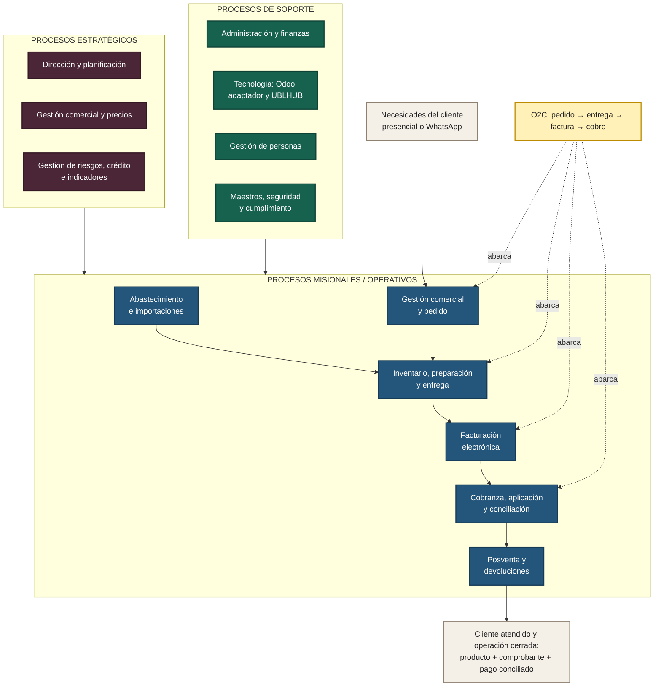
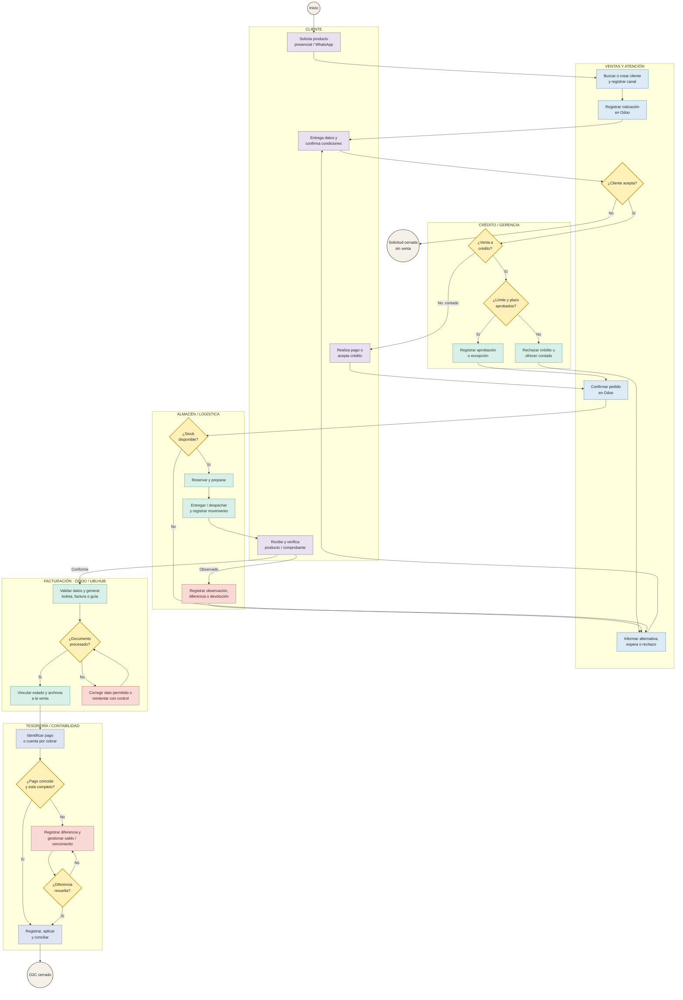

# Macroprocesos ERP: mapa de procesos, SIPOC y flujo por roles del O2C

**Empresa:** IMPORTACIONES MYS HERMANOS S.A.C.  
**Proceso analizado:** Order to Cash (O2C), desde la solicitud del cliente hasta la aplicación y conciliación del cobro.  
**Sistemas objetivo:** Odoo como ERP central y UBLHUB como servicio de emisión electrónica.  
**Canales de origen:** atención presencial y WhatsApp móvil atendido manualmente.  
**Versión:** 1.0 — 3 de octubre de 2026.

## 1. Propósito y alcance

Este documento desarrolla tres artefactos con niveles de detalle complementarios:

1. El **mapa de procesos** ubica el O2C dentro de la organización y muestra su relación con los procesos estratégicos y de soporte.
2. El **SIPOC** delimita el macroproceso O2C e identifica proveedores, entradas, etapas, salidas y clientes.
3. El **flujo por roles** explica quién ejecuta, decide, registra y resuelve las excepciones durante una operación O2C.

Los tres entregables usan el mismo límite: el proceso comienza cuando el cliente solicita o confirma su intención de compra y termina cuando el producto fue entregado, el comprobante fue emitido y el pago quedó identificado, aplicado y conciliado en el ERP. Una cotización no aceptada termina como oportunidad cerrada y no completa el O2C.

### Resultado esperado

El proceso debe dejar una cadena trazable entre:

`canal → cliente → cotización/pedido → reserva → entrega → comprobante → pago → conciliación`

Odoo conserva el estado comercial y financiero de la operación. UBLHUB procesa la boleta, factura o guía de remisión y devuelve su estado. El canal WhatsApp origina la solicitud, pero el vendedor registra manualmente el pedido en Odoo; no se presupone automatización del canal.

### Supuestos que deben validar los responsables del negocio

- La venta minorista se atiende principalmente al contado.
- El crédito se habilita únicamente para clientes autorizados, con límite y plazo registrados.
- La disponibilidad se consulta y la reserva se registra en Odoo.
- El pago puede recibirse antes o después de la entrega según la condición comercial aprobada.
- Facturación y contabilidad supervisan la emisión electrónica, el registro del pago y la conciliación.
- Las excepciones fuera de política requieren autorización y evidencia en el ERP.

---

## 2. Entregable 1: mapa de procesos

### 2.1 Objetivo

El mapa responde: **¿qué procesos conforman la organización, cómo se relacionan y dónde se ubica el O2C?**

El O2C es un macroproceso operativo transversal. Une la atención comercial con inventario, entrega, facturación, tesorería y contabilidad. Los procesos estratégicos fijan sus políticas y metas; los procesos de soporte le proporcionan personas, datos, tecnología y control administrativo.

### 2.2 Diagrama renderizable

### 2.3 Descripción de los procesos

| Nivel | Proceso | Función dentro del modelo | Relación con O2C |
| --- | --- | --- | --- |
| Estratégico | Dirección y planificación | Define objetivos, presupuesto y prioridades | Aprueba metas de venta, servicio y liquidez |
| Estratégico | Gestión comercial y precios | Define segmentos, listas de precios, descuentos y canales | Establece las condiciones con las que se registra el pedido |
| Estratégico | Riesgos, crédito e indicadores | Define límites de crédito, excepciones y controles | Controla exposición, vencimiento y desempeño del ciclo |
| Misional | Abastecimiento e importaciones | Asegura disponibilidad de productos | Alimenta el inventario utilizado para prometer y entregar |
| Misional | Gestión comercial y pedido | Identifica al cliente, cotiza y confirma el pedido | Inicia y estructura la transacción O2C |
| Misional | Inventario, preparación y entrega | Reserva, prepara, despacha y registra conformidad | Convierte el pedido en producto entregado |
| Misional | Facturación electrónica | Genera y controla boletas, facturas y guías | Produce el documento asociado a la venta y entrega |
| Misional | Cobranza, aplicación y conciliación | Identifica el ingreso, lo aplica a la deuda y concilia | Cierra financieramente el O2C |
| Misional | Posventa y devoluciones | Atiende observaciones, cambios, notas y devoluciones | Reabre o ajusta la operación cuando corresponde |
| Soporte | Administración y finanzas | Provee tesorería, contabilidad y control | Registra pagos, diferencias y conciliaciones |
| Soporte | Tecnología | Mantiene Odoo, integración y UBLHUB | Asegura disponibilidad, intercambio y trazabilidad |
| Soporte | Personas | Define perfiles, capacitación y cobertura | Habilita responsables competentes y segregación de funciones |
| Soporte | Maestros, seguridad y cumplimiento | Mantiene datos, accesos y reglas | Reduce duplicidad, errores tributarios y accesos indebidos |

### 2.4 Lectura del mapa

El flujo de valor inicia con la necesidad del cliente. Gestión comercial transforma esa necesidad en un pedido válido; inventario lo convierte en una entrega; facturación genera la evidencia tributaria; cobranza transforma la cuenta por cobrar en dinero aplicado y conciliado. Posventa gestiona los eventos posteriores que afecten producto, comprobante o saldo.

---

## 3. Entregable 2: SIPOC del Order to Cash

### 3.1 Objetivo y límites

El SIPOC responde: **¿quién suministra qué información o recurso, qué hace el proceso, qué produce y quién recibe el resultado?**

| Elemento | Definición |
| --- | --- |
| Evento de inicio | Cliente solicita una cotización o confirma una compra por el canal presencial o WhatsApp |
| Primera actividad controlada | Ventas identifica al cliente y registra la solicitud en Odoo |
| Evento de fin | Pago aplicado y conciliado; pedido, entrega y comprobante vinculados y cerrados |
| Dueño del macroproceso | Responsable comercial, con responsabilidad coordinada de Finanzas sobre cobranza y cierre |
| Alcance incluido | Cliente, pedido, disponibilidad, condición comercial, reserva, entrega, emisión, cobro y conciliación |
| Fuera del alcance | Captación de prospectos, importación completa, automatización de WhatsApp y contabilidad avanzada |

### 3.2 Diagrama SIPOC renderizable

```mermaid
flowchart LR
    subgraph S["S · PROVEEDORES"]
      direction TB
      S1["Cliente"]
      S2["Ventas y Gerencia"]
      S3["Almacén / Abastecimiento"]
      S4["Banco o medio de pago"]
      S5["Odoo, UBLHUB y SUNAT"]
    end

    subgraph I["I · ENTRADAS"]
      direction TB
      I1["Solicitud y datos del cliente"]
      I2["Producto, cantidad, precio<br/>y condición comercial"]
      I3["Stock y modalidad de entrega"]
      I4["Datos tributarios"]
      I5["Confirmación o evidencia de pago"]
    end

    subgraph P["P · PROCESO O2C"]
      direction TB
      P1["1. Registrar solicitud<br/>y cliente"]
      P2["2. Cotizar y validar<br/>stock / crédito"]
      P3["3. Confirmar pedido<br/>y reservar"]
      P4["4. Preparar y<br/>entregar"]
      P5["5. Emitir comprobante<br/>electrónico"]
      P6["6. Cobrar, aplicar<br/>y conciliar"]
      P1 --> P2 --> P3 --> P4 --> P5 --> P6
    end

    subgraph O["O · SALIDAS"]
      direction TB
      O1["Cliente y pedido únicos"]
      O2["Reserva y entrega registradas"]
      O3["Boleta, factura o guía<br/>con estado"]
      O4["Pago identificado y aplicado"]
      O5["Saldo, trazabilidad<br/>e indicadores actualizados"]
    end

    subgraph C["C · CLIENTES"]
      direction TB
      C1["Cliente comprador"]
      C2["Ventas y Gerencia"]
      C3["Almacén"]
      C4["Facturación / Contabilidad"]
      C5["Tesorería y autoridades"]
    end

    S --> I --> P --> O --> C

    classDef supplier fill:#4b2636,color:#fff,stroke:#341823;
    classDef input fill:#dbeaf5,color:#172533,stroke:#6291b5;
    classDef process fill:#24557a,color:#fff,stroke:#163a55,stroke-width:2px;
    classDef output fill:#d9f0e9,color:#16362e,stroke:#5b9e8d;
    classDef customer fill:#17624f,color:#fff,stroke:#0d4134;
    class S1,S2,S3,S4,S5 supplier;
    class I1,I2,I3,I4,I5 input;
    class P1,P2,P3,P4,P5,P6 process;
    class O1,O2,O3,O4,O5 output;
    class C1,C2,C3,C4,C5 customer;
```

### 3.3 Matriz SIPOC detallada

| Proveedores (S) | Entradas (I) | Proceso (P) | Salidas (O) | Clientes de la salida (C) |
| --- | --- | --- | --- | --- |
| Cliente; Ventas | Consulta, canal, identificación, productos y cantidades | **P1. Registrar solicitud y cliente:** buscar coincidencias, crear o reutilizar ficha y registrar canal | Solicitud trazable; cliente único; necesidad definida | Cliente; Ventas; Gerencia |
| Cliente; Gerencia; Almacén; datos maestros | Lista de precios, descuentos, stock, condición de pago, límite de crédito | **P2. Cotizar y validar:** calcular oferta, verificar stock y validar crédito si corresponde | Cotización válida; decisión de stock; crédito aprobado o rechazado | Cliente; Ventas; Almacén; Finanzas |
| Cliente; Ventas; Odoo | Aceptación, datos completos, autorización excepcional si existe | **P3. Confirmar y reservar:** convertir la cotización en pedido y reservar existencias | Pedido confirmado; stock reservado; compromiso de entrega | Cliente; Ventas; Almacén |
| Almacén; Ventas; transportista o cliente | Pedido reservado, instrucciones y modalidad de entrega | **P4. Preparar y entregar:** recoger, verificar, despachar y registrar conformidad u observación | Producto entregado; movimiento de inventario; evidencia de entrega | Cliente; Ventas; Facturación |
| Ventas; Facturación; Odoo; UBLHUB; SUNAT | Venta, receptor, tributos, serie, tipo de documento y datos de traslado | **P5. Emitir comprobante:** generar, enviar, consultar respuesta y vincular archivos y estado | Boleta/factura y, cuando aplique, guía; estado electrónico registrado | Cliente; Facturación; Contabilidad; SUNAT |
| Cliente; banco/medio de pago; Tesorería; Odoo | Pago, referencia bancaria, cuenta por cobrar, tolerancias y vencimiento | **P6. Cobrar, aplicar y conciliar:** identificar el ingreso, registrarlo, aplicarlo al documento y resolver diferencias | Pago aplicado; saldo actualizado; conciliación y cierre o gestión de deuda | Cliente; Tesorería; Contabilidad; Ventas; Gerencia |

### 3.4 Controles y medidas del SIPOC

| Etapa | Control mínimo | Evidencia | Indicador sugerido |
| --- | --- | --- | --- |
| P1 | Buscar por documento/RUC y teléfono normalizado antes de crear | Identificador único y usuario de registro | Porcentaje de clientes duplicados |
| P2 | Validar precio, descuento, stock y crédito | Cotización versionada y autorización | Tiempo de cotización; rechazos por stock/crédito |
| P3 | Evitar confirmación duplicada y stock negativo | Pedido, reserva y referencia de canal | Pedidos registrados una sola vez |
| P4 | Verificar cantidad y conformidad | Movimiento y constancia de entrega | Entregas completas y a tiempo |
| P5 | Usar clave idempotente y conservar respuesta electrónica | Solicitud, respuesta, identificador y archivos | Emisión aceptada al primer envío |
| P6 | Exigir referencia del pago y coincidencia con cuenta/documento | Pago, aplicación, diferencia y conciliación | Días de cobro; cartera vencida; pagos sin aplicar |

---

## 4. Entregable 3: flujo O2C por roles

### 4.1 Objetivo

El flujo responde: **¿quién ejecuta cada actividad, quién decide, qué se registra y quién resuelve las excepciones?** Cada subgrafo del diagrama representa un carril de responsabilidad.

### 4.2 Diagrama renderizable por roles

### 4.3 Responsabilidad y registro por actividad

| N.º | Actividad o decisión | Ejecuta | Decide / responde | Registro obligatorio |
| ---: | --- | --- | --- | --- |
| 1 | Solicitar producto y definir canal | Cliente / Ventas | Cliente | Fecha, canal y referencia de atención |
| 2 | Identificar o crear cliente | Ventas | Ventas | Documento/RUC, tipo y coincidencia reutilizada |
| 3 | Preparar cotización | Ventas | Ventas; Gerencia si hay excepción | Productos, cantidades, precio, vigencia y descuento |
| 4 | Aceptar condiciones | Cliente | Cliente | Aceptación y condición de pago |
| 5 | Validar crédito | Crédito/Finanzas | Responsable autorizado o Gerencia | Límite, deuda, plazo y resolución |
| 6 | Confirmar pedido | Ventas | Ventas | Pedido, canal, cliente y autorización asociada |
| 7 | Comprobar y reservar stock | Almacén / Odoo | Almacén | Ubicación, unidades y reserva |
| 8 | Preparar y entregar | Almacén/Logística | Almacén | Salida, responsable, fecha y conformidad |
| 9 | Emitir documento electrónico | Facturación / integración | Facturación | Solicitud idempotente, respuesta, estado y archivos |
| 10 | Identificar cobro o deuda | Tesorería | Tesorería | Medio, importe, fecha, referencia y cliente |
| 11 | Aplicar y conciliar | Tesorería/Contabilidad | Contabilidad | Documento aplicado, diferencia y conciliación |
| 12 | Resolver excepción | Área originadora | Gerencia cuando sale de política | Motivo, decisión, responsable, fecha y evidencia |

### 4.4 Excepciones del proceso

| Excepción | Tratamiento | Responsable primario | Criterio de salida |
| --- | --- | --- | --- |
| Cliente duplicado o datos incompletos | Detener confirmación, reutilizar ficha o completar datos | Ventas | Cliente único y datos mínimos válidos |
| Precio o descuento fuera de política | Solicitar aprobación antes de confirmar | Gerencia | Autorización vinculada o cotización corregida |
| Crédito rechazado | Ofrecer pago al contado o cerrar solicitud | Crédito / Ventas | Nueva condición aceptada o cierre sin venta |
| Stock insuficiente | Ofrecer sustituto, espera o preventa autorizada | Ventas / Gerencia | Reserva posible o compromiso autorizado |
| Diferencia en preparación o entrega | Registrar observación y corregir antes de conformidad | Almacén | Entrega conforme, devolución o pedido ajustado |
| Rechazo o falta de respuesta electrónica | Corregir únicamente datos permitidos y reintentar sin duplicar | Facturación / Administrador | Estado resuelto y evidencia vinculada |
| Pago parcial, sin referencia o con diferencia | Mantener saldo abierto e investigar | Tesorería / Contabilidad | Importe aplicado y diferencia resuelta |
| Vencimiento | Ejecutar seguimiento de cobranza y escalar por antigüedad | Finanzas / Gerencia | Pago, acuerdo aprobado o tratamiento contable autorizado |
| Devolución posterior | Recibir producto, ajustar inventario y emitir documento correctivo | Almacén / Facturación | Stock, documento y saldo actualizados |

### 4.5 Reglas de negocio del O2C

1. Toda venta registra un canal de origen: `ERP/presencial` o `WhatsApp móvil`.
2. Ventas busca al cliente antes de crear una ficha y no duplica registros para cambiar su segmento.
3. Un pedido no se confirma sin precio vigente, condición de pago y disponibilidad o excepción autorizada.
4. La reserva disminuye la disponibilidad comprometible, pero la salida se registra con la entrega.
5. La venta a crédito requiere cliente habilitado, límite disponible y plazo vigente.
6. Una solicitud repetida no crea dos pedidos, dos cobros ni dos documentos electrónicos.
7. El comprobante conserva relación con pedido, entrega y respuesta de UBLHUB.
8. Todo pago registra importe, fecha, moneda, medio y referencia verificable.
9. Un pago se considera cerrado cuando está aplicado al documento correcto y conciliado.
10. Las anulaciones, preventas, descuentos excepcionales, ajustes y castigos conservan autorización y motivo.
11. Quien vende no ajusta existencias; quien entrega no cambia precios; quien administra accesos no aprueba sus propios permisos.
12. Ningún actor elimina la trazabilidad de solicitudes, respuestas, errores, movimientos o conciliaciones.

---

## 5. Correspondencia entre los tres entregables

| Mapa de procesos | SIPOC | Flujo por roles | Resultado controlado |
| --- | --- | --- | --- |
| Gestión comercial y pedido | P1 Registrar; P2 Cotizar; P3 Confirmar | Cliente, Ventas, Crédito/Gerencia | Pedido válido y autorizado |
| Inventario, preparación y entrega | P3 Reservar; P4 Entregar | Almacén/Logística | Producto y movimiento trazables |
| Facturación electrónica | P5 Emitir comprobante | Facturación, Odoo y UBLHUB | Documento vinculado y con estado |
| Cobranza y conciliación | P6 Cobrar, aplicar y conciliar | Cliente, Tesorería y Contabilidad | Saldo actualizado y cierre financiero |
| Posventa y devoluciones | Ajuste de salidas cuando existe excepción | Ventas, Almacén, Facturación y Finanzas | Operación corregida sin perder historial |

Esta correspondencia impide que los artefactos describan procesos distintos: el mapa muestra **dónde** ocurre el O2C, el SIPOC define **qué recibe y entrega**, y el flujo por roles establece **cómo y quién lo ejecuta**.

## 6. Indicadores de gestión propuestos

| Indicador | Fórmula | Fuente | Responsable | Frecuencia |
| --- | --- | --- | --- | --- |
| Tiempo total O2C | Fecha/hora de conciliación − fecha/hora de solicitud | Odoo | Gerencia | Semanal |
| Tiempo de registro | Registro del pedido − recepción de solicitud | Odoo | Ventas | Semanal |
| Entrega completa y a tiempo | Pedidos completos a tiempo / pedidos entregados | Odoo Inventario | Almacén | Semanal |
| Exactitud de stock | Unidades coincidentes / unidades contadas | Odoo y conteo | Almacén | Mensual |
| Emisión al primer envío | Documentos aceptados al primer envío / emitidos | Odoo–UBLHUB | Facturación | Semanal |
| Días promedio de cobro | Promedio de fecha de cobro − fecha de documento | Odoo Contabilidad | Finanzas | Mensual |
| Cartera vencida | Saldo vencido / cuentas por cobrar | Odoo Contabilidad | Finanzas | Semanal |
| Pagos sin aplicar | Importe recibido no aplicado / importe recibido | Tesorería/Odoo | Tesorería | Diario |
| Cierre completo | O2C cerrados sin excepción pendiente / O2C finalizados | Odoo | Gerencia | Mensual |

## 7. Criterios de aceptación del diseño

El diseño se considera validado cuando los responsables confirmen que:

- el mapa contiene todos los procesos que gobiernan, ejecutan y soportan el O2C;
- el inicio y el fin del SIPOC coinciden con la operación real;
- cada entrada tiene un proveedor y cada salida tiene un cliente identificable;
- cada actividad del flujo tiene responsable y evidencia en el ERP;
- las decisiones de stock, crédito, emisión, entrega y pago tienen una ruta de excepción;
- los estados de pedido, entrega, comprobante y pago pueden relacionarse mediante identificadores del ERP;
- Finanzas confirma las reglas de crédito, aplicación, vencimiento y conciliación;
- los indicadores pueden calcularse con datos que realmente registra la solución.

## 8. Convenciones para visualizar los diagramas

Los tres diagramas están escritos en **Mermaid** dentro de este archivo. GitHub, GitLab, Obsidian y otros visores compatibles los muestran como gráficos. Si un editor solo presenta el código, debe habilitarse la extensión o vista previa de Mermaid. El contenido textual y las tablas conservan toda la información necesaria incluso cuando el visor no renderiza los gráficos.
