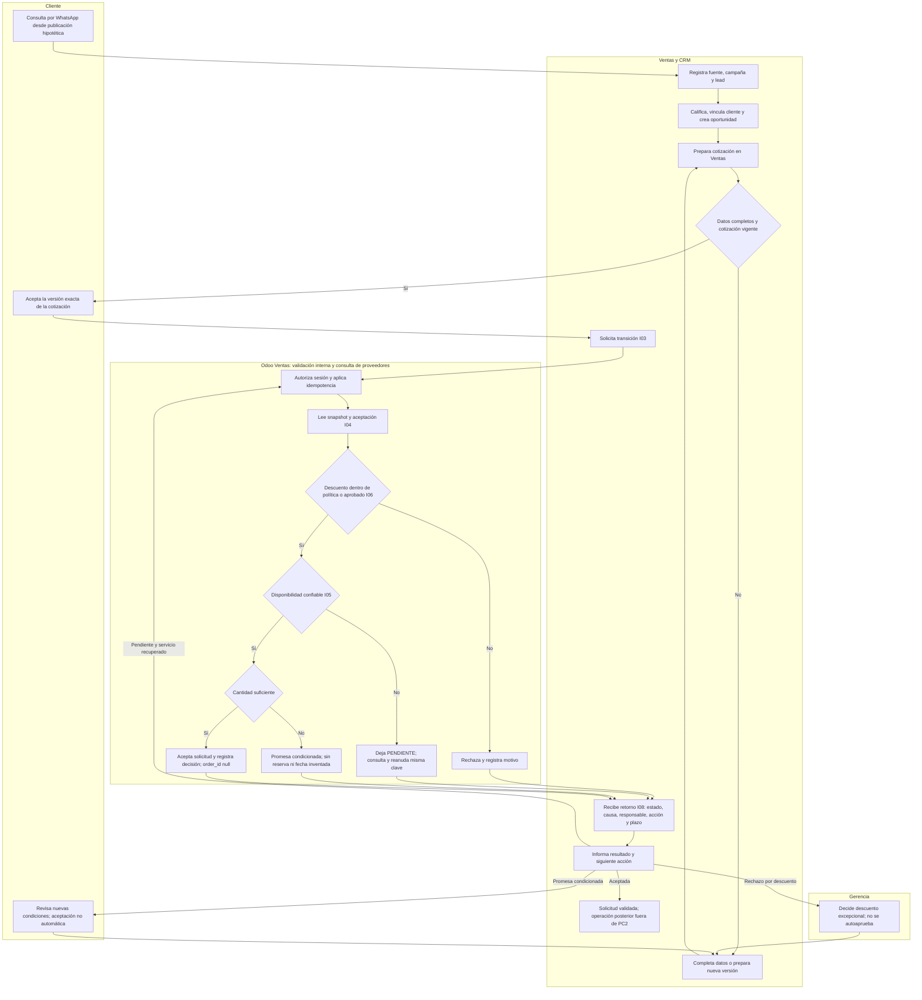
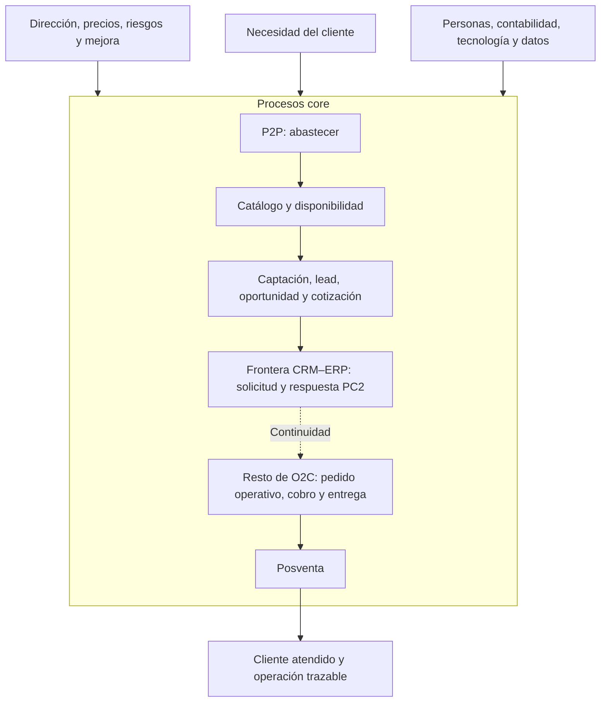

# Escenario comercial y transición CRM–ERP · PC2

**Revisión propuesta:** Shirley (escenario), Adrian (flujo), Benjamin (continuidad). No acredita campaña ni entrevista real. [Supuestos y referencias](../fuentes/pc2.md).

## 1. Caso común

Una publicación promocional hipotética de autoradios invita a consultar por WhatsApp. El cliente de demostración solicita cinco unidades. El vendedor registra manualmente la fuente `PUBLICACION-DEMO`, campaña `CAM-DEMO-AUTORADIOS`, medio WhatsApp y referencia `ATN-DEMO-001` en CRM de Odoo.

El vendedor califica el lead con necesidad concreta, cantidad y posibilidad de atenderlo. Vincula un cliente sin coincidencias ambiguas y convierte el lead en oportunidad. Prepara desde CRM una cotización que conserva Ventas. Registra la aceptación de su versión exacta y solicita evaluar la transición mediante I03. El tramo termina con aceptación, rechazo o promesa; una falla técnica deja la solicitud pendiente.

### Cotización de demostración

| Dato | Normal PC2-N01 | Excepción PC2-E01 |
| --- | --- | --- |
| Producto | AUT-DEMO-001, autoradio genérico | Mismo producto |
| Cantidad | 5 | 5 |
| Precio final didáctico por unidad | S/400.00 | S/400.00 |
| Importe antes del descuento | S/2,000.00 | S/2,000.00 |
| Descuento | 5 % = S/100.00 | 10 % = S/200.00 |
| Total cotizado | **S/1,900.00** | **S/1,800.00** |
| Aprobación requerida | Dentro del umbral propuesto | Gerencia; ausente en la prueba |
| Existencias observadas | 8 unidades | 8 unidades |
| Resultado | Solicitud ACEPTADA | RECHAZADA: descuento sin aprobación |
| Pago / entrega propuestos | Contado; recojo ALM-DEMO, solicitado 16/10 18:00 -05:00 | Mismas condiciones didácticas |
| Seguimiento CRM | SIN_TAREA; pedido NO_CONFIRMADO | PENDIENTE_APROBACION; Gerencia, plazo supuesto 24 h |

Precios finales aproximados, sin desglose ni validación tributaria. Cotizaciones enviadas, aceptadas el 15/10/2026 a las 17:00 y vigentes hasta el 16/10/2026 a las 23:59:59, zona `-05:00`. Son fechas de escenario; el manifiesto de ejecución registra aparte la hora real de las pruebas.

Para la promesa complementaria PC2-P01 hay tres unidades, sin una fecha de reposición acreditada. No se promete una fecha: se devuelve la condición para que cliente y Ventas revisen cantidad/plazo. Su aceptación exige nueva versión y solicitud. No se toma esa respuesta como pedido confirmado.

## 2. Flujo por responsabilidades

Este diagrama es un **flujo de actividades con carriles conceptuales**, no un archivo BPMN 2.0 ejecutable. Las decisiones y participantes corresponden al contrato; para entrega a un motor BPMN faltaría modelar y validar la notación en esa herramienta.

Errores de versión, aceptación, identidad o permiso salen con rechazo y código del [contrato](../arquitectura/contratos/crm-erp-v1.md); no deben atravesar el camino de aceptación. El lazo de Gerencia implica cambiar versión y recoger nueva aceptación antes de una nueva solicitud, no modificar una solicitud rechazada.

I08 conserva oportunidad y cotización, con seguimiento según causa; rechazo de solicitud no significa oportunidad perdida. El plazo didáctico de 24 horas y las condiciones de pago/entrega requieren validación empresarial. Las denegaciones de acceso o formato no crean solicitud ni publican seguimiento comercial.

## 3. Casos de uso

| ID | Actor principal | Capacidad | Precondición / resultado |
| --- | --- | --- | --- |
| UC-PC2-01 | Ventas | Registrar y calificar lead | Fuente/campaña registradas → oportunidad asignada |
| UC-PC2-02 | Ventas | Buscar y vincular cliente | Acceso autorizado → ficha única o coincidencia revisada |
| UC-PC2-03 | Ventas / Cliente | Cotizar y aceptar | Producto y precio oficiales → versión aceptada y vigente |
| UC-PC2-04 | Gerencia | Autorizar descuento excepcional | Solicitud de autorización → decisión de esa versión, sin autoaprobación |
| UC-PC2-05 | Ventas | Solicitar transición | Cotización aceptada → respuesta del contrato y bitácora |
| UC-PC2-06 | Ventas | Consultar/reanudar solicitud | Acceso a la oportunidad → mismo resultado o recuperación de pendiente |

## 4. Macroprocesos de contexto

El mapa y los SIPOC describen el negocio completo como continuidad de Semana 5. PC2 solo desarrolla la frontera comercial resaltada; **no extiende la implementación a P2P ni al resto de O2C**. Los procesos son propuestas por validar, no un organigrama ni una lista de módulos.

| Familia | Macroprocesos | Resultado |
| --- | --- | --- |
| Estratégicos | Dirigir operación; definir portafolio/precios; gestionar riesgos y mejora | Políticas y prioridades aprobadas |
| Core | Abastecer P2P; mantener disponibilidad; captar y convertir oportunidades; atender O2C; posventa | Producto disponible y atención comercial trazable |
| Soporte | Contabilidad, personas, tecnología, datos y mantenimiento | Recursos y controles para operar |

| SIPOC | Proveedores | Entradas | Proceso de 6 pasos | Salidas | Clientes |
| --- | --- | --- | --- | --- | --- |
| **O2C, contexto** | Cliente, Ventas, catálogo, Almacén y medio de pago | Necesidad, identificación mínima, producto/precio, disponibilidad y pago | 1 Captar/calificar; 2 Cotizar/aceptar; **3 Solicitar/evaluar transición PC2**; 4 Confirmar/preparar; 5 Cobrar/documentar; 6 Entregar/cerrar | Decisión comercial; posteriormente venta, pago, documento y entrega vinculados | Cliente, Ventas, Almacén, Finanzas y Gerencia |
| **P2P, contexto propuesto** | Almacén, comprador, proveedor, Gerencia y Finanzas | Necesidad de reposición, catálogo, presupuesto, oferta y condiciones | 1 Detectar necesidad; 2 Aprobar; 3 Ordenar compra; 4 Recibir/verificar; 5 Conciliar factura; 6 Pagar/cerrar | Compra autorizada, recepción, stock y obligación conciliados | Almacén, proveedor, Contabilidad y Gerencia |

La secuencia operacional de cobro/documentación/entrega debe validarse con la empresa fuera de PC2. P2P es contexto didáctico, no evidencia de la forma real de importar/comprar. El [avance anterior](../macroproesos%20ERP/macroprocesos-o2c.md) conserva su alcance histórico de dos canales; el Word de Semana 5 usó alcance físico más acotado. Este incremento adopta explícitamente el escenario WhatsApp autorizado para PC2.
